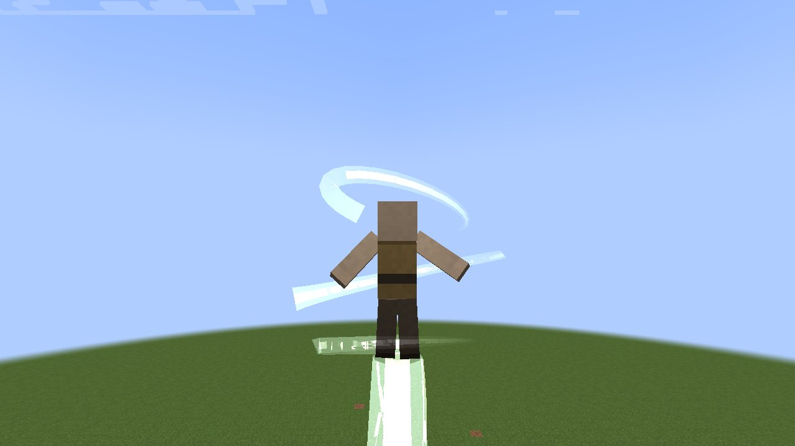
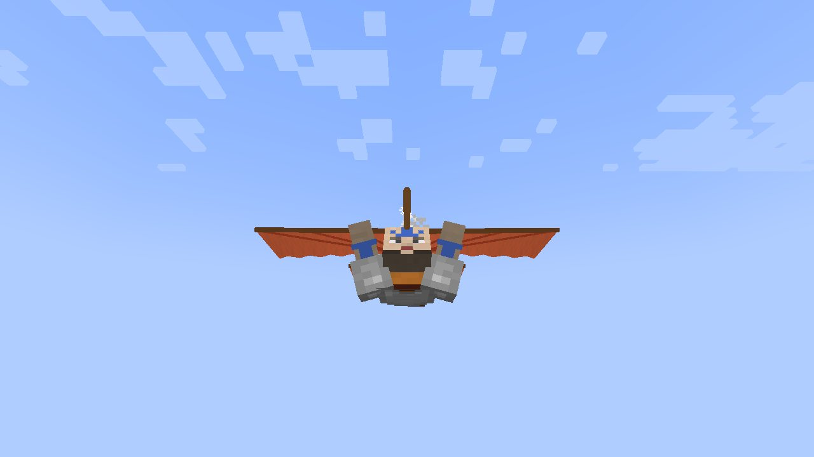
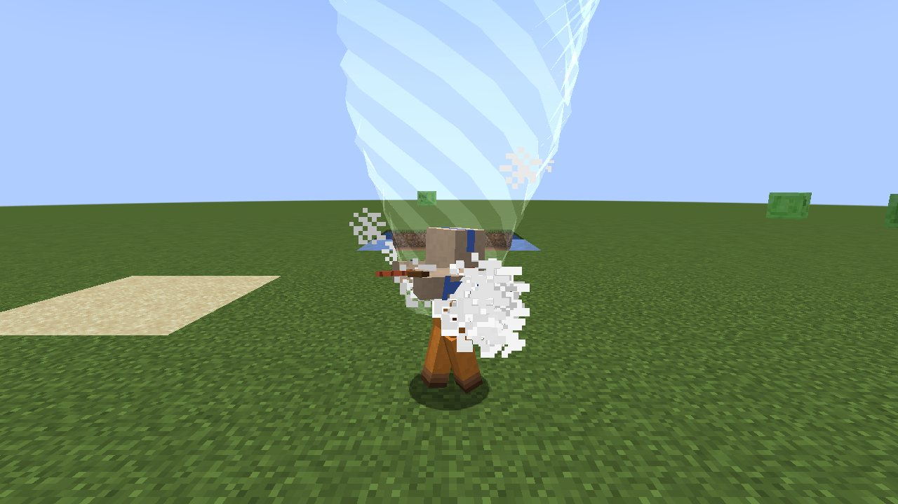

# כשפות אוויר

[English](Airbending)

*עמוד האוויר*

*דאון האוויר, פתוח בגלישה*

*הכשף תלוי מתחת לכנפיים*

*הטורנדו*

כשף האוויר מעיף את כולם אחורה בגל אוויר, מסתתר בכדור של אוויר, קופץ גבוה וגולש על **דאון האוויר** שלו, חותך
בלהבי אוויר, עוזב את גופו במדיטציה, נושם מתחת למים, רוכב על כדור אוויר ושולח טורנדו; ומי שמנתק את כבליו הארציים
עף, ולוקח את הנשימה של האויב. נולדים לזה ([איך הופכים לכשף](Becoming-a-Bender-HE)); מתחילים עם **גל הדף אוויר**.

המספרים הם *מתחיל / מתקדם / מומחה*. שמות ב`קוד` הם [אפשרויות שרת](Server-Configuration-HE).

## אוויר

| יכולת | סוג | מה היא עושה |
|---|---|---|
| **גל הדף אוויר** | לחיצה | גל אוויר מעיף את כל מי שבחרוט לפניכם (**6 / 9 / 12** בלוקים) אחורה: `airBlastPush` (1.6) × **1 / 1.5 / 2.2** של דחיפה ונזק 1; פריטים וחיצים עפים איתו. טעינה `airBlastCooldown` (שנייה). |
| **מגן אוויר** | הפעלה/כיבוי | כדור אוויר של **2.5 / 3 / 3.5** בלוקים סביבכם (רואים אותו ככדור עמום ומסתחרר): יצורים מורחקים וחיצים חוזרים אל מי שירה אותם. הוא סופג את המכות שמיועדות לכם (הכל מלבד נפילות, רעב, טביעה וכדומה): `airShieldStrength` (10) × **1 / 1.5 / 2** נזק, ואז הוא **נשבר ומתפוצץ**: כל מי שבטווח הרדיוס + 2 מועף אחורה וסופג `airShieldBurstDamage` (7, שלושה וחצי לבבות). המגן נח 15 שנ' אחרי שהוא נשבר, ועולה קצת אוכל כל עוד הוא דלוק. |
| **קפיצת אוויר** | לחיצה | ירו אוויר על הרצפה ועופו למעלה: **0.9 / 1.2 / 1.5** של דחיפה (בערך 4, 7 ו-11 בלוקים), עם נפילה איטית ל-**3 / 4 / 5 שנ'**; גם היצורים שלידכם עולים. טעינה 1.5 שנ'. **גלישה:** נפלו עם [דאון האוויר](Items-and-Crafting-HE) באחת הידיים (בלי להתכופף) והאוויר נושא אתכם קדימה ב-**0.55 / 0.65 / 0.75** בלוקים לטיק ולמטה לאט; הסתכלו למטה כדי לצלול. אין נזק נפילה. (`gliderNeeded` כבוי נותן לכל כשף אוויר לגלוש בלעדיו.) |
| **להבי אוויר** | לחיצה | **1 / 2 / 3** להבי אוויר חותכים אל מה שאתם מסתכלים עליו: `airBladeDamage` (5, שניים וחצי לבבות) כל אחד, בלי הדיפה. טעינה שנייה. |
| **הקרנה רוחנית** | לחיצה | שבו בלי לזוז על האדמה ולחצו: הרוח עוזבת את הגוף ואתם **צופים** ל-`projectionSeconds` (20) × **1 / 2 / 3** שניות, חופשיים לעוף דרך קירות ולהסתכל לתוך מערות, עד `projectionRange` (32) × **1 / 2 / 4** בלוקים מהגוף (רחוק יותר, הקשר מושך אתכם חזרה). הגוף נשאר מאחור כדמות במדיטציה בסקין שלכם: **אם משהו פוגע בו, אתם חוזרים מיד והמכה נוחתת עליכם.** לחצו שוב כדי לחזור מוקדם. טעינה 20 שנ'. |
| **בועת אוויר** | פסיבי | מתחת למים, בועת אוויר סביב הראש: למתחיל האוויר לא יורד מתחת לשש בועות, מתקדם נושם חופשי, מומחה שוחה כמו דולפין. |
| **כדור אוויר** | הפעלה/כיבוי | רכבו על כדור אוויר: **60% / 90% / 120%** מהר יותר, עולים על בלוקים, ואף פעם לא נופלים חזק. |
| **טורנדו** | לחיצה | טורנדו קטן הולך לפניכם ל-**5 / 7 / 9 שנ'**, ברוחב **1.5 / 2.5 / 3.5** בלוקים: הוא מרים, מסובב ומעיף כל מה שהוא פוגש (יצורים, פריטים, חיצים) ופוגע **1 / 1.5 / 2** כל חצי שנייה; בקיר הוא פונה. טעינה 12 שנ'. |

## הדאון, כמו כנפי אליטרה

- **כל כשף אוויר** עם [דאון האוויר](Items-and-Crafting-HE) ביד יכול לגלוש, לא צריך קפיצת אוויר. **קליק ימני**
  באוויר פותח אותו מתי שרוצים; הוא גם נפתח לבד כשנופלים, אבל רק אחרי שנפלתם **לפחות 3 בלוקים** (קפיצה או ירידה קצרה
  לא פותחות אותו).
- פתוח, הוא מטה לאורך הגוף עם מוט ישר בגובה הכתפיים, כנפיים כתומות ברוחב של כשלושה בלוקים שנגררות מאחוריו, וזנב בחצי
  הגודל מאחורי הרגליים. סגור, נושאים אותו באלכסון על הגב.
  תלויים מתחתיו, הידיים למעלה על המוט והרגליים נגררות; הכנפיים נפרשות מהמטה כשהוא נפתח ומתקפלות כשהוא נסגר.
- הוא עף כמו **אליטרה**: טסים לאן שמסתכלים. צלילה צוברת מהירות, ועם המהירות **מושכים למעלה ומטפסים**. הטיפוס מוציא את
  המהירות; לאט מדי, שוקעים.
- **קפיצת אוויר על הדאון** מנפנפת בכנפיים: משב שדוחף קדימה לאן שמסתכלים, מהר יותר מהמהירות הרגילה של הגלישה, כדי לטפס
  שוב.
- התכופפות, מים או הקרקע מקפלים אותו.

## כשף האוויר המשוחרר מכבלים

כשף אוויר ש**הורג את חיית המחמד שלו** (זאב, חתול, תוכי או סוס שהוא אילף) מנתק את כבליו הארציים, כמו זאהיר
(`petKillSeversTethers`). מאז:

* אפשר ללמוד **תעופה** ו**חנק** (הן במגילה, אפורות עד אז);
* ההדפים והלהבים שלו עושים `tetherlessDamageBonus` (2) נזק נוסף, ההדף שלו מעיף 30% פחות רחוק והטורנדו שלו נושך חזק
  יותר: כשפות האוויר שלו הופכת מהרחקה להתקפה;
* הפאנל אומר *משוחרר מכבלים*. מפעיל יכול לקבוע או לבטל: `/enlightened tetherless`.

| יכולת | סוג | מה היא עושה |
|---|---|---|
| **תעופה** | הפעלה/כיבוי | תעופה כמו בקריאייטיב: לחצו על המקש כדי להדליק ולהמריא, שוב כדי לנחות (גם לחיצה כפולה על רווח עובדת). מהירות תעופה 0.08. |
| **חנק** | החזקה | החזיקו את המקש על היצור שאתם מסתכלים עליו (עד 8): האוויר עוזב את ריאותיו; כשלא נשאר לו הוא סופג 2 נזק לשנייה, כטביעה, והוא מואט. נגמר אם הוא מתרחק יותר מ-12 בלוקים מכם. טעינה 6 שנ'. |

## מקשי ברירת מחדל

R גל הדף אוויר, ⇧R להבי אוויר, G מגן אוויר, ⇧G חנק, V קפיצת אוויר, ⇧V תעופה, B כדור אוויר, ⇧B הקרנה רוחנית, N טורנדו.

## נראויות

טנזין (ברירת מחדל), זאהיר, ג'ינורה, הנזיר ג'יאטסו, ג'יי וקארתיק משבעת המקלטים, הסקין שלכם. ראו [נראויות](Looks-HE).

## חדש ב-1.2

| יכולת | סוג | מה היא עושה |
|---|---|---|
| **שאיבת אוויר** | לחיצה | משב שמושך אליכם את מה שאתם מסתכלים עליו (עד **10 / 14 / 18**): יצורים, חצים, פריטים. השהיה 3 שניות (1.5 אם לא משך כלום). |
| **פרץ אוויר** | לחיצה | כדור אוויר מתפרץ מכם, **5 / 7 / 9** בלוקים, וזורק אחורה את כל מי שסביבכם. השהיה **10 / 8 / 6 שניות**. |
| **עמוד אוויר** | מתג | עמוד רוח מרים אתכם **6 / 10 / 15** בלוקים מהקרקע ומחזיק אתכם שם; התכופפות כדי לרדת. |
| **זריזות אוויר** | פסיבי | קלים יותר על הרגליים: רצים מהר יותר, ומהרמה השנייה קופצים גבוה יותר. |
| **צעד אוויר** | פסיבי | לחיצה כפולה על כיוון מזניקה אתכם על משב; לחיצה כפולה על קפיצה מקפיצה. השהיה **2 / 1.5 / 1 שניות**. |

**כדור האוויר** הוא עכשיו כדור של אוויר שרוכבים עליו כמו אנג: יושבים על כדור רוח מתגלגל שנושא אתכם מעל
פערים, מצויר כאוויר מסתחרר אמיתי.

## חדש ב-1.3

- **הדאון הוא של הסדרה.** מטה עץ מעל הידיים שממנו נפתחות שתי מניפות של בד כתום על צלעות קורנות, עם סנפיר זנב;
  הכשף תלוי מתחתיו. **קליק ימני** על דאון האוויר פותח את הכנפיים (בנפילה אמיתית הן נפתחות לבד); מכוונים עם
  המבט: **צוללים למהירות, מטפסים כדי להוציא אותה** (למומחה מהירות שיא גבוהה יותר); **מקש קפיצת האוויר מנפנף**
  בכנפיים להרמה; **התכופפות** או הקרקע מקפלים אותן. קפיצת אוויר כבר לא מאיטה את הנפילה: **כשף אוויר לא סופג נזק
  נפילה** בכלל.
- **הכדור** עומד על הקרקע (הרוכב יושב עליו) ו**מחליק על המים**: רוכבים עליו מעל נהרות וימים. זה הכדור הטורקיז של
  הסדרה עטוף ברצועות לבנות מסתובבות, עם שובל אבק.

## חדש ב-1.4

- **עמוד האוויר** נושא אותך **מהר לכל הכיוונים**: קדימה, אחורה ולצדדים עם מקשי התנועה, ונראה כמו בסדרה (עמוד רוח
  מסתחרר שמצטמצם עד הרגליים, מערבולת אבק בבסיסו, רצועות וטבעות אוויר נטויות סביב הרוכב).
- **החנק** נראה כמו של זהיר: בועת אוויר שקופה סביב כל הראש של הקורבן, שוליים בהירים, פסי אוויר שמסתחררים בתוכה, וזרם
  דק של נשימה שנמשך אל היד שלך.
- [מקדש האוויר הדרומי](Southern-Air-Temple-HE) עומד בהרים, עם ביזון האוויר, גורו פאתיק והדאונים.

