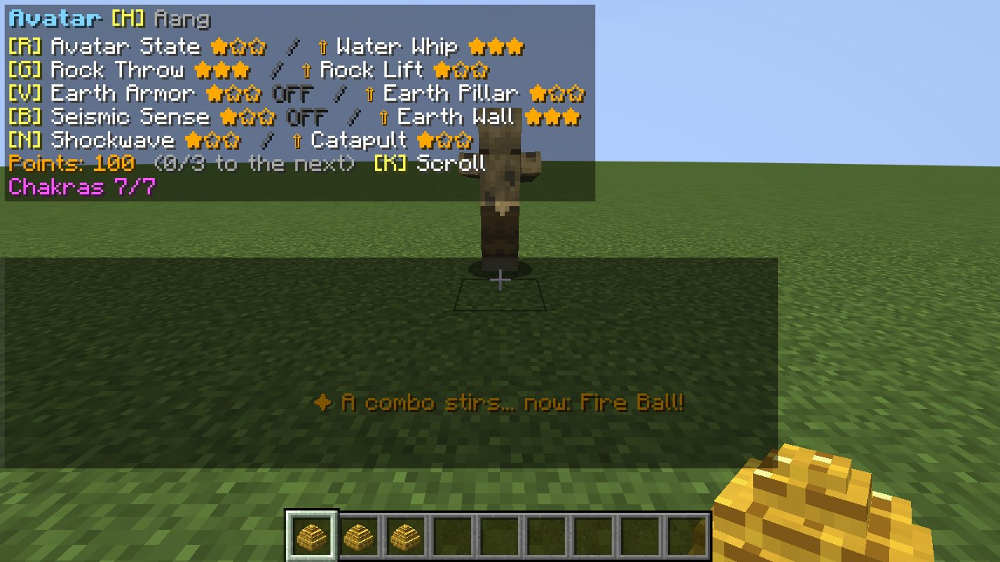
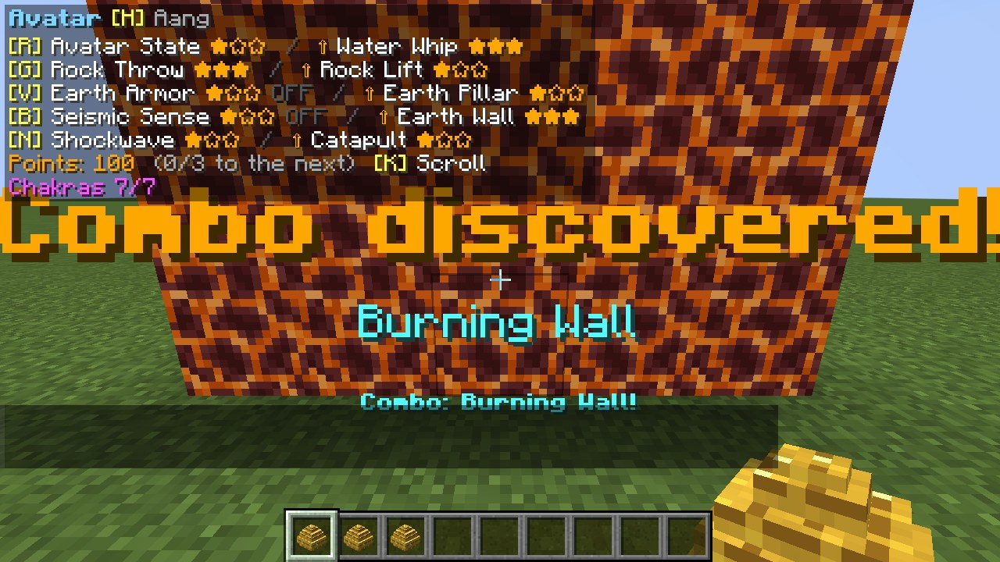
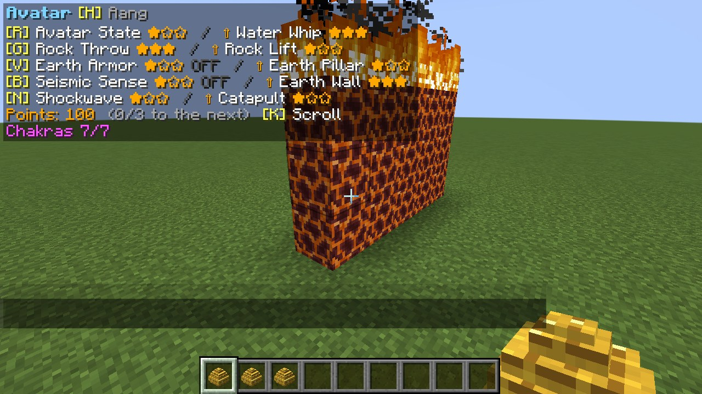
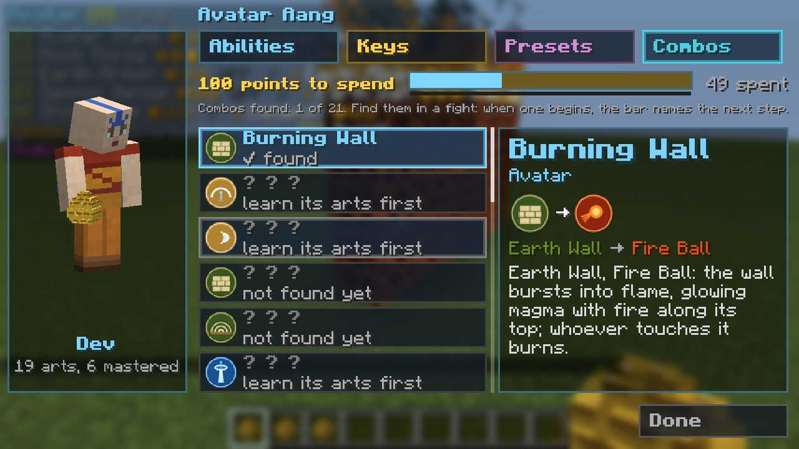

# קומבואים וצעדים

[English](Combos-and-Steps)

בהשראת הקומבואים של ProjectKorra והצורות של *Legend Reforged*: רצף הטלות בטווח `comboWindowTicks` (3 שניות) זו
מזו, שכל אחת מהן יצאה לפועל, מסתיים באומנות גדולה יותר. המסך אומר **קומבו: ...!** כשהיא נוחתת. אפשרות השרת
`combos` מכבה אותם.

| קומבו | יסוד | רצף | מה הוא עושה |
|---|---|---|---|
| **טוויסטר** | אוויר | מגן אוויר, טורנדו, הדף אוויר | ציקלון שרץ על הקרקע קדימה, מרים וזורק את מי שהוא פוגש. |
| **טאטוא אוויר** | אוויר | להבי אוויר, להבי אוויר, פרץ אוויר | מניפת להבים שמטאטאת את השדה. |
| **כיפת אדמה** | אדמה | קיר אדמה, גל הלם | כיפת אדמה נסגרת סביבכם לזמן מה. |
| **עמודי אדמה** | אדמה | גל הלם, עמוד אדמה, עמוד אדמה | עמודים מתחת לכל אויב קרוב מעיפים אותם לאוויר. |
| **גל קרח** | מים | מערבולת מים, הקפאה | גל קרח שוטף קדימה ומקפיא את כל מי שבתוכו. |
| **כדורי קרח** | מים | קיר קרח, סכיני קרח, סכיני קרח | סערה של כדורי קרח. |
| **בעיטת אש** | אש | כדור אש, כדור אש, מעגל אש | קשת אש שנבעטת מהרגליים. |
| **סחרור אש** | אש | מגן אש, מעגל אש | מערבולת להבה שמסתחררת רחוק ורחב. |
| **קיר בוער** | האווטאר | קיר אדמה, כדור אש | הקיר עולה בלהבות: מאגמה זוהרת עם אש לאורך הראש שלו; מי שנוגע בו נשרף. |
| **קיר מאגמה** | אדמה (לבה) | קיר אדמה, שביל לבה | הקיר נמס למאגמה זוהרת עם אש לאורך הראש שלו; מי שנוגע בו נשרף. |
| **סילון רעם** | אש (ברק) | סילון אש, ברק | אתם נורים קדימה על אש, וברקים קופצים מכם לאויבים הקרובים ומשתקים אותם. |
| **נשימת הדרקון** | אש | אגרוף אש, כדור אש | נשיפת להבה ארוכה, כמו של דרקון. |
| **מהלומת אוויר** | אוויר | קפיצת אוויר, פיצוץ אוויר | אתם עפים למעלה ומטיחים את האוויר סביבכם, משטחים ומשתקים את כל הקרובים. |
| **תותח ואקום** | אוויר | שאיבת אוויר, גל הדף אוויר | מה ששאבתם נורה רחוק. |
| **סערת סלעים** | אדמה | זריקת סלע, זריקת סלע, גל הדף | סערת סלעים עפה קדימה. |
| **רעידת אדמה** | אדמה | אחיזת אדמה, גל הדף | האדמה רועדת סביבכם: כל מי שעליה נזרק למעלה, משותק ומואט. |
| **גל צונאמי** | מים | שוט מים, שוט מים, מערבולת מים | גל ענק שוטף את כל מה שלפניכם (ומכבה שריפות). |
| **גאות מרפאה** | מים | ריפוי, בועת מים | מרפאה אתכם, כל שחקן קרוב ואת חיות המחמד שלכם. |
| **ענן קיטור** | האווטאר | שוט מים, כדור אש | ענן קיטור רותח שמעוור את כל מי שלפניכם. |
| **טורנדו אש** | האווטאר | טורנדו, כדור אש | טורנדו של אש. |
| **סופת חול** | האווטאר | גל הדף אוויר, זריקת סלע | סופת חול שמעוורת ומאטה את כל מי שלפניכם. |

כל קומבו דורש שהיכולות ברצף שלו נלמדו; מתג או החזקה נספרים כשהם מתחילים.

## למצוא קומבואים בקרב

*קומבו מתעורר: השורה למטה אומרת מה הצעד הבא*

*גילית קומבו!*

*הקיר הבוער*

*לשונית הקומבואים במגילת הכשפות*

לא צריך את הדף הזה: את הקומבואים מוצאים **בקרב**.

* כשההטלות שלכם **מתחילות קומבו שעוד לא מצאתם** (ואתם יודעים את כל היכולות שלו), נשמע צלצול והשורה למטה אומרת
  **"✦ קומבו מתעורר... עכשיו: <היכולת הבאה>!"**. כל קומבו רומז כך רק מדי פעם (45 שניות), כדי שהקרב לא יהפוך לשיעור.
* בפעם הראשונה שאתם מצליחים קומבו, המסך אומר **גילית קומבו!** עם השם שלו, ומתנגנת תרועה.
* לשונית **קומבואים** במגילה מראה את הקומבואים של היסוד שלכם: אלה שמצאתם עם הצעדים ומה הם עושים, והשאר כ-**? ? ?** עם
  היכולת הראשונה שלהם, כדי שתדעו מאיפה להתחיל ("קודם ללמוד את היכולות שלו" אם עוד אי אפשר). מה שמצאתם נשמר גם אחרי מוות.

## צעדים

מצורת ה-STEP של *Legend Reforged*: כשף שלמד את הצעד של היסוד שלו (**צעד אדמה**, **צעד אוויר**, **צעד מים**,
**צעד אש**: פסיביים, בלי מקש) מזנק ב**לחיצה כפולה על כיוון** (קדימה, אחורה, שמאלה, ימינה) וקופץ ב**לחיצה כפולה
על קפיצה**. הנחיתה רכה. לכל יסוד הצעד נראה אחרת: פרץ אבק, משב, יריעת מים, הבזק אש. השהיה 2 / 1.5 / 1 שניות.
אפשרות השרת `steps` מכבה אותם.

