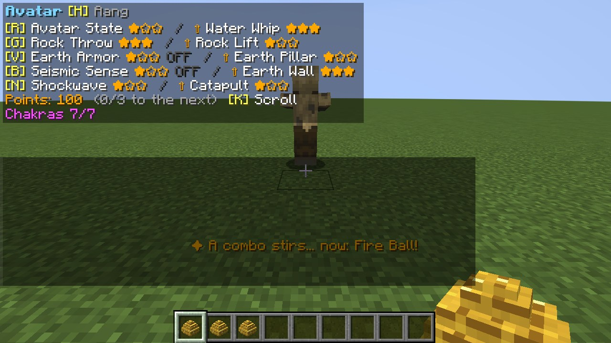
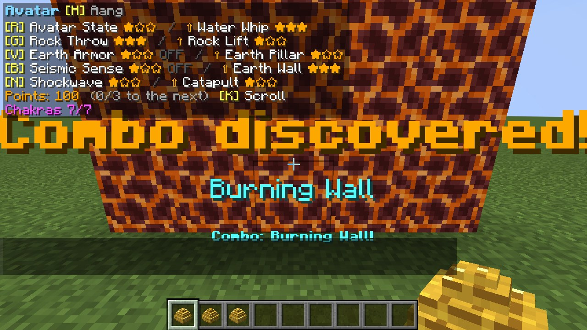
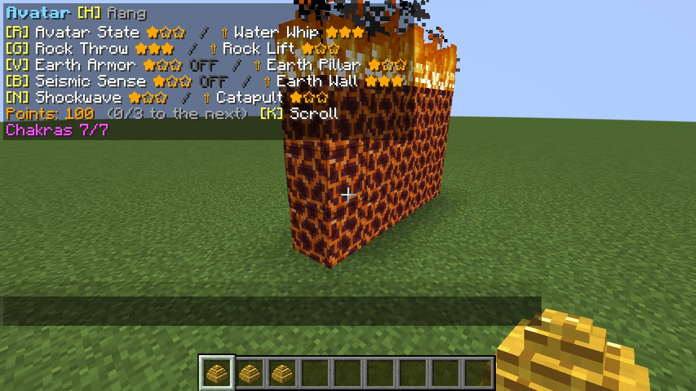
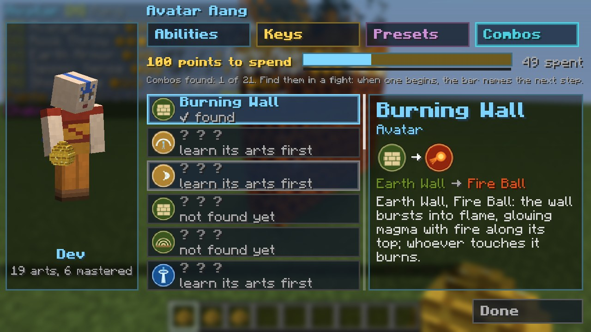

# Combos and Steps

[עברית](Combos-and-Steps-HE)

Inspired by ProjectKorra's combos and *Legend Reforged*'s forms: a sequence of casts within `comboWindowTicks`
(3 s) of each other, each going off, ends in a greater art. The screen says **Combo: ...!** when it lands. The
server option `combos` turns them off.

| Combo | Element | Sequence | What it does |
|---|---|---|---|
| **Twister** | air | Air Shield, Tornado, Air Blast | A cyclone that runs along the ground ahead, lifting and throwing whoever it meets. |
| **Air Sweep** | air | Air Blades, Air Blades, Air Burst | A fan of blades that sweeps the field. |
| **Earth Dome** | earth | Earth Wall, Shockwave | A dome of earth closes round you for a while. |
| **Earth Pillars** | earth | Shockwave, Earth Pillar, Earth Pillar | Pillars under every enemy near fling them into the air. |
| **Ice Wave** | water | Water Spout, Freeze | A wave of ice sweeps ahead and freezes all in it. |
| **Ice Bullets** | water | Ice Wall, Ice Knives, Ice Knives | A storm of ice bullets. |
| **Fire Kick** | fire | Fire Ball, Fire Ball, Fire Ring | An arc of fire kicked from the feet. |
| **Fire Spin** | fire | Fire Shield, Fire Ring | A whirl of flame spinning out far and wide. |
| **Burning Wall** | the Avatar | Earth Wall, Fire Ball | The wall bursts into flame: glowing magma with fire along its top; whoever touches it burns. |
| **Magma Wall** | earth (lava) | Earth Wall, Lava Path | The wall melts to glowing magma with fire along its top; whoever touches it burns. |
| **Thunder Jet** | fire (lightning) | Fire Jet, Lightning | You shoot ahead on fire, and lightning leaps from you to the enemies near, stunning them. |
| **Dragon's Breath** | fire | Fire Fist, Fire Ball | A long breath of flame, like a dragon's. |
| **Air Slam** | air | Air Jump, Air Burst | You fly up and slam the air down round you, flattening and stunning all near. |
| **Vacuum Cannon** | air | Air Suction, Air Blast | What you pulled in is fired far away. |
| **Rock Storm** | earth | Rock Throw, Rock Throw, Shockwave | A storm of rocks flies ahead. |
| **Earthquake** | earth | Earth Grab, Shockwave | The ground shakes round you: everyone on it is thrown up, stunned and slowed. |
| **Tidal Wave** | water | Water Whip, Water Whip, Water Spout | A great wave washes everything ahead away (and puts out fires). |
| **Healing Tide** | water | Water Healing, Water Bubble | Heals you, every player near and your pets. |
| **Steam Cloud** | the Avatar | Water Whip, Fire Ball | A scalding cloud of steam that blinds all ahead. |
| **Fire Tornado** | the Avatar | Tornado, Fire Ball | A tornado of fire. |
| **Sandstorm** | the Avatar | Air Blast, Rock Throw | A sandstorm that blinds and slows all ahead. |

Each combo needs the abilities of its sequence learned; a toggle or a hold counts when it starts.

## Finding combos in a fight

*A combo stirs: the bar names the next step*

*Combo discovered!*

*The Burning Wall*

*The Bending Scroll's Combos tab*

You don't need this page: combos are found **in a fight**.

* When your casts **begin a combo you haven't found yet** (and you know all its arts), a chime rings and the bar
  says **"✦ A combo stirs... now: <the next art>!"**. Each combo hints like this once in a while (45 s), so a fight
  is not a lecture.
* The first time you land a combo, the screen says **Combo discovered!** with its name, and a fanfare plays.
* The scroll's **Combos** tab lists your element's combos: the ones you found with their steps and what they do, the
  others as **? ? ?** with their first art, so you know where to begin ("learn its arts first" if you can't do it yet).
  What you found is kept through deaths.

## Team combos

New in 1.1.0: two benders of **different elements** working one move together. One bender casts an art of the
combo's first side; within **3 s** (`teamComboWindowTicks`) another bender, of another element, casts an art of its
second side **into it**: aimed within **8 blocks** (`teamComboRange`) of where the first one aimed, or, for a
tornado, through the tornado itself. A **fire ball, lava shuriken, rock, sand, ice knife or snowball that flies into
another bender's tornado** joins it too. The combo goes off where the two meet; both benders see **Team combo: ...!**,
both take its cooldown, both find it, and neither is hurt by it. It is as strong as the two of them together. One
bender alone (even the Avatar) never makes a team combo. The server option `teamCombos` turns them off.

| Combo | Elements | First side | Second side (cast into it) | What it does |
|---|---|---|---|---|
| **Firestorm** | air + fire | Tornado, Air Blast | Fire Ball, Fire Fist, Fire Whip, Blaze, Fire Jet | The tornado catches fire: it lives only about a third of what it had left (`fireTornadoLife`) but strikes **three times as hard** (`fireTornadoDamage`), twice as often, and sets everything it spins alight. Into an air blast: a gale of fire rolls on the way the air was going. |
| **Hurricane** | air + water | Tornado | Water Vortex, Water Whip, Water Spout | A great water tornado: half again as big, nearly twice as long-lived, dragging harder; it puts out fires and slows. |
| **Dust Devil** | air + earth | Tornado, Air Blast | Rock Throw, Shockwave, Sand Lift, Earth Spikes | A cyclone of sand and stone that blinds and slows whatever it spins. Into an air blast: a sandstorm. |
| **Blizzard** | air + ice | Tornado, Air Blast | Ice Knives, Freeze, Frost Breath, Snow Throw | A tornado of snow that freezes whatever it spins, striking twice as hard. Into an air blast: a gust of frost. |
| **Scalding Steam** | water + fire | Water Whip, Water Vortex, Water Spout, Water Shield | Fire Ball, Fire Fist, Fire Ring, Blaze, Fire Whip | A cloud of scalding steam hangs there for **6 s** (`steamCloudSeconds`): it burns, blinds and weakens everyone in it. |
| **Magma Eruption** | earth + fire | Earth Pillar, Earth Wall, Rock Throw, Shockwave, Earth Spikes | Fire Ball, Fire Fist, Blaze, Fire Ring | The ground erupts: it melts to magma for **6 s** (`magmaSeconds`), throws everyone near up in flames, and rains molten rock. |
| **Mud Flood** | water + earth | Water Whip, Water Vortex, Water Spout | Shockwave, Earth Grab, Rock Throw, Mud Wave, Hidden Pit | A flood of mud rolls out, turning the soil to mud for a while, knocking everyone back and bogging them down for 7 s. |
| **Storm Surge** | water + lightning | Water Whip, Water Vortex, Water Spout | Lightning | The lightning runs through the water to everyone near it, and to everyone wet (in water or rain) farther off, stunning them. |
| **Lightning Rod** | metal + lightning | Metal Wall, Metal Blades, Metal Pull | Lightning | The bolt leaps from the metal to the nearest enemy, and on from him to the next (four to six of them). |

**Finding them.** When a bender near you casts an art that begins a team combo you haven't found (and you know an
art of its other side), a chime rings and your bar says **"✦ Team combo! Cast <your art> into <his> <art>!"**. The
first time, the screen says **Team combo discovered!**. The scroll's Combos tab lists the team combos either of your
element's sides can take, marked **team combo**, their two steps joined by **+**.

## Steps

From *Legend Reforged*'s STEP form: a bender who learned his element's step (**Earth Step**, **Air Step**,
**Water Step**, **Fire Step**: passives, no key) dashes with a **double tap of a direction** (forward, back, left,
right) and hops with a **double tap of Jump**. The landing is soft. Each element's step looks its own way: a burst
of dust, a gust, a sheet of water, a flare of fire. Cooldown 2 / 1.5 / 1 s. The server option `steps` turns them
off.
