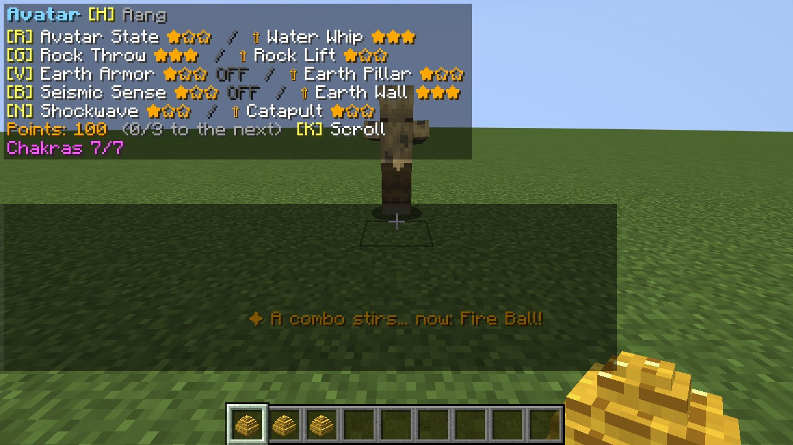
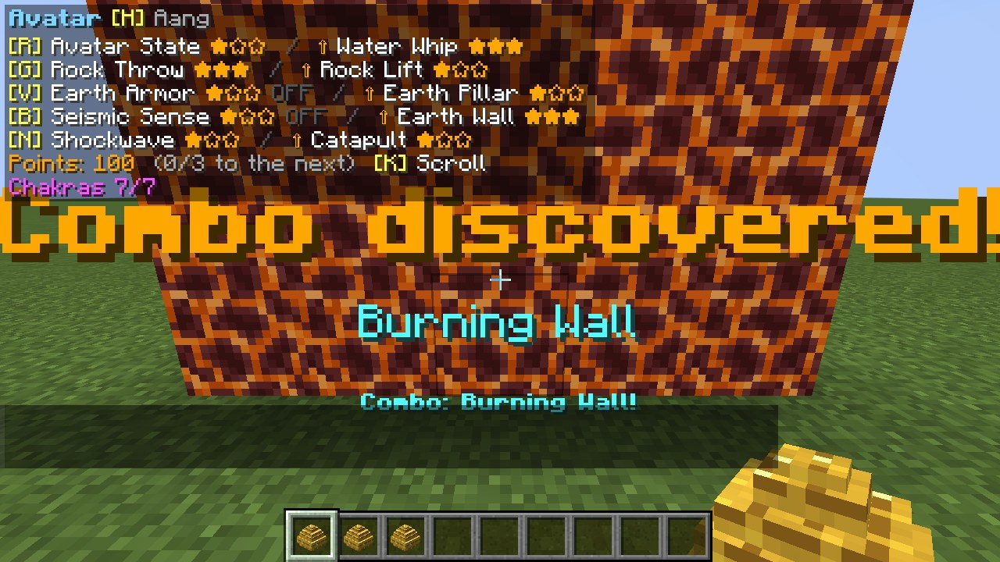
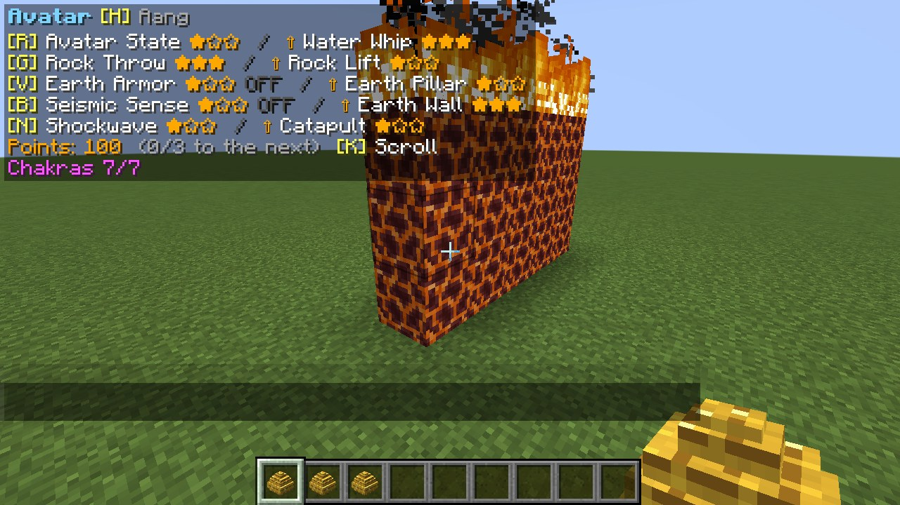
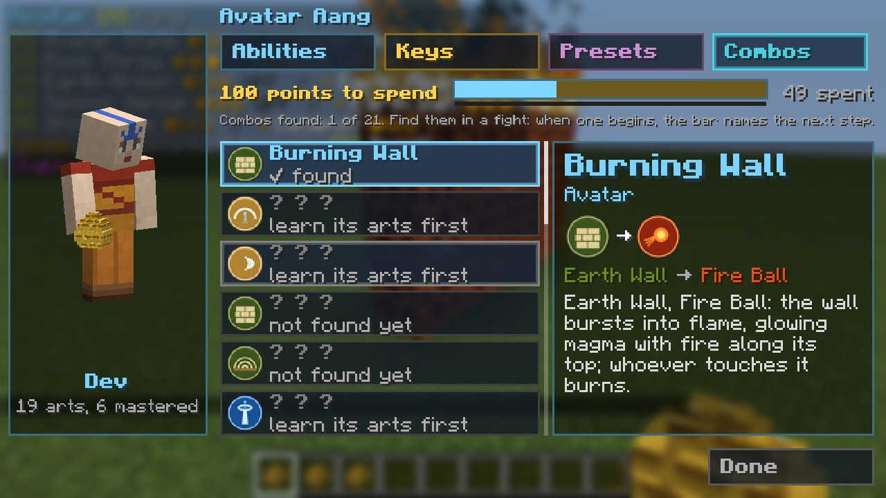

# Combos and Steps

[עברית](Combos-and-Steps-HE)

Inspired by ProjectKorra's combos and *Legend Reforged*'s forms: a sequence of casts within `comboWindowTicks`
(3 s) of each other, each going off, ends in a greater art. The screen says **Combo: ...!** when it lands. The
server option `combos` turns them off.

| Combo | Element | Sequence | What it does |
|---|---|---|---|
| **Twister** | air | Air Shield, Tornado, Air Blast | A cyclone that runs along the ground ahead, lifting and throwing whoever it meets. |
| **Air Sweep** | air | Air Blades, Air Blades, Air Burst | A fan of blades that sweeps the field. |
| **Earth Dome** | earth | Earth Wall, Shockwave | A dome of earth closes round you for a while. |
| **Earth Pillars** | earth | Shockwave, Earth Pillar, Earth Pillar | Pillars under every enemy near fling them into the air. |
| **Ice Wave** | water | Water Spout, Freeze | A wave of ice sweeps ahead and freezes all in it. |
| **Ice Bullets** | water | Ice Wall, Ice Knives, Ice Knives | A storm of ice bullets. |
| **Fire Kick** | fire | Fire Ball, Fire Ball, Fire Ring | An arc of fire kicked from the feet. |
| **Fire Spin** | fire | Fire Shield, Fire Ring | A whirl of flame spinning out far and wide. |
| **Burning Wall** | the Avatar | Earth Wall, Fire Ball | The wall bursts into flame: glowing magma with fire along its top; whoever touches it burns. |
| **Magma Wall** | earth (lava) | Earth Wall, Lava Path | The wall melts to glowing magma with fire along its top; whoever touches it burns. |
| **Thunder Jet** | fire (lightning) | Fire Jet, Lightning | You shoot ahead on fire, and lightning leaps from you to the enemies near, stunning them. |
| **Dragon's Breath** | fire | Fire Fist, Fire Ball | A long breath of flame, like a dragon's. |
| **Air Slam** | air | Air Jump, Air Burst | You fly up and slam the air down round you, flattening and stunning all near. |
| **Vacuum Cannon** | air | Air Suction, Air Blast | What you pulled in is fired far away. |
| **Rock Storm** | earth | Rock Throw, Rock Throw, Shockwave | A storm of rocks flies ahead. |
| **Earthquake** | earth | Earth Grab, Shockwave | The ground shakes round you: everyone on it is thrown up, stunned and slowed. |
| **Tidal Wave** | water | Water Whip, Water Whip, Water Spout | A great wave washes everything ahead away (and puts out fires). |
| **Healing Tide** | water | Water Healing, Water Bubble | Heals you, every player near and your pets. |
| **Steam Cloud** | the Avatar | Water Whip, Fire Ball | A scalding cloud of steam that blinds all ahead. |
| **Fire Tornado** | the Avatar | Tornado, Fire Ball | A tornado of fire. |
| **Sandstorm** | the Avatar | Air Blast, Rock Throw | A sandstorm that blinds and slows all ahead. |

Each combo needs the abilities of its sequence learned; a toggle or a hold counts when it starts.

## Finding combos in a fight

*A combo stirs: the bar names the next step*

*Combo discovered!*

*The Burning Wall*

*The Bending Scroll's Combos tab*

You don't need this page: combos are found **in a fight**.

* When your casts **begin a combo you haven't found yet** (and you know all its arts), a chime rings and the bar
  says **"✦ A combo stirs... now: <the next art>!"**. Each combo hints like this once in a while (45 s), so a fight
  is not a lecture.
* The first time you land a combo, the screen says **Combo discovered!** with its name, and a fanfare plays.
* The scroll's **Combos** tab lists your element's combos: the ones you found with their steps and what they do, the
  others as **? ? ?** with their first art, so you know where to begin ("learn its arts first" if you can't do it yet).
  What you found is kept through deaths.

## Steps

From *Legend Reforged*'s STEP form: a bender who learned his element's step (**Earth Step**, **Air Step**,
**Water Step**, **Fire Step**: passives, no key) dashes with a **double tap of a direction** (forward, back, left,
right) and hops with a **double tap of Jump**. The landing is soft. Each element's step looks its own way: a burst
of dust, a gust, a sheet of water, a flare of fire. Cooldown 2 / 1.5 / 1 s. The server option `steps` turns them
off.
