

# בה סינג סה ואומאשו

[English](Earth-Kingdom-Cities)

## בה סינג סה

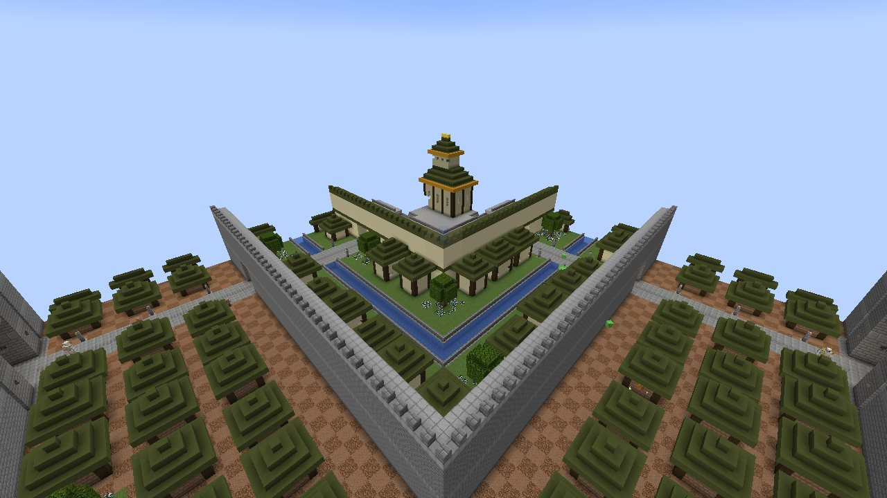
*בה סינג סה: שלוש טבעות סביב הארמון*

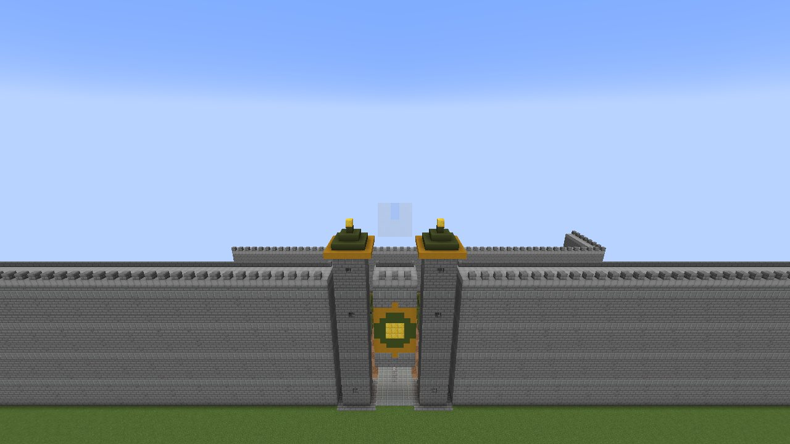
*החומה החיצונית*

העיר הגדולה של ממלכת האדמה, במישורים, באחו ובסוואנה: כ-200 בלוקים רוחב. שלוש חומות טבעת אחת בתוך השנייה, לכל אחת
שערים בארבעה רחובות:

* **החומה החיצונית**, בגובה 26 בלוקים עם שביל מאחורי המשוננים, מגדלי שער עם גגות ירוקים וסמל ממלכת האדמה מעל כל
  שער;
* בתוכה **הטבעת התחתונה**, בתים צפופים מלבני בוץ עם גגות ירוקים על אדמה מאובקת;
* **החומה האמצעית**, ובתי אבן החול של **הטבעת האמצעית** סביב תעלה שהרחובות חוצים בגשרים;
* **החומה הפנימית**, עם כיסוי ירוק, ו**הטבעת העליונה** של בתים מפוארים עם רכסים זהובים וגינות;
* בלב העיר, על במה מוגבהת עם מדרגות מארבעת הרחובות, **ארמון מלך האדמה**: שני אולמות תחת גגות ירוקים מדורגים עם
  עיטור זהב, והכס בפנים.

כפריים גרים ברחובות, **שומרי העיר** בירוק הכהה ובזהב של צבא המלך שומרים על השערים ועל מדרגות הארמון, ובחלק
מהבתים יש תיבה.
**אין מלחמה בבה סינג סה**: שום מפלצת לא נכנסת לחומות (לא מהחושך, לא ממזמן, לא מביצה ולא מפשיטה), ואי אפשר לזמן
בה וויתר או בוס אחר.

## הדרקון של היסמין: בית התה של אירו

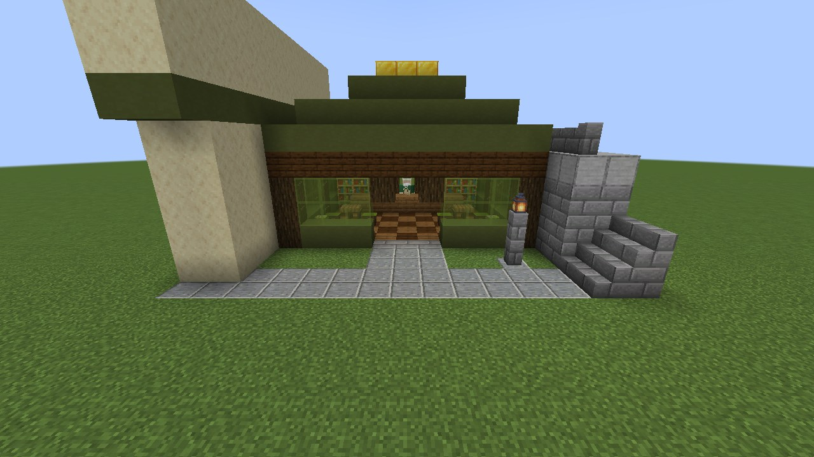
*הדרקון של היסמין, בטבעת העליונה*

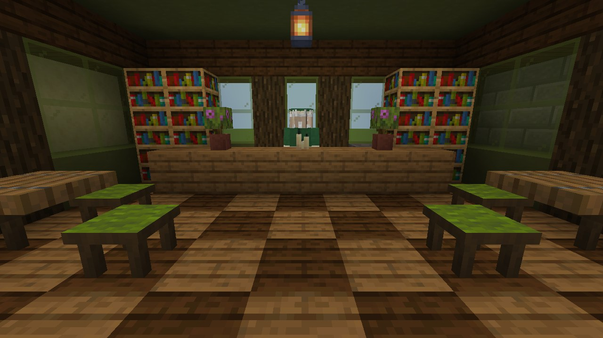
*בפנים: אירו מאחורי הדלפק*

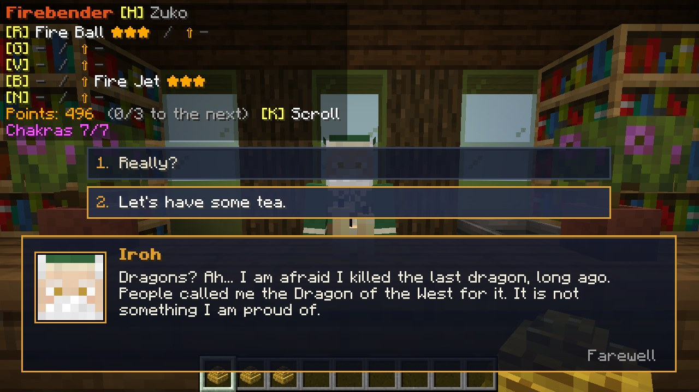
*שאלו אותו על הדרקונים*

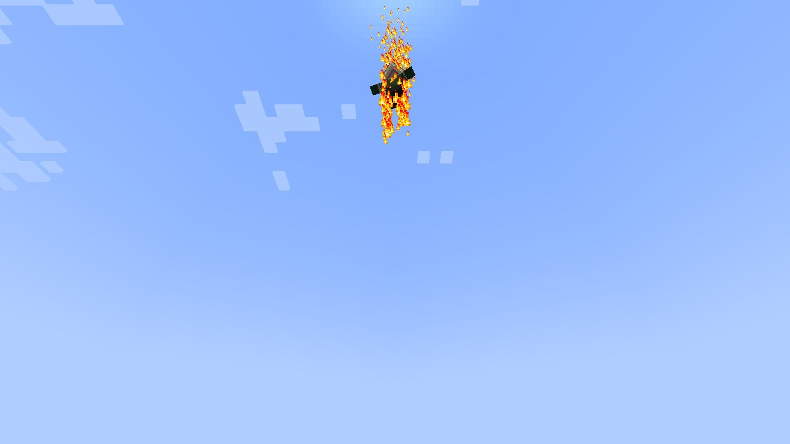
*תקעו בקרן הטסונגי, ואירו מגיע על סילוני אש*

ב**טבעת העליונה** של בה סינג סה, ליד הרחוב הדרומי סמוך לארמון, עומד **הדרקון של היסמין**: ירוק וזהב, עמודי עץ כהה,
זכוכית ירוקה, גג ירוק מדורג עם רכס זהב. בפנים עומד **אירו** בבגדי מגיש התה שלו (גלימה ירוקה וסינר עם פרח היסמין) מאחורי הדלפק, בין מדפי תה, קומקום ואזליאות; שני שולחנות עם **שרפרפים** ממלאים את החדר, ופנסים תלויים מעל.

* **דברו עם אירו** (קליק ימני): הוא מברך אתכם, ואתם בוחרים מה לענות.
  * **"אשמח לתה."**: התה שלו, תמורת גושי זהב קטנים: **תה יסמין** (3: התחדשות), **תה ג'ינסנג** (4: כוח ומהירות חפירה ל-45
    שניות), **תה הדרקון** (6: עמידות לאש וספיגה לשתי דקות), עוגיות, פאי דלעת, עוגה (מטיל זהב) ושרפרפי תה (שני מטילים).
    את התה שותים, ואפשר לשתות גם כשאתם שבעים.
  * **"אתה יודע איפה הדרקונים?"**: הוא חושש שהוא **הרג את הדרקון האחרון**, לפני הרבה זמן...
  * **"תוכל להגיש תה בבית שלי?"**: תמורת **50 זהב** (מטילים; גוש זהב שווה תשעה, עם עודף) הוא נותן לכם את **קרן
    הטסונגי** שלו.
  * **"יש לך עצה, דוד?"**: פיסת חוכמה שלו.
* גם **זוקו** מגיש שם תה: שאלו אותו איפה אבא שלו, והוא יסמן את [יער וולונג](Wulong-Forest-HE) על מפה.
* **לשבת ולאכול**: קליק ימני על **שרפרף תה** כדי לשבת עליו (התכופפות או קפיצה כדי לקום); אוכלים ושותים בישיבה. אפשר גם
  לייצר שרפרפים (צמר ירוק מעל שני מקלות נותן שניים).
* **קרן הטסונגי**: תקעו בה (קליק ימני) איפה שאתם גרים, ו**אירו מגיע בטיסה על סילוני אש** מהאגרופים ומהרגליים, נוחת
  לידכם, ומוכר את התה שלו **בבית שלכם** מעכשיו, ונשאר ליד המקום. תקעו שוב במקום אחר והוא עובר לשם (יש לכם אירו אחד
  משלכם; פעם בדקה). בבית הוא מברך אתכם כחבר.

## אומאשו

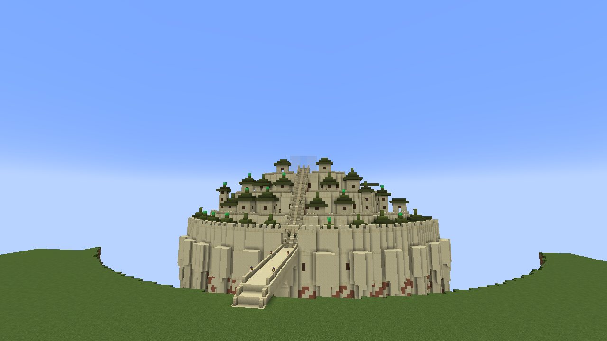
*אומאשו מעל התהום, הגשר על קשתות גבוהות*

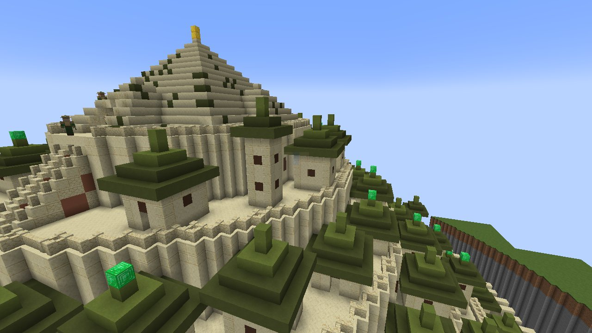
*הטרסות והפירמידה בפסגה*

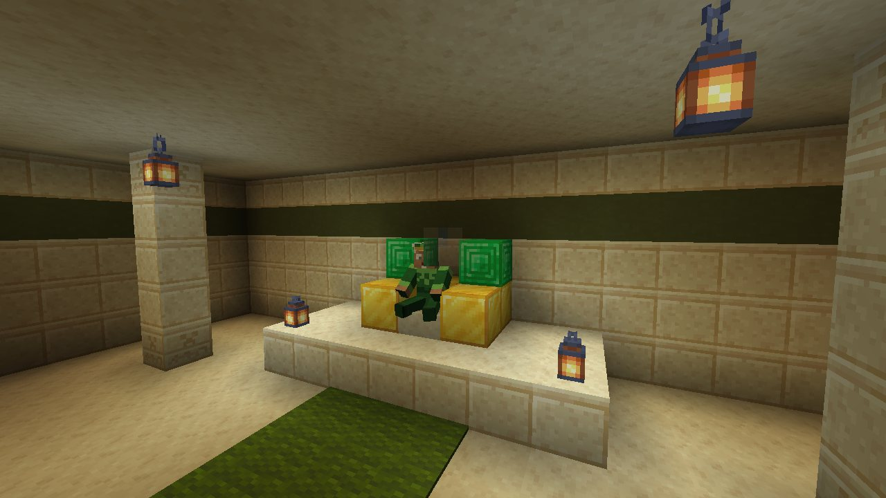
*המלך בומי על כסאו*

העיר של המלך בומי, במישורים, באחו ובסוואנה, בנויה כמו בסדרה: הר של **אבן חול** שעולה מתוך תהום עמוקה עם נהר
בתחתיתה, הצוק שלו מצולע בתמוכות מחודדות, ומגיעים אליו רק ב**גשר ארוך אחד על קשתות גבוהות**. חומה משוננת מקיפה את
העיר בשפת הצוק, עם שער במקום שבו הגשר נכנס. מעליה הטרסות מטפסות, כל אחת רחוב טבעת מאחורי מעקה, צפופה בבתי אבן חול
ובמגדלים גבוהים תחת **גגות פגודה ירוקים**; **גרם מדרגות גדול** חצוב במעלה ההר מהשער עד הפסגה, שם עומדת **פירמידה
מדורגת** גדולה, עם גמלונים בארבעת צדדיה וקצה זהוב.

בתוך הפירמידה נמצא **אולם הכס**: עמודים, פנסים תלויים, שביל ירוק אל במה, ועל כס הזהב שלו **המלך בומי** בעצמו. לחיצה
ימנית עליו והוא מדבר: חסה, חידות, פלופסי, סוכריות סלע, עצות של גאון מטורף (קצת יותר בכל פעם; הוא מזהה את האווטאר
כשהוא רואה אותו). שום דבר לא יכול לפגוע בו.

כפריים גרים על הטרסות; שומרים שומרים על השער, על המדרגות ועל האולם; מפלצות לא נכנסות לעיר.

## לדבר עם אנשים

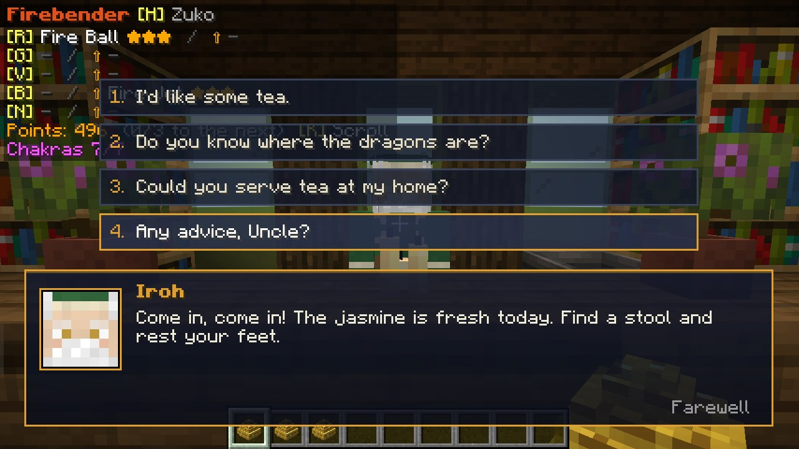
*מסך השיחה*

כל מי שאפשר לדבר איתו (אירו, גורו פאתיק, המלך בומי, שומרי הערים, לוחמי השמש, צב האריה, ראווה) עונה ב**מסך השיחה**:
פאנל בתחתית המסך עם הפנים שלו, השם שלו, והמילים שלו מוקלדות (קליק, רווח או אנטר מראים אותן מיד), ומעליו **תשובות
לבחירה** (או המקשים 1-4). "להתראות" או Esc מסיימים את השיחה; גם התרחקות. מה שפעם דרש קליק ימני שני הוא עכשיו תשובה:
לקבל את המבחן של לוחמי השמש, להכניס את ראווה, לקבל את המתנה של צב האריה. שאלו את שומרי בה סינג סה איפה יש תה טוב.

## שומרי העיר

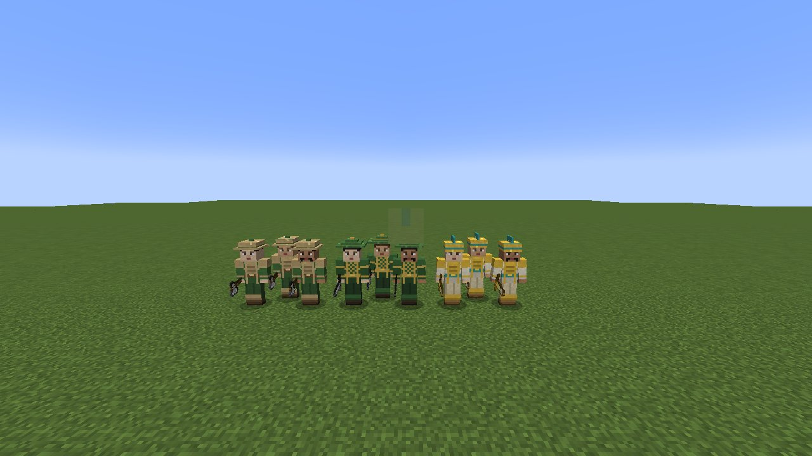
*השומרים של אומאשו, בה סינג סה ואלורה*

לאומאשו, לבה סינג סה ולאלורה יש **שומרים** משלהן. שומר נשאר ליד העמדה שלו (כ-20 בלוקים סביבה), **נלחם בכל מפלצת
שמתקרבת** (לא בקריפרים), ומחזיר מלחמה, יחד עם שאר השומרים, נגד מי שמכה אחד מהם. הוא אף פעם לא תוקף שומר אחר או את
תושבי העיר.

כל עיר מלבישה את השומרים שלה בצבעים שלה, ולכל אחת שלושה פרצופים:

| עיר | מדים | קסדה | נשק |
|---|---|---|---|
| אומאשו | טוניקה ירוקה מתחת ללוחות עור חומים-בהירים | כובע עגול עם שוליים | גרזן ברזל |
| בה סינג סה | הירוק הכהה של צבא המלך, שריון קשקשים עם עיטור זהב | חרוט ירוק מדורג | חרב ברזל |
| אלורה | גלימות מדבר לבנות, שריון חזה מזהב, אבנט טורקיז | קסדת זהב עם ציצת טורקיז | חרב זהב |

**דברו עם שומר** (לחיצה ימנית): הוא מברך אתכם במילים שלו, ואז מספר על העיר שלו, קצת יותר בכל פעם: מגלשות הדואר
וסוחר הכרובים של אומאשו, הדאי לי ודרקון היסמין של בה סינג סה, הבריגדות וגבישי הזהב של אלורה. לאווטאר יש מילה משלו;
לשומר באמצע קרב אין זמן לדבר.

**ביצת זימון של שומר העיר** (קריאייטיב) יוצרת שומר של עיר אקראית, שהעמדה שלו היא המקום שבו הוא עומד.

