# Ba Sing Se and Omashu

[עברית](Earth-Kingdom-Cities-HE)

## Ba Sing Se

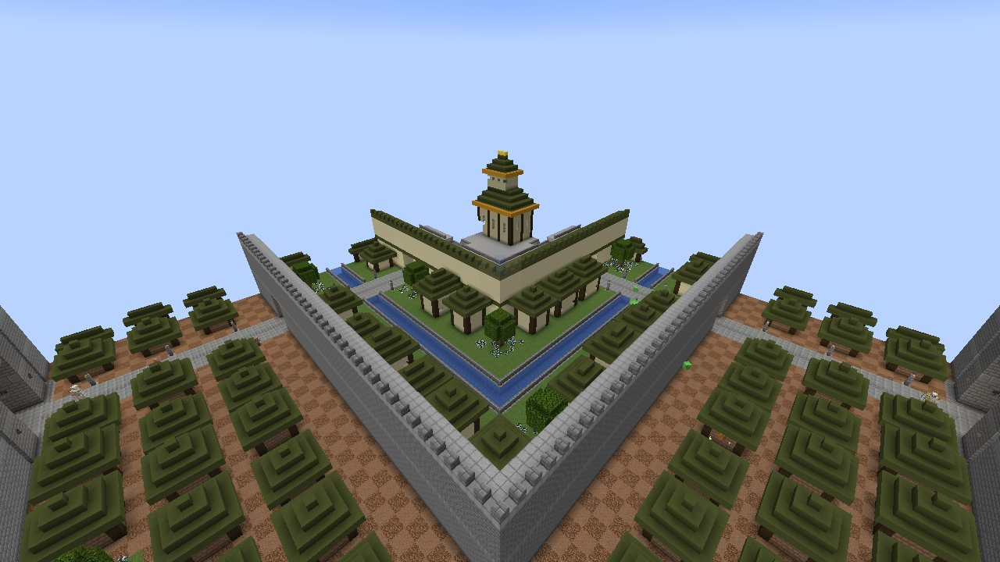
*Ba Sing Se: three rings round the palace*

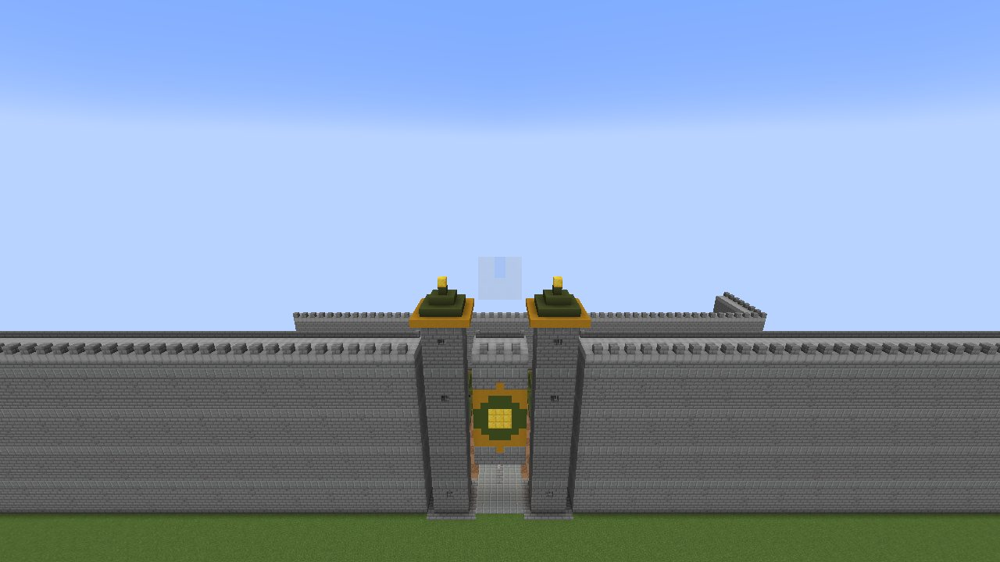
*The Outer Wall*

The great city of the Earth Kingdom, in plains, meadows and savannas: about 200 blocks across. Three ring walls one
inside the other, each with gates on four streets:

* the **Outer Wall**, 26 blocks high with a walk behind its crenels, gate towers under green roofs and the Earth
  Kingdom's emblem over each gate;
* inside it the **Lower Ring**, close mud-brick houses under green roofs on dusty ground;
* the **Middle Wall**, and the **Middle Ring**'s sandstone houses round a canal the streets cross by bridges;
* the **Inner Wall**, capped in green, and the **Upper Ring** of fine houses with golden ridges and gardens;
* at the heart, on a raised platform with stairs from the four streets, the **Earth King's palace**: two halls under
  stepped green roofs trimmed in gold, the throne within.

Villagers live in its streets, **city guards** in the dark green and gold of the royal army keep its gates and the
palace stairs, and some houses keep a chest.
**There is no war in Ba Sing Se**: no monster comes inside its walls (not from the dark, a spawner, an egg or a raid),
and no wither or other boss can be raised there.

## The Jasmine Dragon: Iroh's tea house

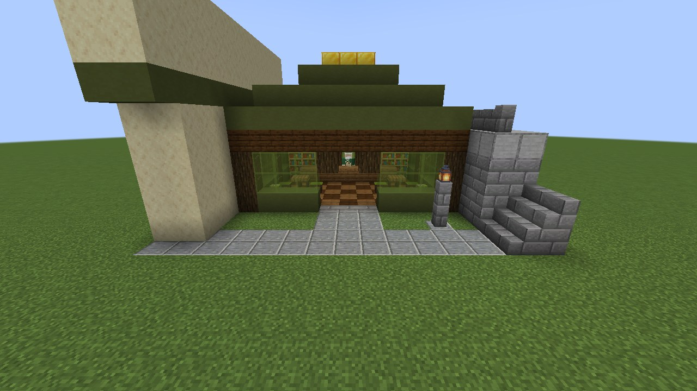
*The Jasmine Dragon, in the Upper Ring*

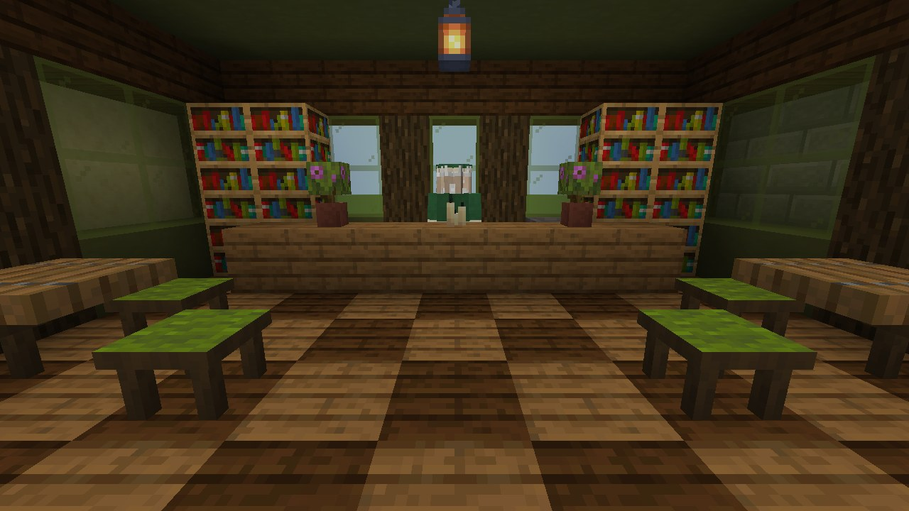
*Inside: Iroh behind his counter*

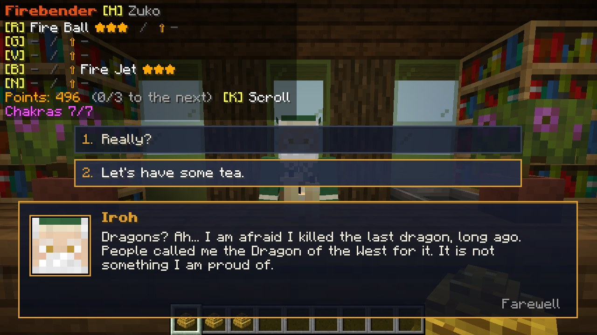
*Ask him about the dragons*

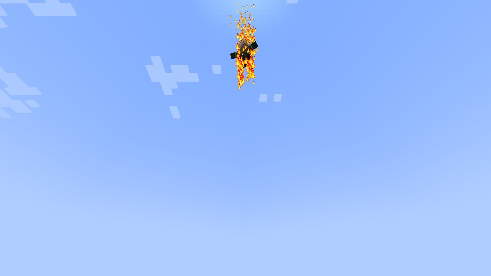
*Blow the tsungi horn, and Iroh comes on jets of fire*

In Ba Sing Se's **Upper Ring**, by the south street near the palace, stands the **Jasmine Dragon**: green and gold,
dark wood pillars, green glass, a tiered green roof with a golden ridge. Inside, **Iroh** in his tea server's
clothes (a green robe, a cream apron, a little green cap) stands behind his counter, between shelves of tea, a kettle
and azaleas; two tables with **stools** fill the room, lanterns hang overhead.

* **Talk to Iroh** (right-click): he greets you, and you choose what to say.
  * **"I'd like some tea."**: his tea, for gold nuggets: **Jasmine Tea** (3: regeneration), **Ginseng Tea** (4:
    strength and haste for 45 seconds), **Dragon Tea** (6: fire resistance and absorption for two minutes), cookies,
    pumpkin pie, a cake (a gold ingot) and tea stools (two ingots). Teas are drunk, and may be drunk when you are full.
  * **"Do you know where the dragons are?"**: he is afraid he **killed the last dragon**, long ago...
  * **"Could you serve tea at my home?"**: for **50 gold** (ingots; a gold block counts nine, with change) he gives you
    his **tsungi horn**.
  * **"Any advice, Uncle?"**: a piece of his wisdom.
* **Sit and eat**: right-click a **tea stool** to sit on it (sneak or jump to stand up); eat and drink sitting there.
  Stools can be crafted too (green wool over two sticks makes two).
* **The tsungi horn**: blow it (right-click) where you live, and **Iroh comes flying down on jets of fire** from his
  fists and feet, lands beside you, and sells his tea **at your home** from then on, keeping near the spot. Blow it
  again elsewhere and he moves there (you have one Iroh of your own; once a minute). At home he greets you as a friend.

## Omashu

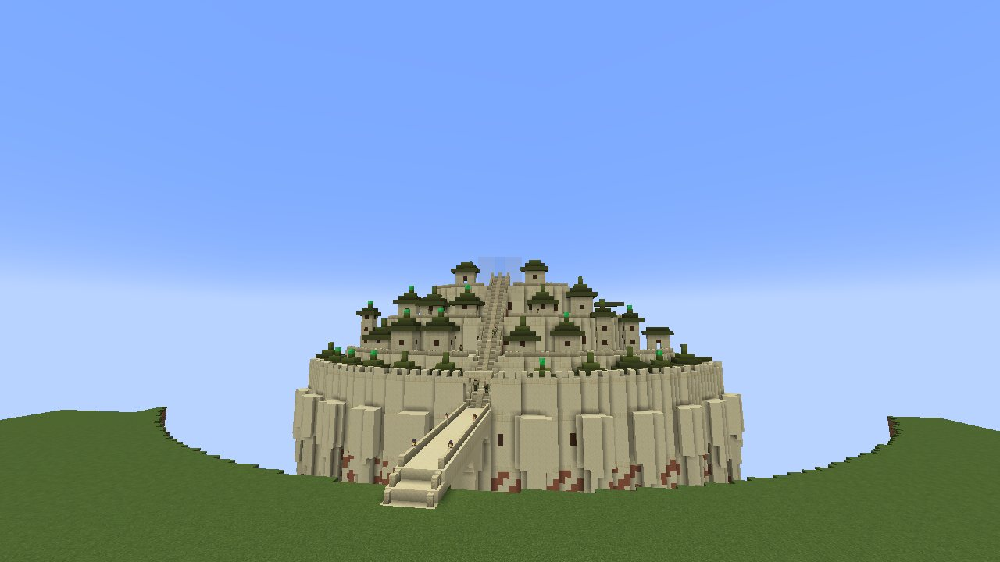
*Omashu over its chasm, the bridge on tall arches*

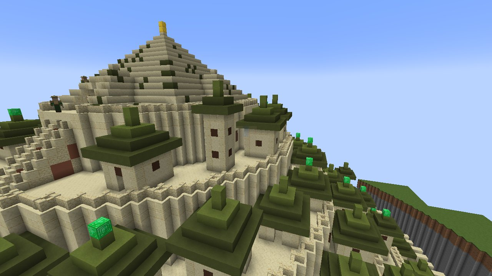
*The terraces and the pyramid on the summit*

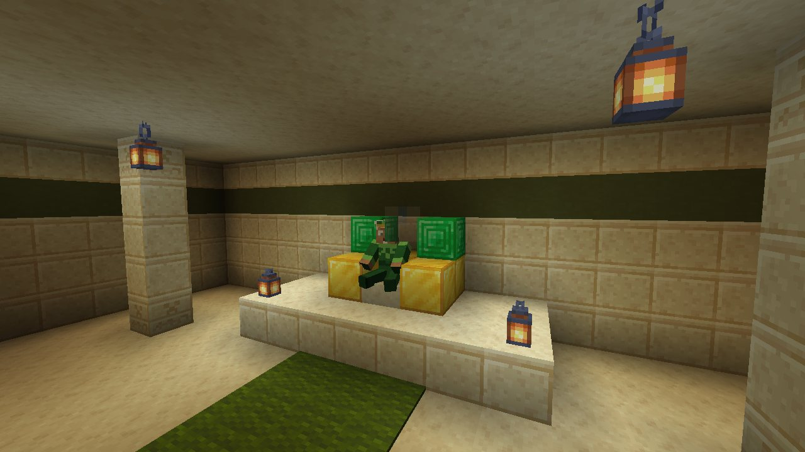
*King Bumi on his throne*

King Bumi's city, in plains, meadows and savannas, built as the show draws it: a mountain of **sandstone** rising out
of a deep chasm with a river at its bottom, its cliff ribbed with pointed buttresses, reached only by **one long bridge
on tall arches**. A battlemented wall rings the city at the cliff's edge, with a gate where the bridge comes in. Above
it the terraces climb, each a ring street behind a parapet, crowded with sandstone houses and tall towers under **green
pagoda roofs**; a **grand stairway** is cut up the mountain's face from the gate to the summit, where a great **stepped
pyramid** stands, gabled on its four sides, with a golden tip.

Inside the pyramid is the **throne hall**: pillars, hanging lanterns, a green aisle to a dais, and on his golden throne
**King Bumi** himself. Right-click him and he talks: lettuce, riddles, Flopsie, rock candy, the advice of a mad genius
(a little more each time; he knows the Avatar when he sees one). Nothing can harm him.

Villagers live on its terraces; guards keep the gate, the stairway and the hall; no monster comes into the city.

## Talking to people

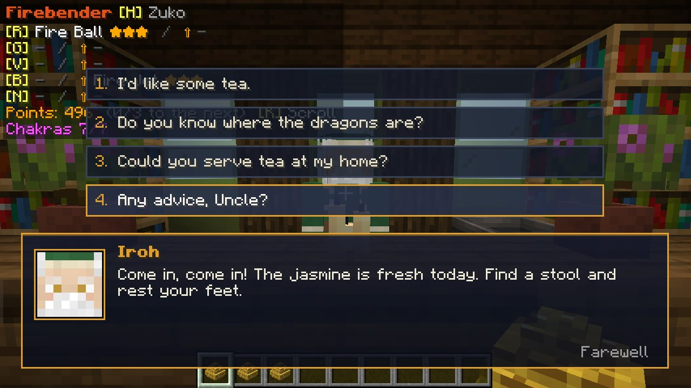
*The talk screen*

Everyone you can talk to (Iroh, Guru Pathik, King Bumi, the city guards, the Sun Warriors, the lion turtle, Raava)
answers on the **talk screen**: a panel at the bottom of the screen with their face, their name and their words typed
out (a click, Space or Enter shows them at once), and **answers to choose** above it (or keys 1-4). "Farewell" or Esc
ends the talk; walking away does too. What used to need a second right-click is an answer now: taking up the Sun
Warriors' test, letting Raava in, receiving the lion turtle's gift. Ask the guards of Ba Sing Se where to find good tea.

## City guards

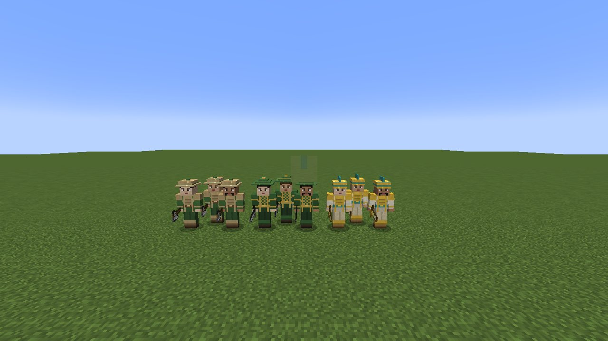
*The guards of Omashu, Ba Sing Se and Ellora*

Omashu, Ba Sing Se and Ellora are kept by their own **guards**. A guard keeps to his post (about 20 blocks round it),
**fights any monster that comes near** (not creepers), and fights back, with the other guards, against anyone who
strikes one of them. He never turns on another guard or on the townsfolk.

Each city dresses its guards in its own colours, and each has three faces:

| City | Uniform | Helmet | Weapon |
|---|---|---|---|
| Omashu | green tunic under tan leather plates | the round brimmed tan cap | iron axe |
| Ba Sing Se | the dark green of the royal army, scale armour edged in gold | the green tiered cone | iron sword |
| Ellora | white desert robes, a gold breastplate, a teal sash | the golden helm with a teal crest | golden sword |

**Talk to a guard** (right-click): he greets you in his own words, then tells you about his city, a little more each
time: the mail chutes and the cabbage merchant of Omashu, the Dai Li and the Jasmine Dragon of Ba Sing Se, the brigades
and the golden crystals of Ellora. The Avatar gets a word of his own; a guard in a fight has no time to talk.

A **City Guard Spawn Egg** (Creative) makes a guard of a city chosen by chance, posted where he stands.
