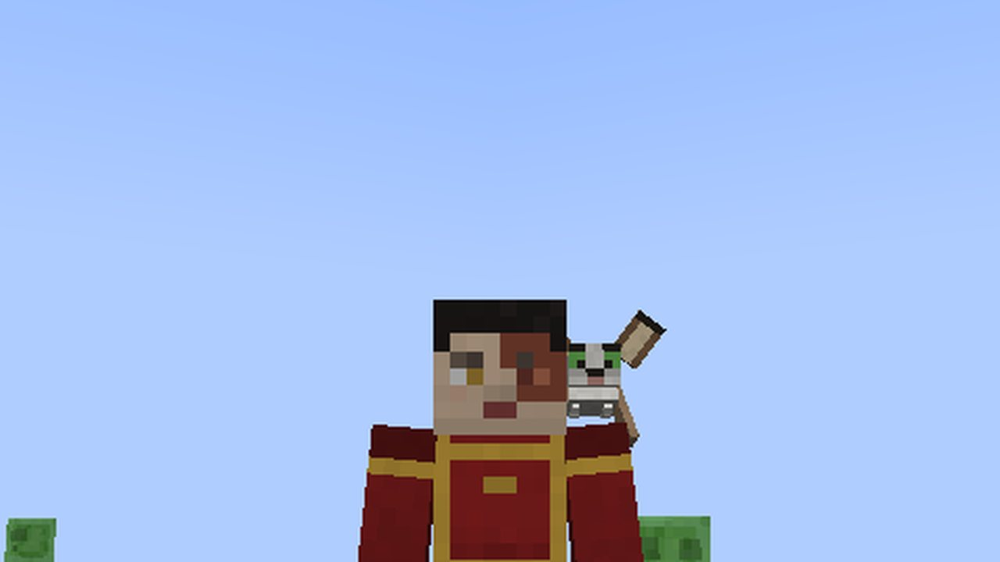

# The Flying Lemur

[עברית](Flying-Lemur-HE)

*A tamed lemur rides on your shoulder*

A small winged lemur, like Momo, inspired by the *Flying Lemur* Avatar add-on. It lives in **jungles, bamboo jungles,
cherry groves, meadows and flower forests**, in small groups, and you can find a **spawn egg** in the creative tab.

## Taming

Hold an **apple, sweet berries, glow berries, a melon slice or a golden apple** and right-click the lemur. About one
feeding in three tames it (hearts). A tamed lemur:

* follows you, flying to keep up, and glides down to you;
* **sits** when you right-click it with an empty hand, and stands again on the next click;
* **rides on your shoulder** like a parrot: it hops up by itself now and then, or when you **sneak and right-click** it with an empty hand; it hops down when you jump, fly or swim;
* can be leashed while standing;
* heals when fed, and breeds with the same food: babies are small and grow up.

## Life

The lemur flies and glides (it takes no fall damage), chirps, scolds when hurt, twitches its ears, tilts its head at
you and perches with its wings folded and its tail curled round. Its wings beat in flight, spread flat in a glide and
fold on the ground; it banks into its turns.

## As the show draws it

Momo's look: white fur, huge bat ears brown outside with a cream band inside, big green eyes ringed in black, tan
wing membranes and a long white tail ringed in brown. Lemurs also live at the [Southern Air Temple](Southern-Air-Temple).
