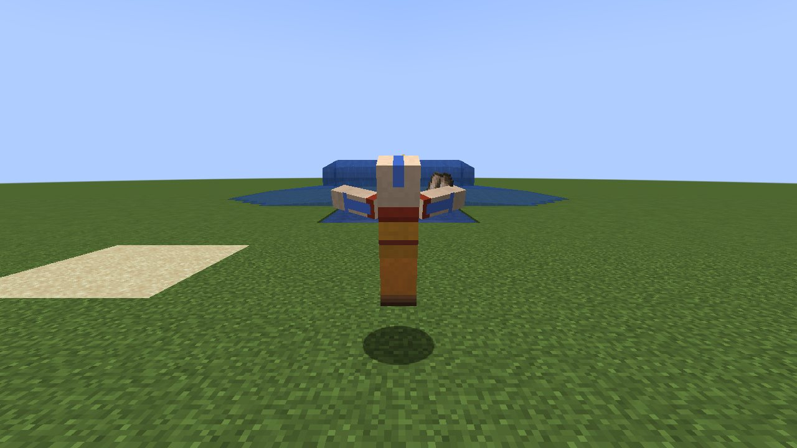
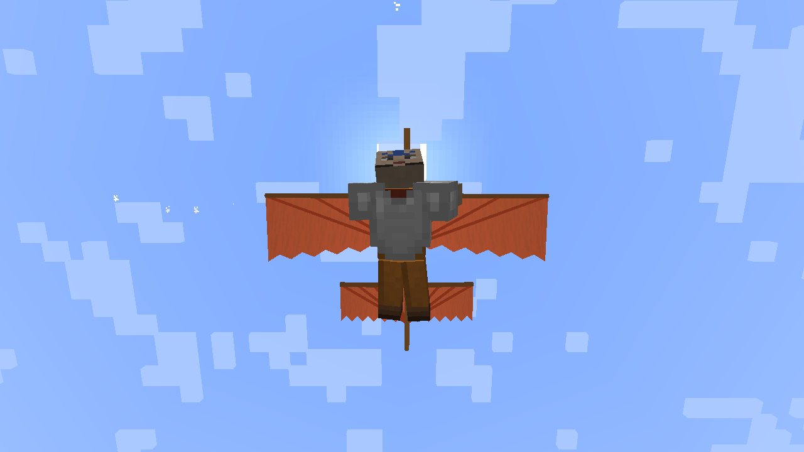
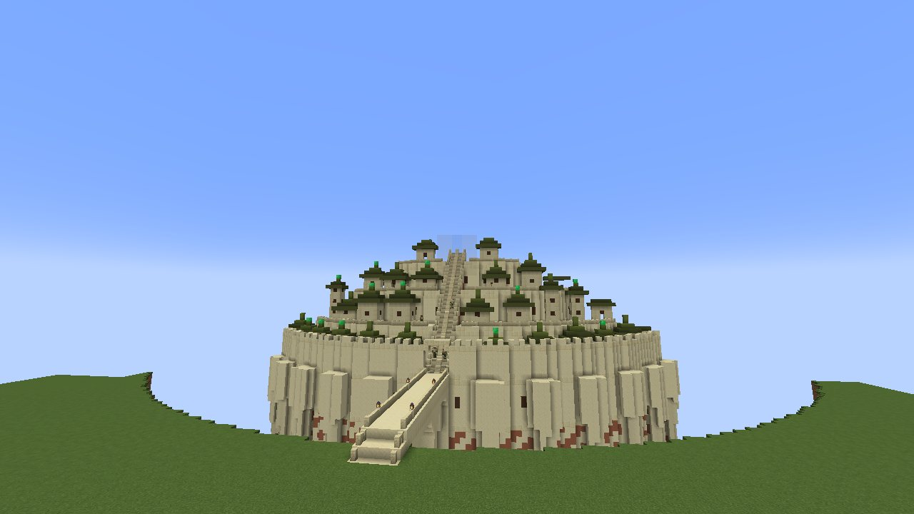
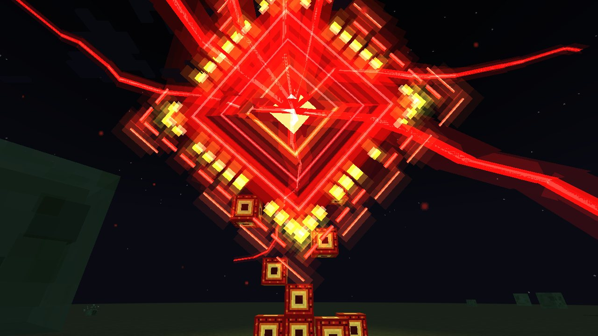

# Enlightened

Become a bender of the Avatar world in Minecraft (NeoForge, 1.21.1): an **earthbender**, an **airbender**, a
**waterbender**, a **firebender** or **the Avatar**, with the sub-bending arts (sand, lava, metal; flight; ice, blood; lightning), a
progression of ability points earned by fighting with your bending, and a loadout of the abilities you take into
battle. [עברית](Home-HE)

<table>
<tr><td align="center"> The Avatar in the elemental sphere</td><td align="center"> Gliding on the Air Glider</td></tr>
<tr><td align="center"> Omashu, King Bumi's city</td><td align="center"> The Anomaly of Seven Havens</td></tr>
</table>

The mod is built on the frame of [Enhanced](https://github.com/yuvalkolodkingal/Enhanced), the superhero mod of the
same authors, and plays the same way.

## Start here

* [Installation](Installation)
* [Becoming a Bender](Becoming-a-Bender): born to an element (or none, or the Avatar) the first time you join; the Avatar Cycle
* [Controls](Controls): the five keys and their Sneak slots, the look key, the scroll key
* [Points and the Bending Scroll](Points-and-the-Bending-Scroll): how you grow, levels, gates, the loadout

## The four elements

* [Earthbending](Earthbending): rock, armour, pillars, walls, the seismic sense; sand, lava, metal
* [Airbending](Airbending): blast, shield, jump and glide, blades, spirit projection, scooter, tornado; the tetherless
* [Waterbending](Waterbending): whip, healing, octopus form, spout, water arms; ice; bloodbending
* [Firebending](Firebending): the skin, fire ball, fist, whip, ring, healing; lightning and its redirection; combustion
* [The Avatar](The-Avatar): all four elements, energybending, spiritbending, the elemental sphere
* [Combos and Steps](Combos-and-Steps): sequences of casts that end in a greater art; the double-tap dash
* [Chakras and the Avatar State](Chakras-and-the-Avatar-State): meditation, the seven chakras, the Avatar State

## More

* [Looks](Looks): Toph, Bumi, Lin, Suyin, Ghazan, Bolin; Tenzin, Zaheer, Jinora, Gyatso, Jae, Kartik; Katara, Amon, Ming-Hua, Pakku; Zuko, Iroh, Azula, Jeong Jeong, Ozai
* [Items and Crafting](Items-and-Crafting): the Air Glider and the back slot, the Water Skin, the Meditation Point, the scrolls (Creative)
* [The Flying Lemur](Flying-Lemur): a tameable winged lemur, like Momo
* [The Southern Air Temple](Southern-Air-Temple): the temple on the mountains, its sky bison, Guru Pathik and Momo
* [The Lion Turtle](Lion-Turtle): an island that swims, energybending for a Hero of the Village, and a home on its shell
* [Ba Sing Se and Omashu](Earth-Kingdom-Cities): the walled capital that keeps all monsters out, the mountain city over its chasm with King Bumi on his throne, and the city guards you can talk to
* [The Spirit World](Spirit-World): a world of its own through the spirit portals, and the Tree of Time
* [Seven Havens](Seven-Havens): the brigade armor trim for any armor, Ellora, the golden city where it is found, and the Anomaly
* [Commands](Commands)
* [Server Configuration](Server-Configuration)
* [Building from Source](Building-from-Source)
* [FAQ](FAQ)

The ideas are Eilon Kolodkin-Gal's; the mod is by Yuval Kolodkin-Gal.
