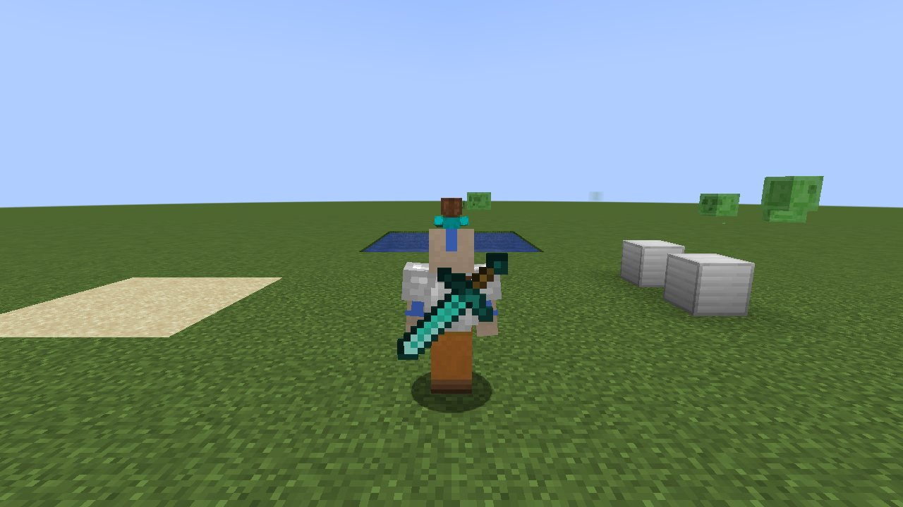
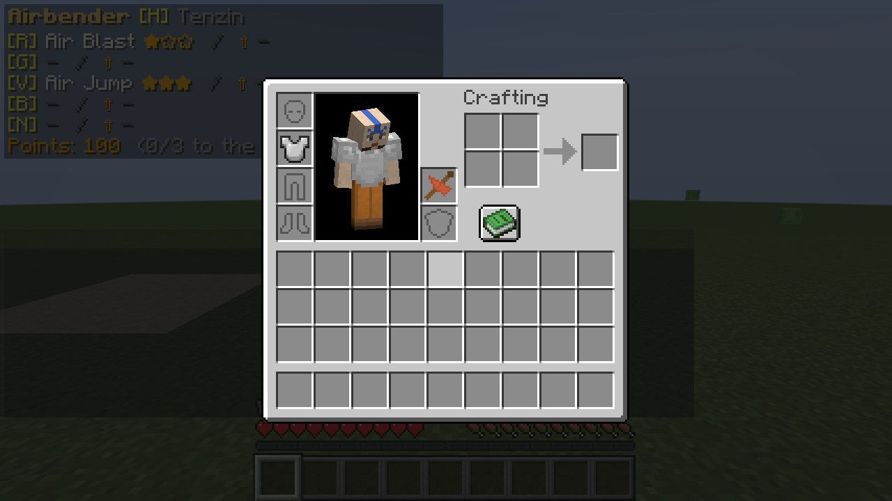

# Items and Crafting

[עברית](Items-and-Crafting-HE)


*Anything on your back: here, a sword*


*The back slot, beside the body*


All in the *Enlightened* creative tab.

## The scrolls

Creative items only: they are no longer crafted or found. Everyone is born to an element instead: see
[Becoming a Bender](Becoming-a-Bender).

## Water Skin

A cow's hide and some thread, for the waterbender away from any lake:

```
L S L
L . L
. L .
```

L = leather, S = string. It holds **ten uses of water** (its durability bar). **Right-click water** to fill it (or use
it while you swim); in the rain under the open sky it fills one use every 15 seconds. A water ability draws on it
whenever you carry no water and no water is near: see [Waterbending](Waterbending#water-where-it-comes-from).

## Air Glider

The airbender's glider staff:

```
L B L
. S .
. S .
```

L = leather, B = breeze rod, S = stick. Held in **either hand** by any airbender, it opens as he falls (or at a right-click in
the air) and he flies on it as on an elytra (see [Airbending](Airbending)); Air Jump pumps the wings for speed. **Dye it**: put it in a crafting table with
any dye (as leather armour) and its wings take the colour: blue, red, whatever you like. In anyone else's hands it is
a staff.

## Meditation Point

A low stone seat for meditation: **cyan dye, paper, cyan dye** over **three smooth stone slabs**. Standing on it (or
on any block in `#enlightened:meditation_point`), meditation runs three times as fast; see
[Chakras and the Avatar State](Chakras-and-the-Avatar-State).

## Avatar Scroll

The four scrolls and a **nether star**, shapeless. Whoever reads it becomes [the Avatar](The-Avatar), a bender of all
four elements; a bender's old element becomes part of the four.

## The back slot

Your inventory has one more slot, beside your body above the off hand: the **back slot**. Put anything there (your
glider, a sword, a banner, a block) and you wear it on your back, over your armour, for everyone to see. A **glider on
your back** flies like one in hand: it opens by itself as you fall, so your hands stay free. What is on your back
falls with your things when you die, unless the world keeps inventories. In the creative inventory the slot is next to
the armour.
