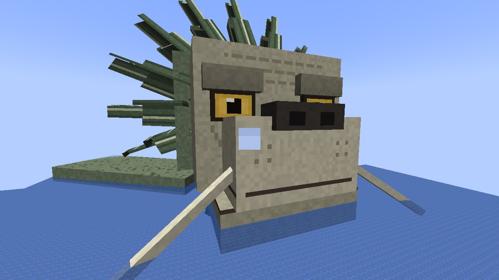
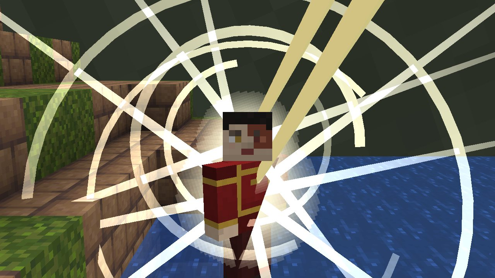

# צב האריה

[English](Lion-Turtle)

*ראש הצב-אריה מעל הים*

*מתנת כיפוף האנרגיה*

צבי האריה הם היצורים העתיקים ביותר בעולם האווטאר: גדולים כמו איים, הבתים הראשונים של בני האדם, ומי שנתנו
לכשפים הראשונים את הכישוף שלהם. ב-Enlightened צב אריה שוחה **באוקיינוס העמוק**: אי של בלוקים אמיתיים באורך
**כ-440 בלוקים וברוחב 360**, כיפה של דשא ויער שמתנשאת 40 בלוקים מעל הים על שריון עם שפה של לוחות חומים, וראש אריה
ענק בחזיתו: פנים בהירות עם עיניים ענבריות גדולות מתחת לגבות כבדות, חוטם רחב ושפם ארוך, כתר של סנפירים קוצניים וזקן
מהם, וסנפירים משני הצדדים. (הגודל נקבע בשרת: `lionTurtleSize`, 1 עד 10.)

כשהעולם יוצר את המקום, האי עולה מן הים תוך כמה שניות, כמה שורות בכל פעם.

## ללכת עליו

אפשר לנחות עליו ולטייל. כל עוד שחקן קרוב אליו הוא **שוחה**: כל `lionTurtleMoveSeconds` (40) שניות הוא זז בלוק אחד
לכיוון שאליו פונה הראש, ונושא את כל מה שעליו (בלוקים, תיבות ותכולתן, מיטות, יצורים, אתכם). השחייה עוברת כגל מהחזית
שלו לגב שלו תוך כמה שניות, שורת בלוקים בכל פעם, כך שהיא אף פעם לא עוצרת את המשחק, ואתם לא רואים אותה; רק אחרי זמן
מה תגלו שאתם רחוקים מהמקום שבו התחלתם. כשיבשה, קרח או מים רדודים חוסמים את דרכו, הוא שוחה הצידה, או אחורה. אי שאף
אחד לא קרוב אליו נשאר היכן שהושאר.

כדי שכולו יוכל לשחות, צב אריה מחזיק את הצ'אנקים שלו טעונים כששחקן קרוב אליו (ומשחרר אותם קצת אחרי שכולם הלכו).

אי אפשר לפגוע בצב האריה והוא לעולם לא עוזב (רק הריק או שחקן במצב יצירתי יכולים להרוג אותו).

## המתנה שלו

עמדו בחזית השריון, ליד הצוואר שלו, ולחצו קליק ימני על ראשו. לרוב האנשים הוא לא אומר דבר. ל**גיבור הכפר** (ההישג על
הצלת כפר מפשיטה) הוא מדבר, ונותן שתי אומנויות, שמונחות על המקשים הפנויים שלכם. כמו שנתן לוואן את הכישוף שלו, הוא
מרים סנפיר גבוה ליד פניו ושולח שני טפרים ענקיים, שזופים עם פסים שחורים, אל **המצח** ואל **החזה** שלכם; אור פורח במקום
שהם נוגעים, טבעות שבורות של אור מקיפות את שתי הנקודות וקרניים ארוכות חוצות דרכן; ואז הטפרים נסוגים.

* **כשפות אנרגיה**: געו בכשף בהישג יד וקחו את הכישוף שלו, ל:
  * **שעתיים** אם אתם האווטאר (לא צריך שום צ'אקרה פתוחה);
  * **6 דקות** אם אתם כשפי אוויר;
  * **3 דקות** לכל אחד אחר (כל כשף אחר, או מי שלא מכשף כלל).
* **החזרת אנרגיה**: געו במי שכישופו נלקח והחזירו לו אותו לפני שהזמן נגמר.

הסכנה: אם האנרגיה של מי שאתם נוגעים בו **חזקה משלכם** (יותר נקודות שהושקעו וצ'אקרות שנפתחו; של האווטאר שווה
יותר), האנרגיה פונה אליכם. אתם מאבדים את הכישוף שלכם לאותו זמן, ואתם המומים. במצב האווטאר אין אנרגיה חזקה משלכם.

## בית

גיבור הכפר יכול גם **לבנות על השריון שלו ולגור שם**, כמו שאנשים חיו על צבי האריה לפני האווטאר. אף אחד אחר לא
יכול לשבור או להניח בלוק עליו (חוץ משחקנים במצב יצירתי). מיטה על השריון שוחה איתו, ואתם מתעוררים בה.

## איך למצוא אחד

צבי אריה חיים באוקיינוסים עמוקים, רחוקים זה מזה (בערך אחד בכל 64 על 64 צ'אנקים, היכן שהאוקיינוס עמוק מתחת לכל
האי). מנהל יכול להעלות אחד עם `/enlightened lionturtle` (בגובה פני הים היכן שאתם עומדים, פונה לאן שאתם פונים),
`/enlightened lionturtle <pos>` (פני הים בגובה הזה) או `/enlightened lionturtle <pos> <size>`.

