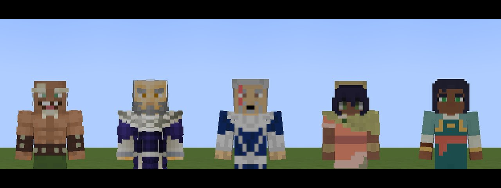

# נראויות

[English](Looks)

*בומי, אירו, ג'ונג ג'ונג, פאבי ונישה*

לכל יסוד כמה **נראויות**: הסקין של דמות מעולם האווטאר, שמחליף את שלכם בכל מקום שהוא מצויר (הגוף, הידיים בגוף
ראשון, התצוגה בתיק), וצבע האנרגיה שלכם. לחצו **H** כדי להחליף נראות (התכופפות + H חוזר אחורה), או
`/enlightened look`. נראות משנה רק איך אתם נראים: היכולות זהות בכל נראות, מלבד יוצאת דופן אחת: **האש של אזולה
כחולה**. כל יסוד מסתיים ב*הסקין שלכם*.

| יסוד | נראויות (לפי הסדר של H) |
|---|---|
| אדמה | **טוף בייפונג**, המלך בומי, לין בייפונג, סוּיין בייפונג, גזאן (אנרגיה אדומה-כתומה), בולין, הסקין שלכם |
| אוויר | **טנזין**, זאהיר, ג'ינורה, הנזיר ג'יאטסו, ג'יי (שבעת המקלטים), קארתיק (שבעת המקלטים), הסקין שלכם |
| מים | **קטרה**, אמון (נואטק, עם המסכה), מינג-הואה (הזרועות שלה מים), מאסטר פאקו (גלימת הלוטוס הלבן), הסקין שלכם |
| אש | **זוקו** (אחרי שהצטרף לקבוצת האווטאר), דוד אירו (גלימת הלוטוס הלבן), אזולה (אש כחולה), ג'אונג ג'אונג (הגלימות האדומות הכהות של העריק), שליט האש אוזאי, הסקין שלכם |

הראשונה בכל שורה היא ברירת המחדל. טוף, לין, סוּיין, ג'ינורה, קטרה, מינג-הואה ואזולה משתמשות במודל הצר (אלכס);
האחרים ברחב.

הסקינים מצוירים על ידי המחולל של המוד עצמו (`tools/skins.py`) מפלטות: גוון העור, השיער והסגנון שלו, הבגדים
והעיטורים, קעקועי החץ של טנזין, ג'ינורה, ג'יאטסו, ג'יי וקארתיק, הצלקת של זוקו, המסכה של אמון, הזקנים, אריח
הלוטוס הלבן על החזה. שריון האדמה ושריון הפלדה הם קליפה שמצוירת מעל הנראות, עם העיניים פתוחות.

