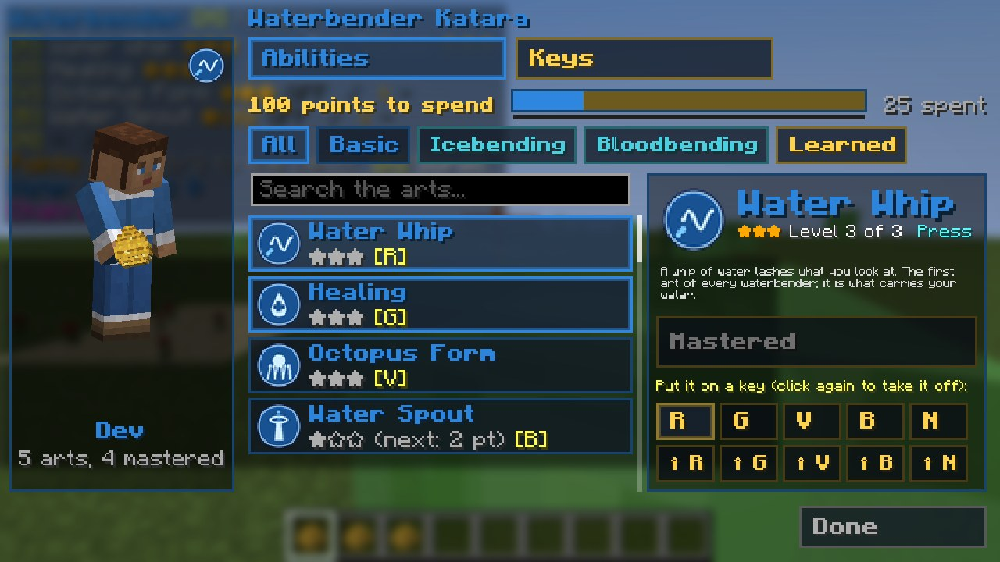
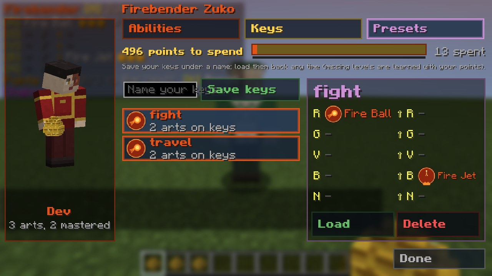

# נקודות ומגילת הכשפות

[English](Points-and-the-Bending-Scroll)

## נקודות יכולת

כל יצור שהורגים **עם הכישוף** (סלע, הדף, שוט, להבה: כל נזק של המוד, אף פעם לא חרב או קשת) נותן **ניסיון**: אחד
למפלצת, עשרה לבוס (הוית'ר, דרקון הקצה, הוורדן, שומר בכיר), שניים לשחקן אחר; חיות וכפריים לא נותנים כלום. כל
`general.xpPerPoint` (3) ניסיון הם **נקודת יכולת** אחת, עם צלצול והודעה. הפאנל מראה את הנקודות ואת הניסיון עד הבאה.

## רמות

לכל יכולת **שלוש רמות**: מתחיל (★☆☆), מתקדם (★★☆), מומחה (★★★). רמה 1 עולה **נקודה אחת**, רמה 2 **שתיים**, רמה 3
**שלוש** (שש בסך הכל כדי לשלוט ביכולת לגמרי). כמעט כל מספר של יכולת גדל עם הרמה: כמה סלעים, כמה רחב הקיר, כמה רחוק
ההדף מעיף, כמה זמן האחיזה מחזיקה, כמה הריפוי מרפא. דפי היסודות מציגים את המספרים כ*מתחיל / מתקדם / מומחה*.

## שערים: כשפות המשנה

כשפות המשנה נפתחות כש**השקעתם** מספיק נקודות ביסוד (ה*כוח* שלכם):

| כשפות | נקודות שהושקעו | אפשרות |
|---|---|---|
| חול (אדמה) | 3 | `earth.sandGate` |
| לבה (אדמה) | 6 | `earth.lavaGate` |
| פלדה (אדמה) | 9 | `earth.metalGate` |
| קרח (מים) | 3 | `water.iceGate` |
| דם (מים) | 9 | `water.bloodGate` |
| ברק (אש) | 6 | `fire.lightningGate` |
| תעופה וחנק (אוויר) | לעולם לא בנקודות: רק כשף אוויר [משוחרר מכבלים](Airbending-HE#כשף-האוויר-המשוחרר-מכבלים) | |

הכוח שלכם קובע גם מי מנצח כשכישוף פוגש כישוף: חול טובעני לא משקיע כשף אדמה חזק או שווה, וכשפות דם לא תופסת כשף מים
חזק או שווה.

## מגילת הכשפות (K)

*מגילת הכשפות: הדמות שלכם, הכרטיסים, היכולת שבחרתם*

לחצו **K** (או קליק ימני עם המגילה של היסוד שלכם) כדי לפתוח אותה. היא בנויה כמו יוצר הגיבורים של Enhanced: כפתורים
גדולים במסגרת בצבע היסוד שלכם, שלוש **לשוניות** למעלה (יכולות, מקשים ופריסטים), ו**פס הנקודות** מתחתן (הנקודות לבזבז בזהב, החלק
שכבר בוזבז, וקו ירוק דק: הניסיון עד הנקודה הבאה).

**הדמות שלכם** עומדת משמאל, והיא **מדגימה את היכולת שבחרתם**: ההצלפה של השוט, האגרוף של הסלע, כדור האש, החומה,
העמוד... שוב ושוב (רק אתם רואים, ושום דבר לא קורה בעולם). מתחתיה: השם שלכם, כמה יכולות אתם יודעים וכמה מהן שלטתם.

**לכל יכולת יש סמל משלה**: תג עגול בצבעי היסוד (שוט, טיפה עם צלב, ברק, להבה, חומה, ספירלה...), על הכרטיס שלה, על
המקש שלה, וגדול ליד השם שלה.

* **יכולות.** **צ'יפים** ממיינים את היכולות: *הכל*, *בסיס*, כל תת-כשפות (חול, קרח, ברק...; לאווטאר יש צ'יפ לכל יסוד)
  ו*נלמדו*. **תיבת חיפוש** מוצאת יכולת לפי השם או לפי מה שהיא עושה. ה**כרטיסים** מראים כל יכולת: הסמל, הכוכבים, המחיר
  של הרמה הבאה, *נעול* כל עוד השער סגור, והמקש שהיא יושבת עליו. לחיצה על כרטיס בוחרת אותו: ה**פאנל שלידו** מראה אותו
  במלואו: הסמל, הרמה, איך משתמשים (לחיצה, החזקה, הפעלה/כיבוי, תמיד פועל), השער (✔ פתוח, ✖ סגור עם הנקודות שהוא דורש),
  מה היא עושה, כפתור **ללמוד** גדול (עם המחיר והנקודות שלכם, או למה עוד אי אפשר), ו**עשרת המקשים**: לחיצה שמה את היכולת
  על המקש, לחיצה נוספת מורידה.
* **מקשים.** עשרת המקשים ככפתורים גדולים, כל אחד רגיל ועם התכופפות (⇧), עם היכולת שעליו. **בחרו מקש, ואז יכולת** מימין
  כדי לשים אותה שם (המקש הבא נבחר בשבילכם, כדי לסדר כמה ברצף). **קליק ימני** על מקש מרוקן אותו. **מקשים ברירת מחדל**
  מסדר את היכולות שלמדתם בסדר ברירת המחדל של היסוד.

* **פריסטים.** שמרו את המקשים שלכם בשם (אותיות מכל שפה, ספרות, `-` ו-`_`) ו**טענו** אותם מתי שתרצו: רמות חסרות
  נלמדות בנקודות שלכם, כמו ב-`/bendpreset load` (אלה אותם פריסטים, עד 20). בחרו פריסט כדי לראות את עשרת המקשים שלו;
  **מחיקה** דורשת שתי לחיצות.

*לשונית הפריסטים*

גלגלת העכבר גוללת את הכרטיסים. כל יכולת שאתם לומדים לוקחת את משבצת ברירת המחדל שלה אם היא פנויה, אחרת את המשבצת
הפנויה הראשונה. הפאנל בפינה תמיד מראה את המקשים כפי שהם עכשיו.

מפעילים יכולים לעשות את כל זה ב[פקודות](Commands-HE): `/enlightened points add`, `/enlightened learn`,
`/enlightened loadout`, `/enlightened reset` (כל הרמות חוזרות, הנקודות מוחזרות).

