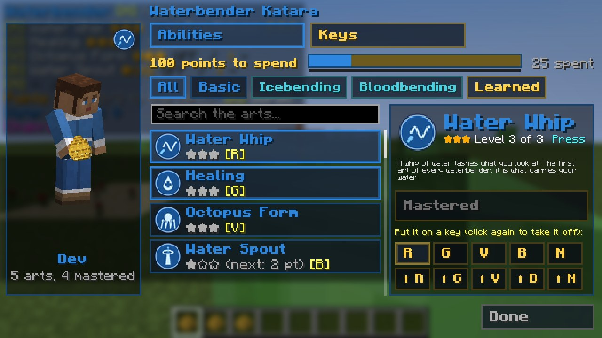

# Points and the Bending Scroll

[עברית](Points-and-the-Bending-Scroll-HE)

## Ability points

Every creature you kill **with your bending** (a rock, a blast, a whip, a flame: any damage of the mod, never a
sword or a bow) earns **experience**: one for a monster, ten for a boss (the Wither, the Ender Dragon, the Warden, an
Elder Guardian), two for another player; animals and villagers give none. Every `general.xpPerPoint` (3) experience
is one **ability point**, with a chime and a message. The panel shows your points and the experience toward the
next.

## Levels

Every ability has **three levels**: novice (★☆☆), adept (★★☆), master (★★★). Level 1 costs **1 point**, level 2
costs **2**, level 3 costs **3** (six in all to master an ability). Almost every number of an ability grows with the
level: how many rocks, how wide the wall, how far the blast throws, how long the grip holds, how much the healing
heals. The element pages list the numbers as *novice / adept / master*.

## Gates: the sub-bending arts

The sub-arts open when you have **spent** enough points on your element (your *strength*):

| Art | Points spent | Option |
|---|---|---|
| Sand (earth) | 3 | `earth.sandGate` |
| Lava (earth) | 6 | `earth.lavaGate` |
| Metal (earth) | 9 | `earth.metalGate` |
| Ice (water) | 3 | `water.iceGate` |
| Blood (water) | 9 | `water.bloodGate` |
| Lightning (fire) | 6 | `fire.lightningGate` |
| Flight and Suffocation (air) | never by points: only a [tetherless](Airbending#the-tetherless-airbender) airbender | |

Your strength also decides who wins when bending meets bending: quicksand never sinks a stronger or equal
earthbender, and bloodbending never holds a stronger or equal waterbender.

## The Bending Scroll (K)

*The Bending Scroll: your picture, the cards, the chosen art*

Press **K** (or right-click with your element's scroll) to open it. It is laid out like Enhanced's Hero Creator: big
buttons framed in your element's colour, two **tabs** on top (Abilities and Keys), and the **points bar** under them
(your points to spend in gold, the share already spent, and a thin green line: the experience toward the next point).

**Your picture** stands on the left, and it **acts out the art you chose**: the whip's lash, the rock's punch, the
fire ball, the wall, the spout... over and over (only you see it, and nothing happens in the world). Under it: your
name, how many arts you know and how many you have mastered.

**Every ability has its own symbol**: a round badge in its element's colours (a whip, a drop with a cross, a bolt, a
flame, a wall, a spiral...), on its card, on its key and big beside its name.

* **Abilities.** **Chips** sort the arts: *All*, *Basic*, each sub-art (Sandbending, Icebending, Lightning...; the
  Avatar has a chip per element) and *Learned*. A **search box** finds an art by its name or by what it does. The
  **cards** show each art: its symbol, its stars, the cost of the next level, *locked* while its gate is closed, and the
  key it sits on. Click a card to choose it: the **panel beside** shows it in full: its symbol, its level, how it is
  used (press, hold, on/off, always on), its gate (✔ open, ✖ closed with the points it asks for), what it does, a big
  **Learn** button (with the cost and your points, or why it can't be learned yet), and the **ten keys**: click one to
  put the art there, click it again to take it off.
* **Keys.** The ten keys as big buttons, each plain and with Sneak (⇧), with the art on it. **Pick a key, then an art**
  on the right to put it there (the next key is picked for you, to lay out several in a row). **Right-click** a key to
  empty it. **Default keys** lays your learned arts out in the element's default order.

The mouse wheel scrolls the cards. Every ability you learn takes its default slot if that is free, else the first free
slot. The panel in the corner always shows the keys as they are now.

Operators can do all of it with [commands](Commands): `/enlightened points add`, `/enlightened learn`,
`/enlightened loadout`, `/enlightened reset` (every level back, the points refunded).
