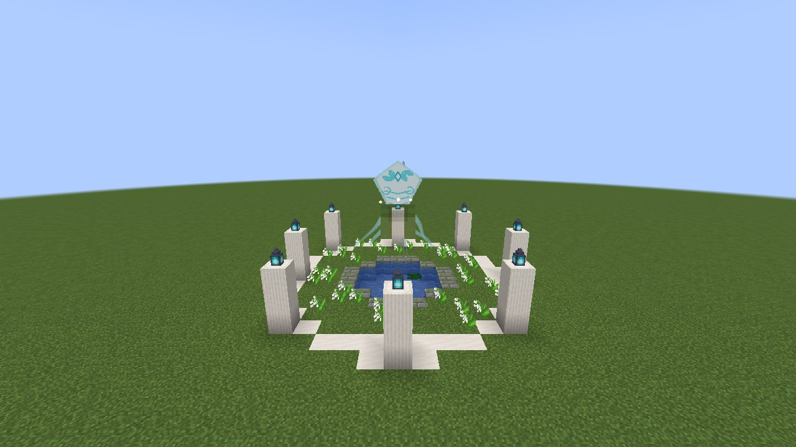
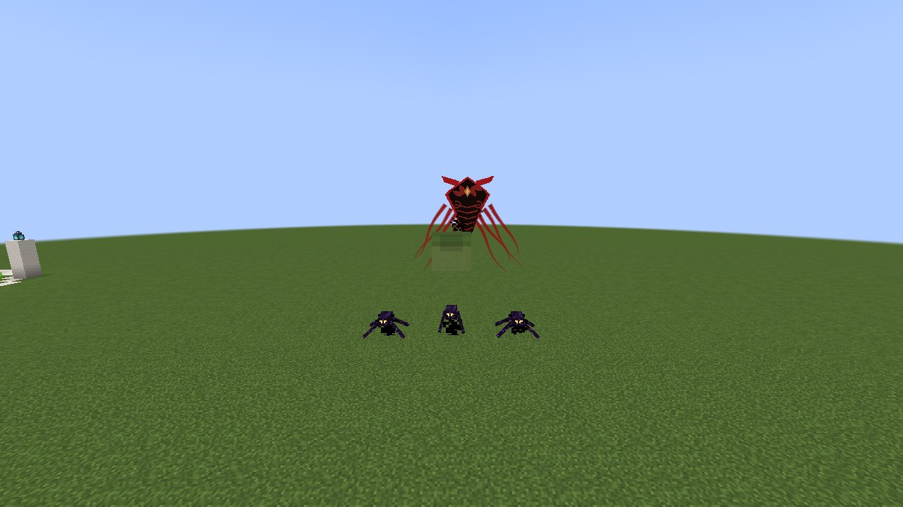
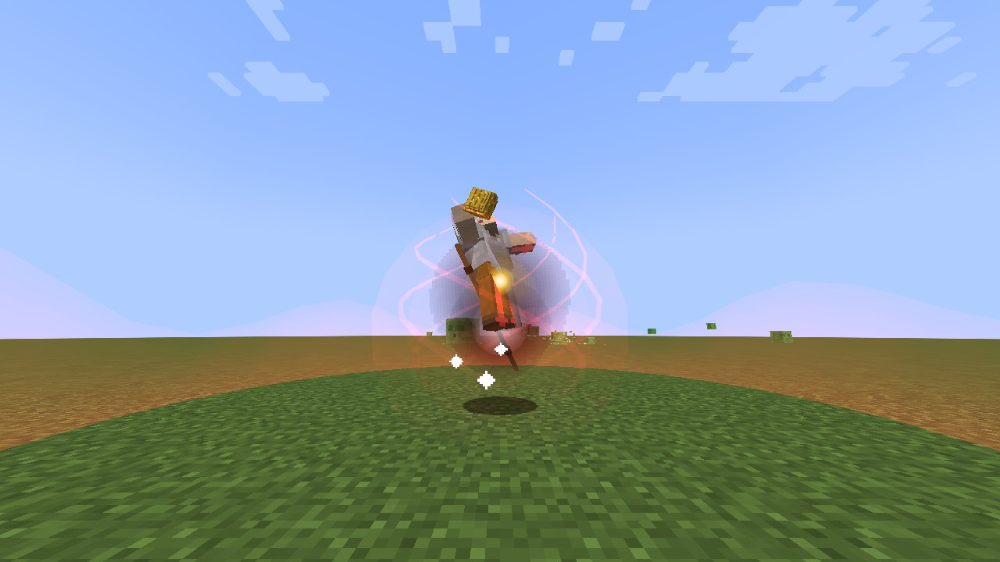

# ראווה וואטו

[English](Raava-and-Vaatu)

*ראווה מחכה בקרחת היער שלה*

לפני הרבה שנים ואן הפך לאווטאר הראשון כשראווה, רוח האור, התאחדה איתו כדי לעמוד נגד ואטו, רוח החושך. ב-Enlightened
(בדרך ברירת המחדל של השרת, `general.avatarPath` = `QUEST`) כך עדיין נבחר האווטאר: **אף אחד לא נולד אווטאר**.

## קרחת היער של ראווה

ראווה מחכה ב**קרחות יער** ברחבי העולם (מישורים, אחו, יערות, חורשות דובדבן, טייגה): טבעת של שמונה עמודים לבנים עם
פנסים חיוורים מעליהם סביב בריכה שקטה, וראווה מרחפת מעליה, עפיפון של אור לבן עם סרטים. **לחצו עליה לחיצה ימנית**
והיא תשאל אם תעזרו לה להביס את ואטו. **לחצו עליה שוב** כדי להסכים: היא נכנסת לגוף שלכם, ו**אתם האווטאר** (נולדים
ליסוד הבא ב[מחזור האווטאר](Becoming-a-Bender-HE)). כל עוד יש בעולם את כל האווטארים שמותר, ראווה לא נמצאת (קרחות
היער שלה ריקות) ולא בוחרת באף אחד.

## הרוחות האפלות

*ואטו והרוחות האפלות שלו*

ואטו יודע. **רוחות אפלות** מתחילות לבוא אליכם, כמה בכל פעם, מתוך החושך מסביב: זוחלות עם רגליים ארוכות ומעופפות
שצוללות מהאוויר, סגול-שחור עם עיניים צהובות בוערות. **הביסו עשר מהן** (`/avatarquest` מראה כמה) וראווה תגיד לכם:
**ואטו נמצא בעולם הרוחות.**

## ההצעה של ואטו

לכו ל[עולם הרוחות](Spirit-World-HE). ואטו מופיע מולכם, שחור ואדום עם זרועות ארוכות, ומדבר: ראווה מעכבת אתכם; בגדו בה,
הצטרפו אליו והפכו ל**אווטאר האפל**. עונים בלחיצה בצ'אט (או עם `/avatarquest light` / `/avatarquest dark`):

* **לסרב**: ואטו תוקף. הביסו אותו (300 נקודות חיים): הוא מקיף אתכם, מכה בברק אדום, מצליף בכם כשמתקרבים, וקורא
  לרוחות אפלות.
* **להצטרף לואטו**: החושך שלו נכנס בכם ו**אתם האווטאר האפל**. ראווה באה נגדכם; הביסו אותה (אותו קרב, באור לבן).

רק מי שהם נשלחו נגדו יכול לפגוע בהם. אם עוזבים או מתים, הקרב מחכה שתחזרו.

## האווטאר האפל

*מצב האווטאר האפל: אדום כהה, עשן שחור, עיניים צהובות*

האווטאר האפל הוא האווטאר, עם כל ארבעת היסודות, עם ההבדלים האלה:

* **הכשפויות האפלות קודמות**: כשפות דם נפתחת לו מיד ופוגעת **פי אחד וחצי**, והוא **משוחרר מהקשרים הארציים**:
  הוא יכול ללמוד את **התעופה** של כשפי האוויר (וגם חניקה).
* **הכשפויות הטהורות חלשות אצלו**: כשפות האנרגיה שלו חלשה בהרבה, והצ'אקרות נותנות פחות למצב האווטאר שלו.
* **מצב האווטאר** שלו בוער ב**אדום כהה** בעשן שחור, והעיניים **צהובות**, במקום לבן.

## דרך הגורל

שרת שמעדיף יכול לקבוע את `general.avatarPath` ל-`FATE`: אז מי שנולד הוא האווטאר פעם אחת משבע והאווטאר האפל פעם אחת
משבע (כל עוד יש בעולם מקום לכל אחד; לכל היותר אווטאר אפל אחד), ראווה וואטו אף פעם לא נמצאים, והמסע לא מתחיל.

