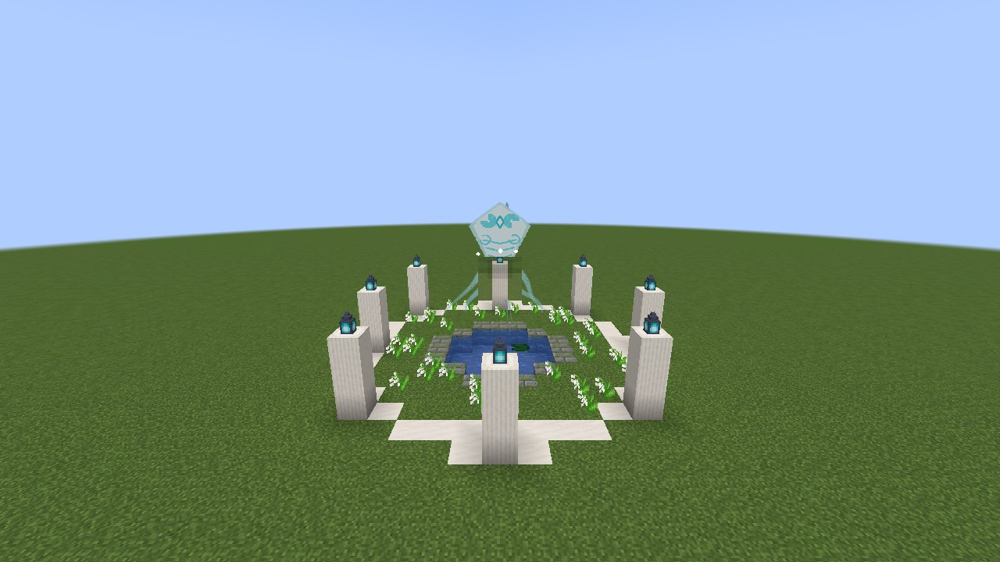
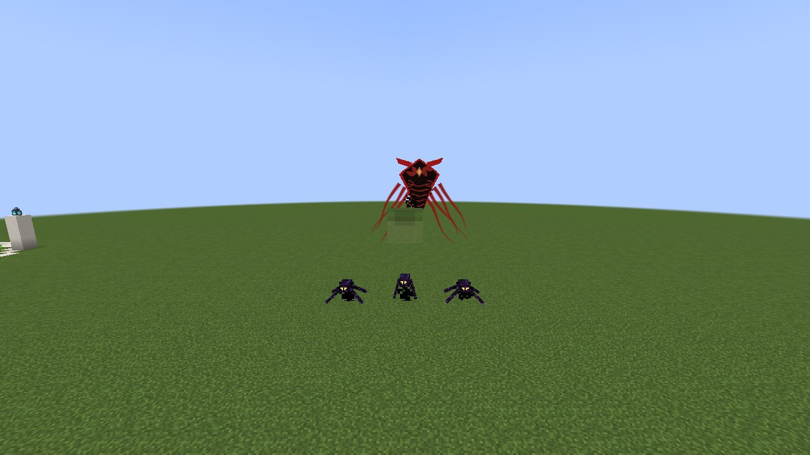
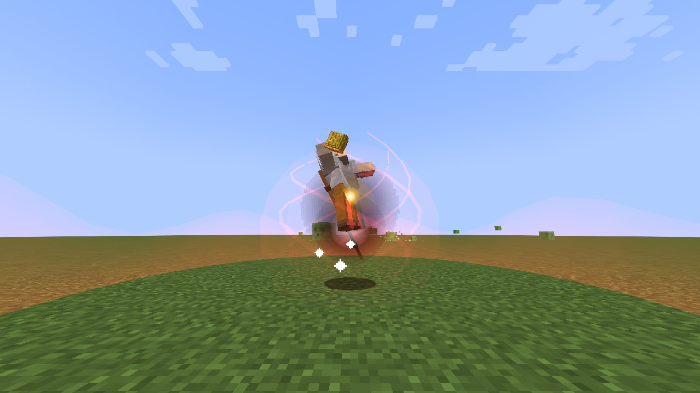

# Raava and Vaatu

[עברית](Raava-and-Vaatu-HE)

*Raava waits in her glade*

Long ago Wan became the first Avatar when Raava, the spirit of light, joined with him to stand against Vaatu, the
spirit of darkness. In Enlightened (on the server's default path, `general.avatarPath` = `QUEST`) that is still how
the Avatar is chosen: **nobody is born the Avatar**.

## Raava's glade

Raava waits in **glades** about the world (plains, meadows, forests, cherry groves, taiga): a ring of eight white
pillars crowned with pale lanterns round a still pool, and Raava hovering over it, a kite of white light trailing
ribbons. **Right-click her** and she asks whether you will help her defeat Vaatu. **Right-click her again** to agree:
she enters you, and **you are the Avatar** (born to the next element of the [Avatar Cycle](Becoming-a-Bender)). While
the world has all the Avatars it may, Raava is not found (her glades stand empty) and chooses nobody.

## The dark spirits

*Vaatu and his dark spirits*

Vaatu knows. **Dark spirits** start to come for you, a few at a time, out of the dark round you: long-legged crawlers
and swooping flyers, purple-black with burning yellow eyes. **Beat ten of them** (`/avatarquest` shows how many) and
Raava tells you: **Vaatu is in the Spirit World.**

## Vaatu's offer

Go to the [Spirit World](Spirit-World). Vaatu appears before you, black and red with long tendrils, and speaks: Raava
holds you back; betray her, join him and become **the Dark Avatar**. Answer by clicking in the chat (or with
`/avatarquest light` / `/avatarquest dark`):

* **Refuse**: Vaatu attacks. Beat him (300 health): he circles you, strikes with red lightning, lashes you when you
  come near, and calls dark spirits to him.
* **Join Vaatu**: his darkness enters you and **you are the Dark Avatar**. Raava comes against you; beat her (the same
  fight, in white light).

Only the one they were set against can harm them. If you leave or die, the fight waits for you to come back.

## The Dark Avatar

*The Dark Avatar's State: dark red, black smoke, yellow eyes*

The Dark Avatar is the Avatar, with all four elements, with these differences:

* **The dark arts come first**: bloodbending opens to him at once and does **half again as much** harm, and he is
  **free of his earthly tethers**: he can learn the airbender's **flight** (and suffocation).
* **The pure arts are weaker in him**: his energybending is much weaker, and the chakras give his Avatar State less.
* His **Avatar State** burns **dark red** in black smoke, his eyes **yellow**, instead of white.

## The fate path

A server that prefers it can set `general.avatarPath` to `FATE`: then a newborn player is the Avatar one time in seven
and the Dark Avatar one time in seven (while the world has room for each; one Dark Avatar at most), Raava and Vaatu are
never found, and the quest never begins.
