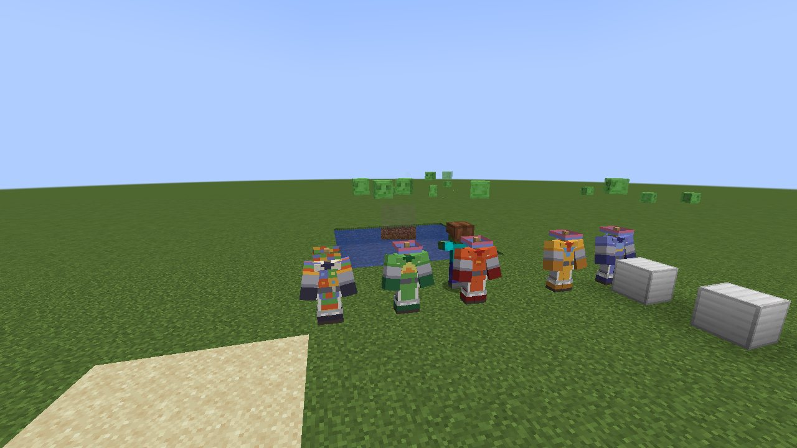
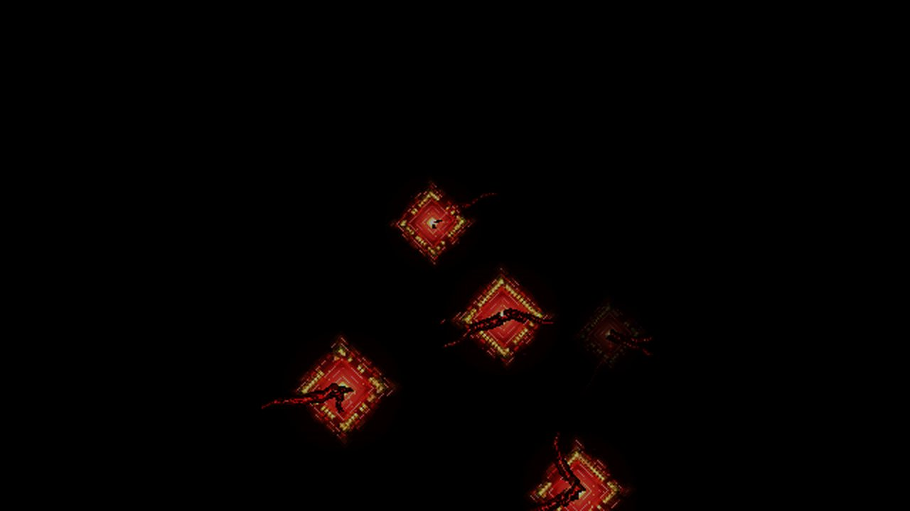
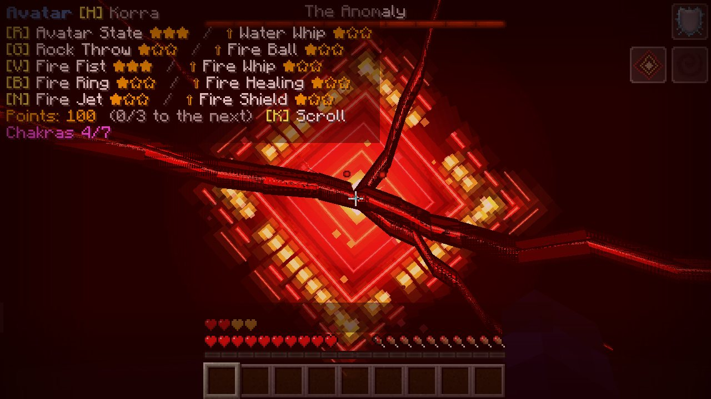
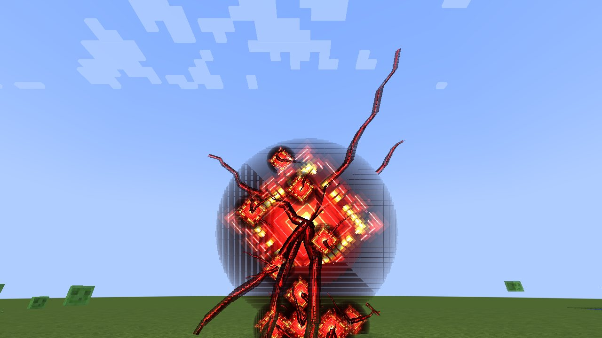
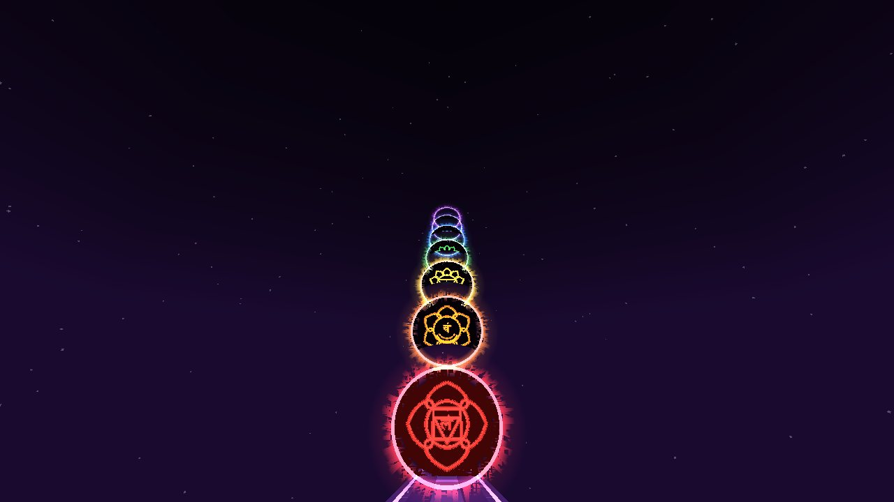
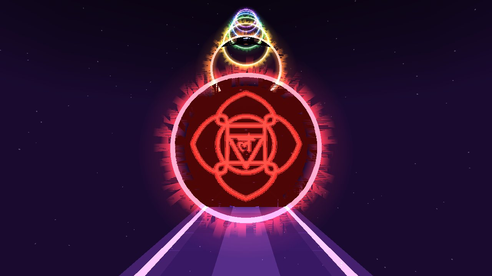
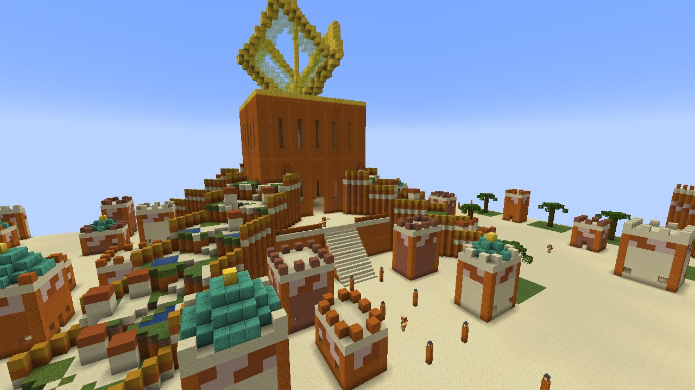

# שבעת המקלטים: עיטור הבריגדה ואלורה

מתוך *אווטאר: שבעת המקלטים*: המדים של ארבע הבריגדות, ואלורה, עיר הזהב של המדבר.

## עיטור השריון של הבריגדה

*עיטור השריון של הבריגדה*

**עיטור השריון של הבריגדה** הוא תבנית נפחות. משתמשים בה בשולחן נפחות על **כל שריון** (עור, שרשראות, ברזל, זהב,
יהלום, נת'רייט, שריון צב), והשריון לובש את המדים של אחת הבריגדות. החומר קובע איזו בריגדה:

| חומר | בריגדה | מראה |
|---|---|---|
| לפיס לזולי | מים | כחול לבנדר וכחול כהה, הירח והסהר על החזה |
| מטיל זהב | אוויר | זהב-כתום, צווארון ואמות אדומים, המשולש הכחול |
| רדסטון | אש | אדום-כתום ואדום עמוק, היהלום |
| פחם | אדמה | ירוק וירוק כהה, הטרפז הזהוב |
| מטיל נת'רייט | האווטאר | כל הארבעה ביחד: לוח החזה מחולק לארבעת הצבעים עם הסמלים, כריות כתפיים בפסים של ארבעת הצבעים, סרט ראש וסינר בארבעה צבעים |

כל חלק של המדים הוא חלק של השריון: **הקסדה** היא רק סרט הראש (הקסדה עצמה נעלמת, והסרט יושב על הראש), **השריון** כולל את כריות הכתפיים, לוח החזה עם הסמל,
שרוולים אפורים והחגורה, **המכנסיים** כוללים את הסינר עם השוליים הלבנים, ו**המגפיים** הם הנעליים הרכות. כל חומר עיטור
אחר (ברזל, זהב, אמרלד...) נותן את אותם מדים בצבעים שלו. פחם עובד כחומר עיטור גם על העיטורים של המשחק עצמו.

את התבנית מוצאים ב**אלורה**. משכפלים אותה כמו כל תבנית עיטור: התבנית, שבעה יהלומים ואבן חול אדומה חתוכה נותנים שתיים.

## האנומליה

*הקוביות האדומות: אנומליות קטנות של אנרגיה*

*פגיעה מהברק האדום שלה: אימה*

*האנומליה, אנרגיה טהורה בהילה של חושך*

*הברק האדום שלה ביום*

*כשמנצחים אותה, היא מראה את שבע הצ'אקרות*

*הצ'אקרה הראשונה, מולדהרה: היכנסו אליה*

באמצע אולם המצודה באלורה תלויות **קוביות אדומות**: אנומליות קטנות של אנרגיה טהורה, כל אחת ריבוע זוהר בצל של עצמו,
כאילו המקום שם נשבר. הן מוצקות כמו בלוקים, אבל אי אפשר לשבור אותן: **מכה באחת מהן מעירה
את האנומליה**, בוס (עם פס חיים בראש המסך). לעיניים שלכם היא **ריבוע הניאון של הסדרה**: ריבוע עומד על הפינה, תמיד מול העיניים,
בזוהר אדום, המסגרות שלו בצבע מלא מתחת לאור שלהן, מסגרת צהובה עבה של קווים מהבהבים, טבעות בורדו כהות, לב שבוער בצהוב
ולבן. אבל אחרי שהברק שלה פגע בכם, **באימה שלכם אתם רואים אותה כמו שהיא באמת**, וגם את הקוביות האדומות שלה: **אנרגיה
טהורה**, בלי שום דבר מוצק, רק אור: קווי מתאר אדומים שבורים, מסגרת צהובה עבה שבורה לקווים מהבהבים, טבעות של אנרגיה אדומה עמומה, לב שבוער
בלבן ובצהוב, וגרגרי אנרגיה שנשאבים פנימה ונזרקים החוצה. היא בולעת את האור סביבה ב**הילה של חושך**, והברקים האדומים
שלה זוחלים ממנה ב**עשן כהה**. מדי פעם היא רועדת, כאילו היא לא באמת שם, וצורחת.

**הברק האדום שלה מביא אימה**: נזרקים ל**חושך**, הראייה **מהבהבת באדום ובשחור** והקצוות נסגרים (אבל האנומליה עצמה זוהרת מבעד לחושך), העולם רועד, הלב
דופק, והרגליים כבדות (כמה שניות, מתחדש בכל פגיעה). היא מרחפת סביב מי שנלחם בה, מכה ב**ברקים אדומים** ומדי פעם **מתפרצת** החוצה והודפת את כל מי
שקרוב; מתחת לחצי מהחיים היא מכה מהר וחזק יותר. רק אנומליה אחת ערה ליד מקום בכל פעם.

כל מכה וכל כישוף עושים לה רק **חצי** מהנזק. **כיפוף אנרגיה** הוא הדרך לנצח אותה: מכוון אליה ממרחק של עד 12 בלוקים,
הוא **שואב רבע מהחיים שלה** בכל פעם ומרפא אותך קצת.

**נצחו אותה**, וכל כשף שנלחם בה נישא אל **העולם הקוסמי** של שבע הצ'אקרות: **שביל של אנרגיה**, אבל בסופו, במקום
הדמות הענקית שלך, **שבע הצ'אקרות** כמו בסדרה: עיגולים כהים מוקפים בלהבות בצבעים שלהן, עולים אחד מעל השני אל הכוכבים,
ובתוך כל אחד **הסמל** שלו זוהר (מולדהרה, סוואדיסטנה, מניפורה, אנהטה, וישודהה, אג'נה, סהסררה, עם עלי הלוטוס והברות
הזרע). הראשון, האדום, עומד על השביל, פתוח ומואר. היכנסו אליו: **הצ'אקרה הראשונה שלכם (אדמה) נפתחת**, ואתם נשלחים
חזרה למקום שבו הייתם.

## אלורה

*אלורה, עיר הזהב*

עיר מוקפת חומה מאבן חול אדומה, ברוחב של כ-180 בלוקים, שעומדת על קרקע ישרה ב**מדבריות ובבדלנדס**. **חומה** גבוהה
מקיפה אותה: מתומן עם פס זיגזג, שביל מאחורי המשוננים, ומגדלים עגולים עם כיפות טורקיז וקצה זהוב בשמונה הפינות. ארבעה
**שערים**, כל אחד בין שני מגדלים, נפתחים לארבעה רחובות ראשיים שמובילים למרכז, וכביש טבעת חוצה אותם. ביניהם **רובעים**
של בתים: אבן חול, אבן חול אדומה וטרקוטה, עם פס זיגזג מתחת לגג, גגות שטוחים או כיפות טורקיז, בחלקם תיבה, וגינות עם
דקלי תמר. פנסים לאורך הרחובות; תושבים מסתובבים בהם, ו[שומרי העיר](Earth-Kingdom-Cities-HE) בלבן ובזהב שומרים על השערים, על כביש הטבעת ועל המצודה. בלב העיר מצודה גבוהה עם שורות של חלונות מקושתים
ושפה זהובה, ובראשה שלושה גבישי זהב ענקיים שנוטים סביב צריח זהב. סביב המצודה רחבה שעולים אליה במדרגות גדולות מארבעת
הצדדים. מפינות הרחבה יורדות ארבע זרועות ארוכות אל המדבר בטרסות מוקפות חומה: שדות טחב ודשא, בריכות, בתים קטנים
ושביל באמצע. כפריים של המדבר גרים ברחבה.

* **אין מפלצות** בעיר.
* בתיבה באולם המצודה יש תמיד את **תבנית עיטור הבריגדה**, עם לפיס, זהב, רדסטון ופחם.
* בטרסה העליונה של כל זרוע יש תיבת שוק, שאולי יש בה עוד תבנית.
