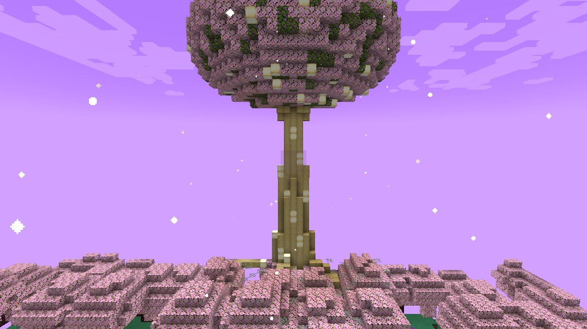
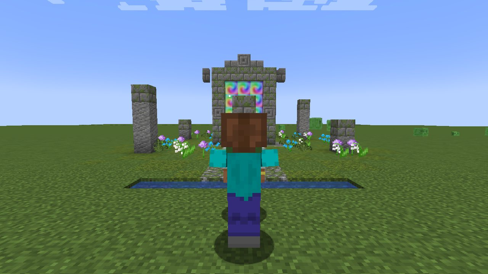

# The Spirit World

[עברית](Spirit-World-HE)

*The Spirit World*

*A spirit portal in the forest*

A world of its own, beside the world of the living: a lavender sky with sparks drifting in the air, groves of cherry
blossom and azalea, trees with purple leaves, giant mushrooms, ferns and flowers. Foxes and rabbits live there, glow
squid in its caves; no monster. Somewhere in it grows the **Tree of Time**: a vast pale tree on great roots, golden
lights in its wood, a hollow at its foot, and a crown of blossom lit gold from within.

## Getting there

* **Spirit portals.** In forests stand gates of old mossy stone in clearings ringed by standing stones, a shimmering
  rainbow light between their pillars. Walk into the light and you cross into the Spirit World, at the same place.
  A gate stands where you arrive (it is built if there is none near), so the way back is always at hand: walk into
  it to return to where you left from.
* **As the Avatar.** The Avatar crosses by meditating (the Meditate key) on a **Meditation Point** for ten seconds;
  meditating on one in the Spirit World brings him back.
