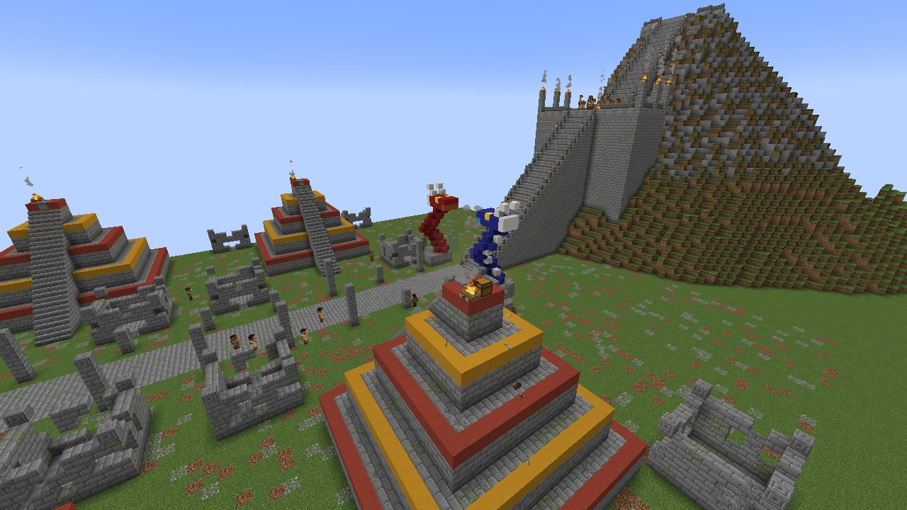
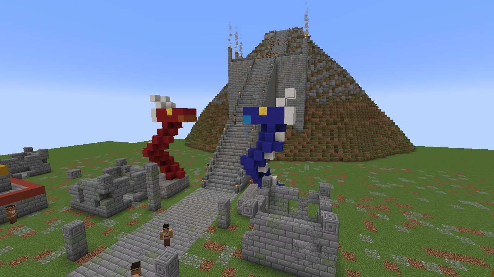
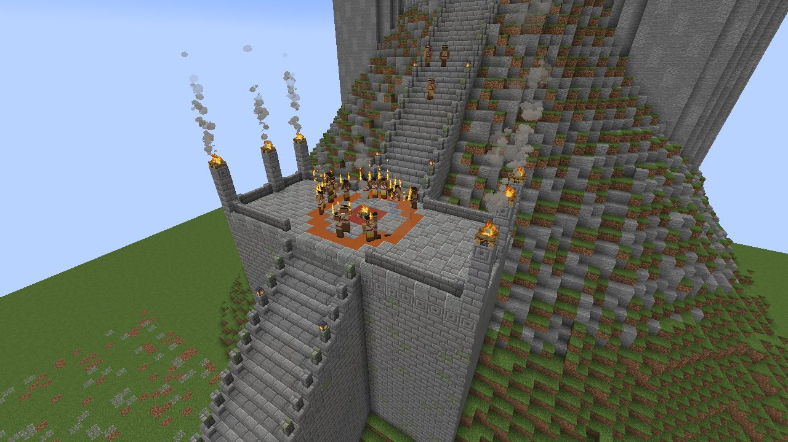
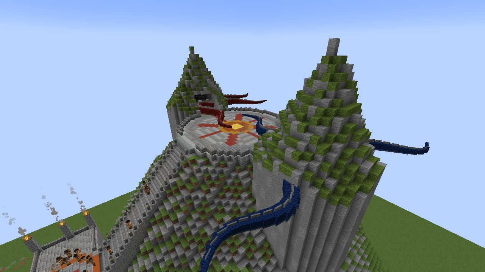
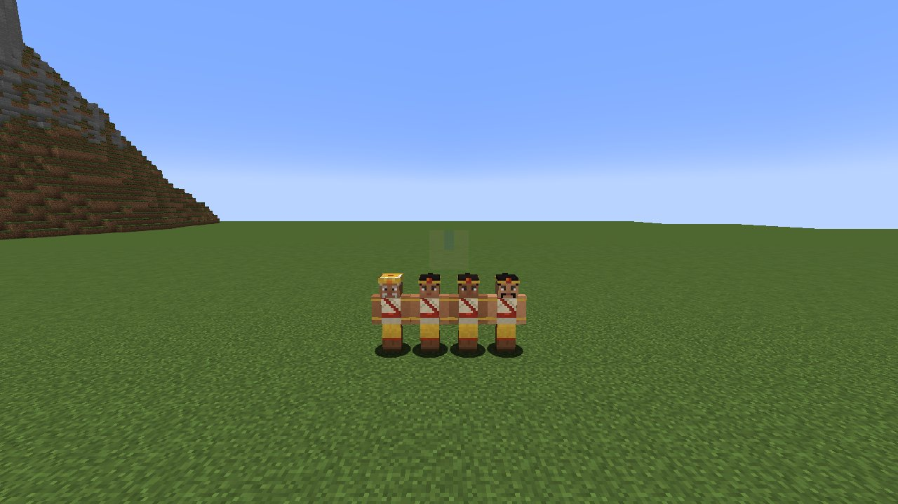
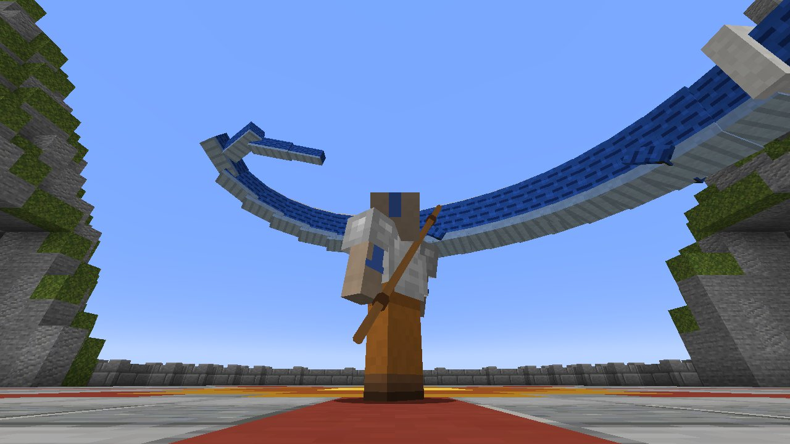
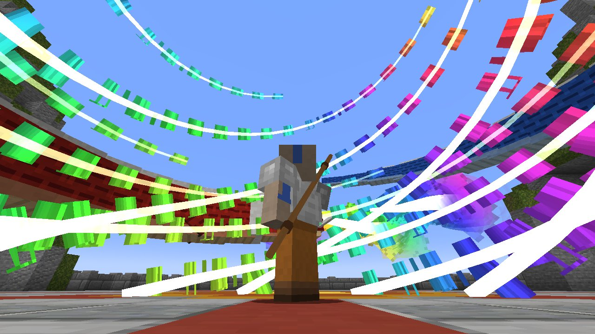
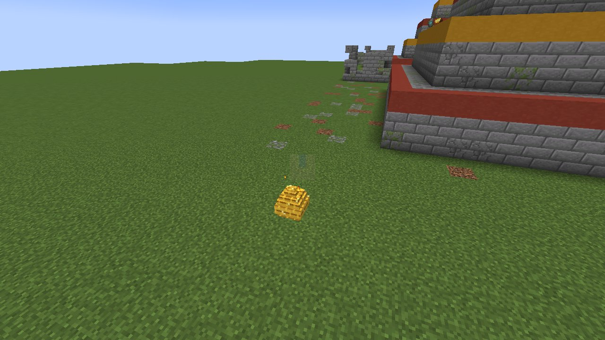
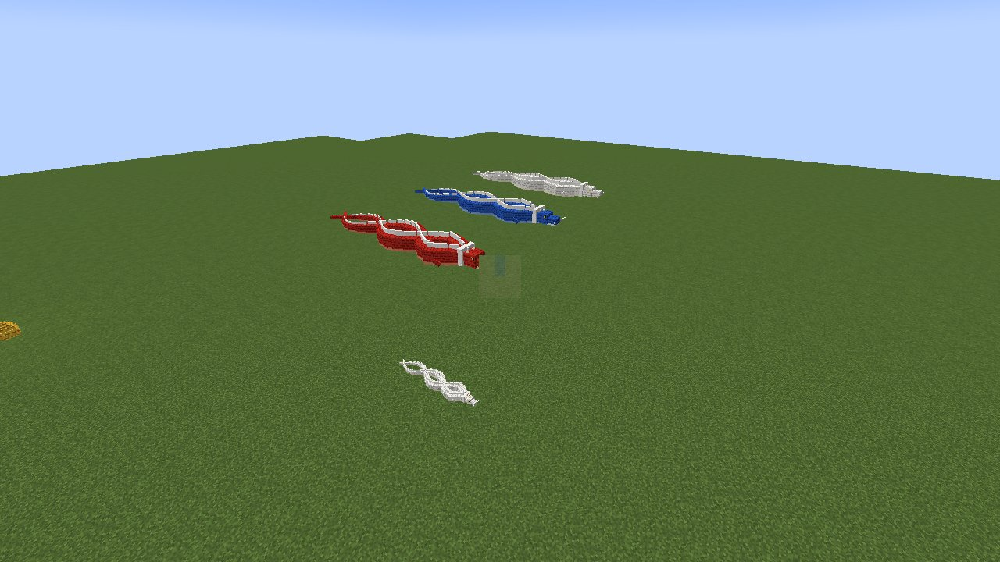
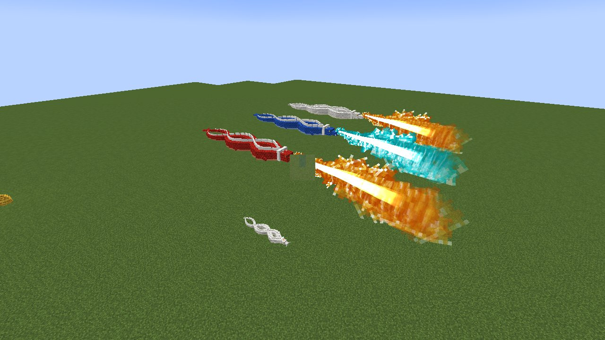

# לוחמי השמש והדרקונים

[English](Sun-Warriors)

*עיר לוחמי השמש והר המאסטרים*

עמוק ב**ג'ונגל** נמצאות חורבות העיר של לוחמי השמש. הם העם שלמד כשפות אש מהדרקונים, וחשבו שהוא נכחד מזמן. הם
עדיין שם.

## העיר

*פסלי דרקונים למרגלות המדרגות*

*הטקס בטרסה שלפני המדרגות האחרונות*

*הפסגה: השמש בין שתי מערות*

שדרה של עמודים שבורים עוברת צפונה בין **פירמידות מדרגות מכוסות צמחייה** לבין **בתי אבן בלי גג**. **פסלי דרקונים**,
אדומים וכחולים, עומדים בשער העיר ולמרגלות ההר. בסוף השדרה מתנשא **הר המאסטרים**. גרם מדרגות מוגבה מטפס על צלע
ההר: קודם אל **טרסה שבה לוחמי השמש רוקדים סביב האש שלהם**, הטקס שלפני הטיפוס האחרון, ומשם הלאה אל **הפסגה**.
הפסגה היא רחבה עגולה מרוצפת בשמש, בין שני צוקים. בכל צוק יש מערה.

**היזהרו מהמלכודות.** הבונים הקדומים החביאו **לוחית לחץ מעל מתקן** ממש בתוך הפתח של כל בית ובראש המדרגות של כל
פירמידה. המתקנים טעונים בחצים או בכדורי אש. בחלק מהבתים ועל הפירמידות יש אוצר (שלל של מקדש ג'ונגל).

## לוחמי השמש

*ראש השבט ושלושה לוחמים*

לוחמי השמש לובשים טוניקות בצבע שמנת, אבנטים אדומים וסינרים זהובים, עם רצועה זהובה על המצח. הם שומרים על העיר,
נלחמים בכל מפלצת שמגיעה (המכות שלהם מציתות אותה), ואש לא פוגעת בהם. לחיצה ימנית מדברת איתם.

* **ראש השבט**, בכיסוי ראש זהוב וגבוה, מחכה למרגלות המדרגות. דברו איתו והוא ישאל אם אתם רוצים **להיבחן על ידי ראן
  ושו**. דברו איתו שוב כדי להסכים, והוא ייתן לכם את **הלהבה הנצחית**.
* **הרקדנים** מסתובבים סביב האש בטרסה, ולהבות עולות מהידיים המורמות שלהם.

## הלהבה הנצחית

האש הראשונה, שבוערת מאז שהדרקונים לימדו אותה, בקערת אבן קטנה. היא **בוערת שבע דקות**: הפס שלה וחלון ההסבר
מראים כמה זמן נשאר. אחר כך היא כבה ונעלמת. היא כבה מיד גם במים. **טפסו מהר.** אם הלהבה כבתה, ראש השבט ייתן
לכם חדשה.

## ראן ושו

*ראן ושו מתעוררים ומקיפים*

*מערבולת האש בכל הצבעים*

במערה המערבית ישן **ראן**, הדרקון האדום; במזרחית, **שו**, הכחול. כשעולים לרחבת הפסגה הם **מתעוררים**, יוצאים
מהמערות, **מקיפים אתכם**, ושופטים.

* **אם הלהבה הנצחית עדיין בוערת אצלכם, או שאתם גיבורי הכפר**, הם עוטפים אתכם ב**מערבולת ענקית של אש בכל
  הצבעים** ו**מברכים אתכם**:
  * האש שלכם **בוערת חזק יותר** (25% יותר נזק לכל יכולות האש);
  * **אש צבעונית** זמינה לבחירה, בנוסף לרגילה ולכחולה (**התכופפות + החלפת נראות**). עד אז התכופפות + החלפת
    נראות מחליפה רק בין רגילה לכחולה;
  * ראן נותן לכם **ביצת דרקון זהובה**. מקבלים ביצה בכל פעם שמביאים את הלהבה; גיבור שבא בלעדיה מקבל ביצה רק
    בפעם הראשונה.
* **את כל השאר הם שורפים.** ברחו, או חזרו עם הלהבה.

הם שופטים את אותו אדם לכל היותר פעם בדקה, ואז חוזרים לישון. שום דבר לא יכול לפגוע במאסטרים.

## ביצת הדרקון הזהובה והדרקון שלכם

*ביצת הדרקון הזהובה*

*דרקונים משלכם: אדום, כחול, לבן, וגור*

*אש דרקון; הכחול נושף כחול*

**הניחו את הביצה בכל מקום.** היא זוהרת, ובחצי הדקה האחרונה היא זזה ומתיזה ניצוצות. **אחרי עשר דקות בוקע גור
דרקון.** הגור שלכם, והוא **אדום, כחול או לבן** (לבן כמו הדרקון של האווטאר), לפי מזל.

* **הוא גדל תוך עשרים דקות.** האכילו אותו בבשר (בקר, חזיר, כבש, עוף, בקלה, סלמון, נא או מבושל) כדי שיגדל מהר
  יותר וכדי לרפא אותו.
* **דרקון בוגר הוא ענק** (גוף נחש ארוך עם רכס ורעמה לבנים, קרניים שמוטות לאחור, ניבים ואף, ארבע רגליים עם
  טפרים וזוג כנפיים שמכות כשהוא עף) ויש לו **200 נקודות חיים**.
* **רכבו עליו:** לחיצה ימנית. הסתכלו לאן שאתם רוצים לטוס והחזיקו קדימה; **קפיצה מעלה אותו**; בלי מקש הוא מרחף
  באוויר. **התקפה (לחיצה שמאלית) נושפת זרם אש ענק** לאן שאתם מסתכלים. **דרקון כחול נושף אש כחולה.**
* **התכופפות + לחיצה ימנית** משאירה אותו במקום; עוד פעם והוא הולך אחריכם.
* כשלא רוכבים עליו, הוא הולך אחריכם ו**נושף אש** על מי שתוקף אתכם, על מי שאתם תוקפים, ועל מפלצות לידכם. האש שלו
  אף פעם לא שורפת אתכם או את חיות המחמד האחרות שלכם.
* הוא לא נפגע מנפילה, ואש לא פוגעת בו.

דרקון מביצת זימון הוא פראי. האכילו אותו בבשר, ומדי פעם הוא יתחיל לסמוך עליכם.

