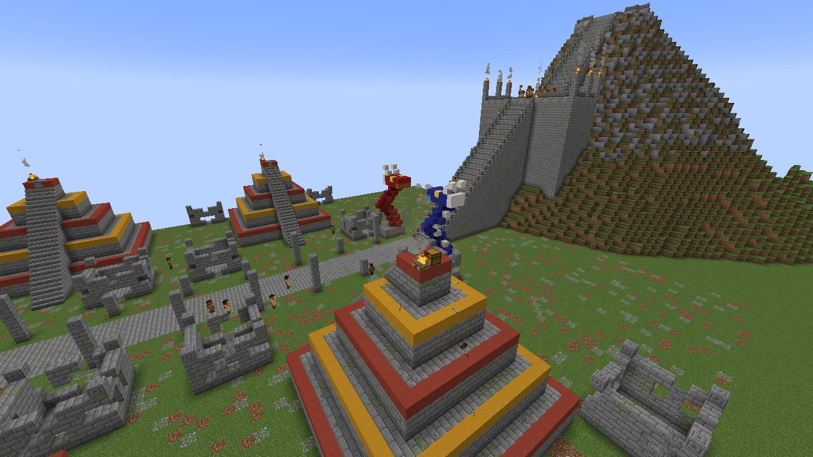
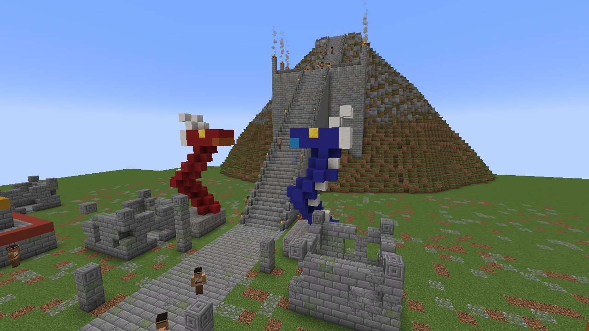
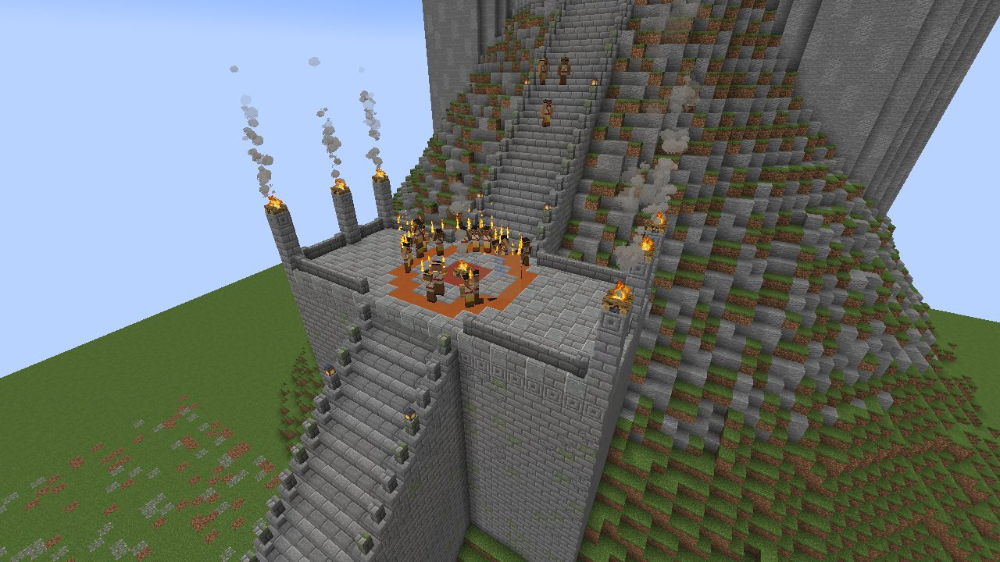
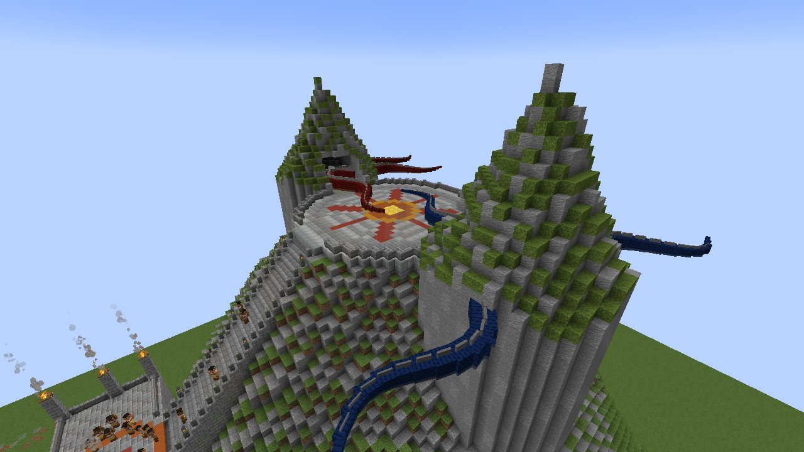
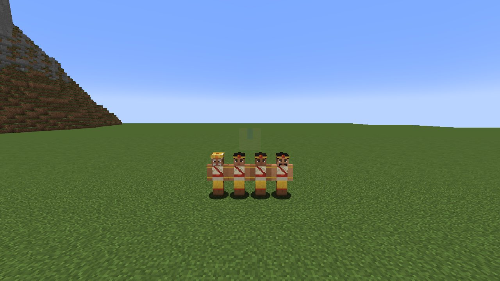
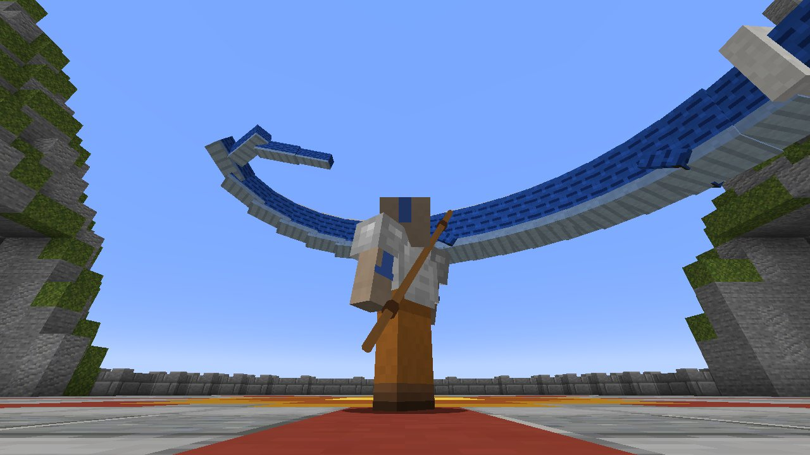
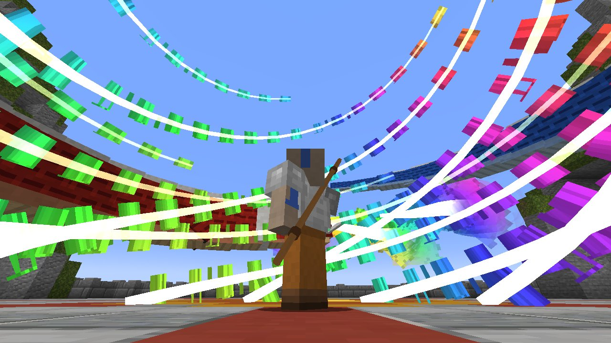
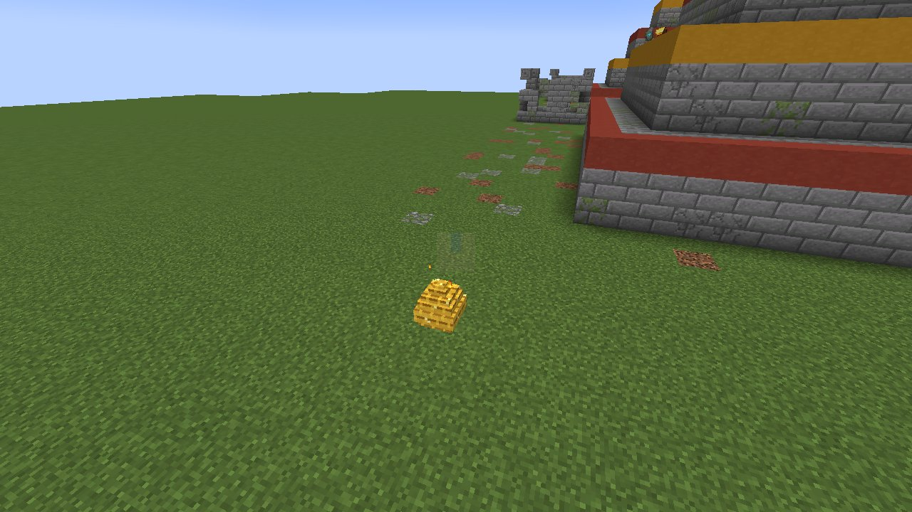
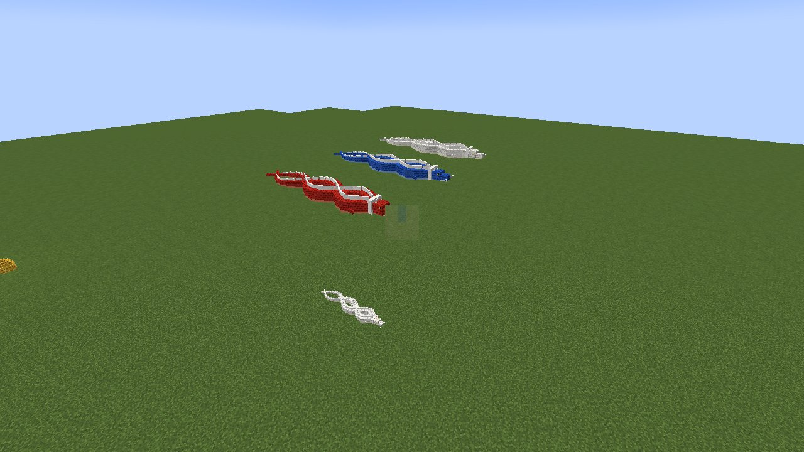
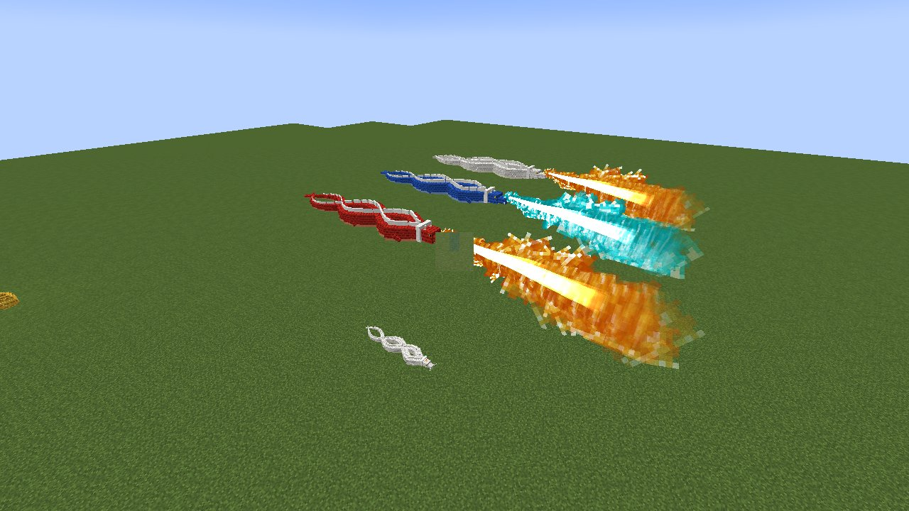

# The Sun Warriors and the Dragons

[עברית](Sun-Warriors-HE)

*The city of the Sun Warriors and the mountain of the masters*

Deep in the **jungle** lie the ruins of the Sun Warriors' city, the people who learned firebending from the dragons and
were thought to have died out long ago. They are still there.

## The city

*Dragon statues at the foot of the stairway*

*The ceremony on the terrace before the last stair*

*The summit: the sun between two caves*

An avenue of broken columns runs north between **overgrown step pyramids** and **roofless stone houses**. **Statues of
dragons**, red and blue, stand at the city's gate and at the foot of the mountain. At the end of the avenue rises the
**mountain of the masters**. A raised stairway climbs its face: first to a **terrace where the Sun Warriors dance round
their fire**, the ceremony that comes before the last climb, and then on to the **summit**. The summit is a round
platform paved with the sun, between two crags. Each crag has a cave.

**Mind the traps.** The old builders hid a **pressure plate over a dispenser** just inside the doorway of every house
and at the top of every pyramid's stair. The dispensers are loaded with arrows or fire charges. There is treasure in
some of the houses and on the pyramids (jungle temple loot).

## The Sun Warriors

*The chief and three warriors*

The Sun Warriors wear cream tunics, red sashes and golden aprons, with a golden band round the brow. They keep the
city, fight any monster that comes (their blows set it alight), and fire does not harm them. Right-click one to talk.

* **The chief**, in his tall golden headdress, waits at the foot of the stairway. Speak to him and he asks whether
  you wish to be **tested by Ran and Shaw**. Speak to him again to accept, and he gives you the **Eternal Flame**.
* **The dancers** go round the fire on the terrace, flames rising from their raised hands.

## The Eternal Flame

The first fire, kept alight since the dragons taught it, in a small stone bowl. It **burns for seven minutes**: its
bar and its tooltip show the time left. After that it goes out and is gone. It also goes out at once in water. **Climb
fast.** The chief gives you another if yours goes out.

## Ran and Shaw

*Ran and Shaw wake and circle*

*The whirl of fire of every colour*

In the west cave sleeps **Ran**, the red dragon; in the east cave, **Shaw**, the blue. When you step onto the summit
platform they **wake**, come out of their caves and **circle you**, and judge.

* **If you carry the Eternal Flame still alight, or you are a Hero of the Village**, they wrap you in a great **whirl
  of fire of every colour** and **bless you**:
  * your fire **burns stronger** (+25% damage for every fire art);
  * **rainbow fire** becomes yours to choose, beside normal and blue (**Sneak + Change Look**). Until then Sneak +
    Change Look only switches between normal and blue;
  * Ran gives you a **golden dragon egg**. You get an egg every time you bring the flame; a hero who comes without it
    gets one only the first time.
* **Anyone else they burn.** Run, or come back with the flame.

They judge the same person at most once every minute, then go back to sleep. Nothing can harm the masters.

## The golden dragon egg and your dragon

*The golden dragon egg*

*Dragons of your own: red, blue, white, and a pup*

*Dragon fire; the blue dragon breathes blue*

**Place the egg anywhere.** It glows, and in its last half minute it stirs and gives off sparks. **After ten
minutes a dragon pup hatches.** The pup is yours, and it is **red, blue or white** (white like the Avatar's dragon),
chosen by chance.

* **It grows up in twenty minutes.** Feed it meat (beef, pork, mutton, chicken, cod, salmon, raw or cooked) to make it
  grow faster and to heal it.
* **A grown dragon is huge** (a long serpent body with a white crest and mane, swept horns, fangs and a nose pad, four
  clawed legs and a pair of wings that beat as it flies) and has **200 health**.
* **Ride it:** right-click. Look where you want to go and hold forward; **Jump climbs**; with nothing held it hangs in
  the air. **Attack (left-click) breathes a great stream of fire** where you look. **A blue dragon breathes blue fire.**
* **Sneak + right-click** makes it stay; do it again and it follows you.
* Unridden, it follows you and **breathes fire** at whatever attacks you, at whatever you attack, and at monsters near
  you. Its fire never burns you or your other pets.
* It takes no fall damage, and fire does not harm it.

A dragon from the spawn egg is wild. Feed it meat and, now and then, it comes to trust you.
