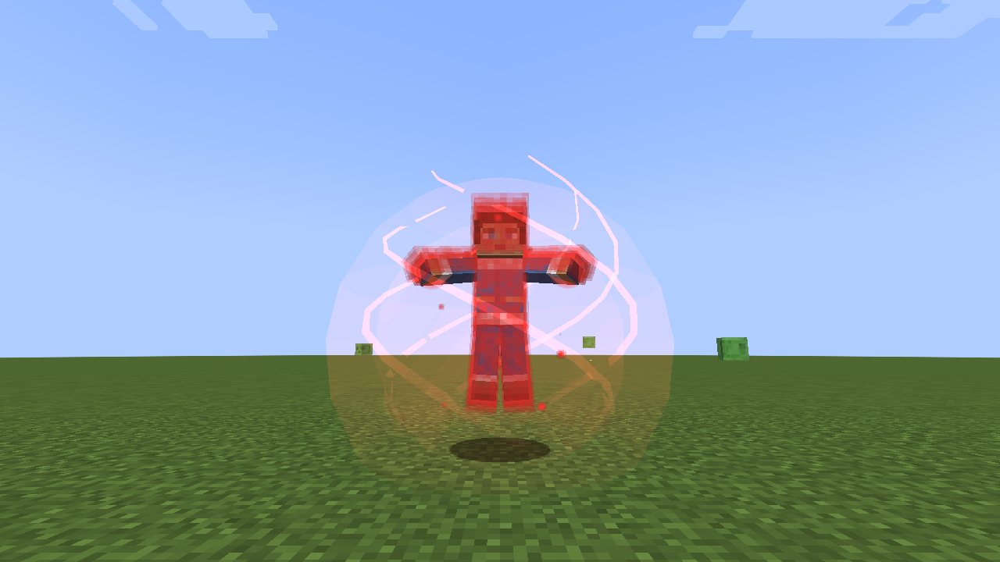

# The Avatar

[עברית](The-Avatar-HE)

*The elemental sphere*

*A part of the Avatar State, in the first chakra's red*

*"Only the Avatar can master all four elements."* Whoever reads the **Avatar Scroll** (the four scrolls bound round
a nether star, shapeless; anyone may read it, a bender's old element becomes part of the four) becomes the Avatar: a
bender of **earth, air, water and fire** at once, with the four first arts to begin with, and every art of every
element to learn. Each element's sub-arts (sand, ice, lightning...) open by the points spent on that element, as for
its own benders. Combos and steps of every element work; the Avatar's step is the first he learned.

Looks: **Aang** (with the arrows, which glow in the Avatar State), **Korra**, **Roku**, **Kyoshi**, **Pavi** and **Nisha** (the twin Avatars of *Seven Havens*), your own skin.

## The Avatar's own arts

Numbers are *novice / adept / master*.

| Ability | Kind | What it does |
|---|---|---|
| **Avatar State** | press | Taught by Guru Pathik with all seven [chakras](Chakras-and-the-Avatar-State) open, enters the Avatar State at will and leaves it at will: you are not invincible, but each blow reaches you at a third (`avatarStateDamageTaken`, 0.3), with 8 more armour and hard to knock back; no bloodbender can take hold of you; your bending is two and a half times as strong and its cooldowns half, for up to **two minutes**; then it rests three times as long as you stayed. The eyes (and Aang's arrows) glow white. |
| **Energybending** | press | The [lion turtle](Lion-Turtle)'s gift, and only its: no points buy it until the lion turtle has given it (then it grows with points). Touch a bender within reach (forehead and chest): his bending is **taken** for `energybendingAvatarMinutes` (120: two hours); no chakra need be open. If his energy is stronger than yours (points spent, and two for each chakra), it turns on you: your own bending is taken for as long and you are stunned; in the Avatar State no energy is stronger. Columns of blue-white and orange light rise from the two of you. Cooldown **30 s**. |
| **Energy Restore** | press | Touch one whose bending was taken (by energybending, or by a bloodbender) and it is **given back** before its time ends. Cooldown **10 s**. |
| **Spiritbending** | press | Unalaq's art, as Korra turned it to good: a spiral of golden light round the creature you aim at (within 8) calms it for **30 / 45 / 60 s**: it forgets its prey, takes no new one, stops fighting and mends a little. Cooldown **8 / 6 / 5 s**. |
| **Elemental Sphere** | toggle | Only in the Avatar State (if the Avatar State is not on your keys, the sphere takes you into it as you raise it, and out of it as you let it go): rings of earth (dark stones), water, air and fire spin round you, tilted like a gyroscope, and carry you through the air at a sprint (fly as in Creative); whoever is in your way as you move is struck and thrown. Ends with the State. |

Default keys: R Avatar State, Sneak+R Energybending, G Spiritbending, Sneak+G Elemental Sphere; then the four
elements' arts in their usual order.

## New in 1.4

- **Only the Avatar has the Avatar State.** Before Guru Pathik's lessons it takes the Avatar only when death is near;
  taught, with all seven chakras open, he **enters it and leaves it at will** (press the art again to leave). See
  [Chakras and the Avatar State](Chakras-and-the-Avatar-State).
- **The seventh chakra** sends the spirit to the cosmic plane, where the Avatar walks a path of light to his own vast,
  glowing self.
- **Each element in its own colour**: the Avatar's fire is fire (no longer blue), his water water, his earth and air
  their own; only the Avatar's own arts shine in his light.
