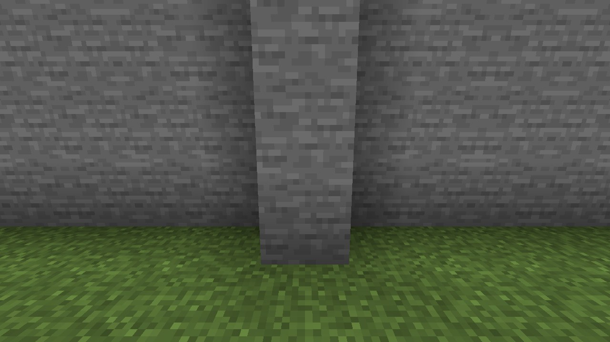
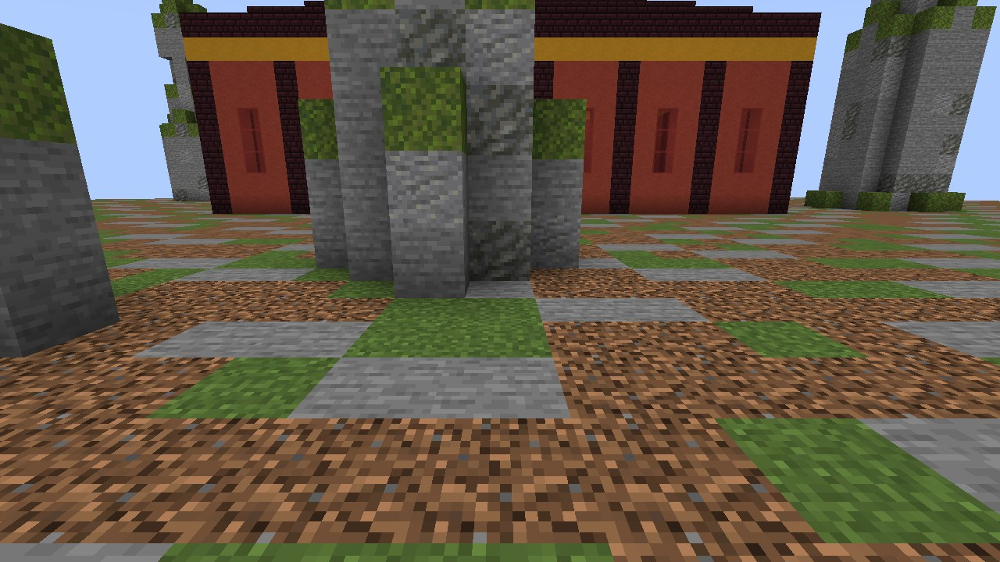
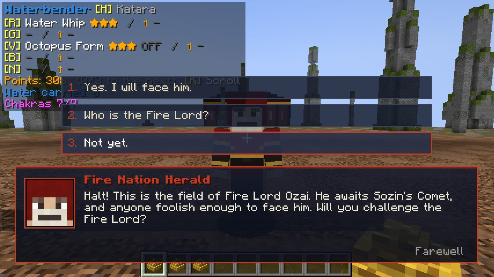
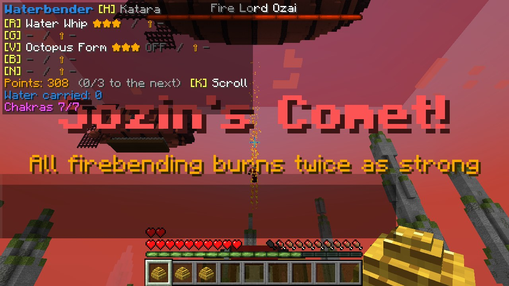
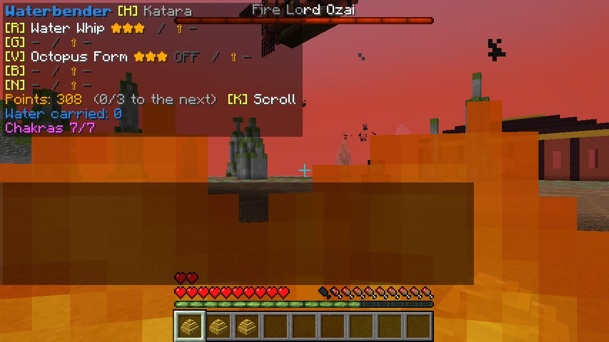
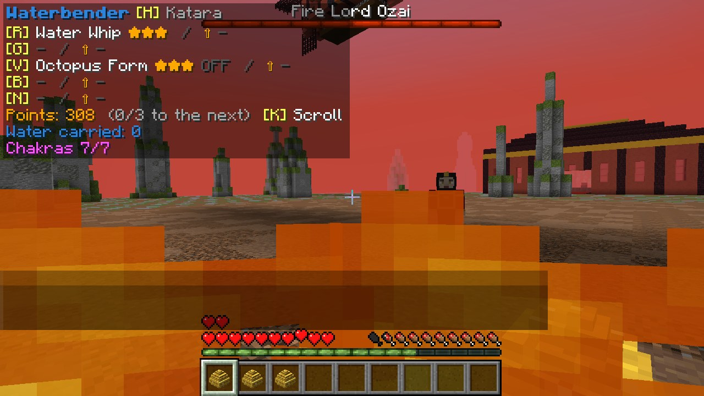
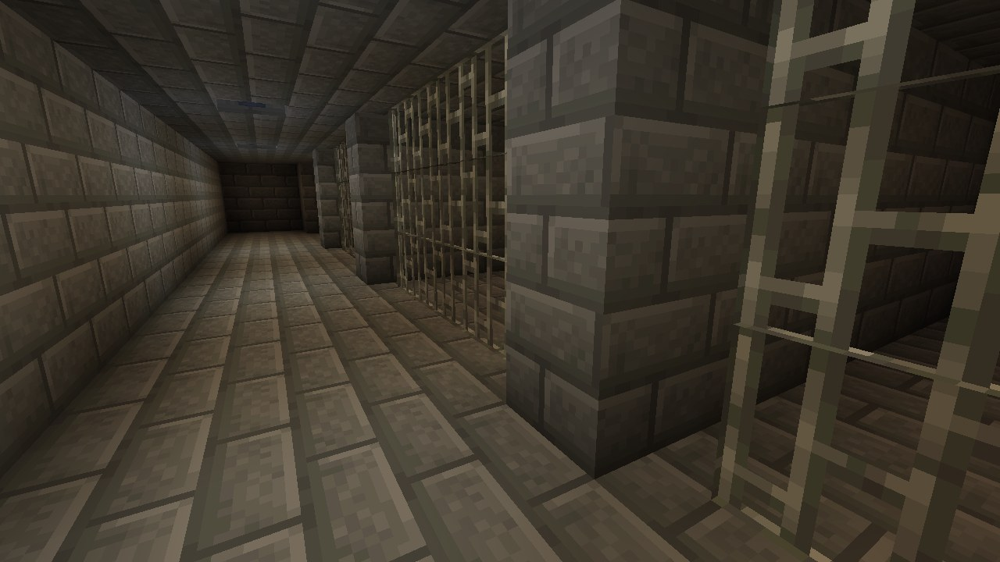
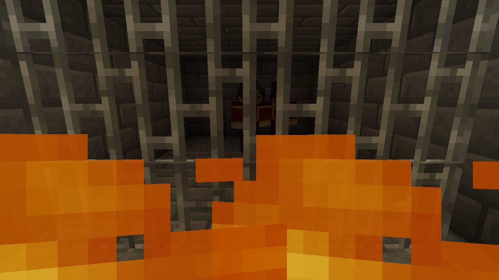

# יער וולונג: כוכב השביט של סוזין ושליט האש אוזאי

[English](Wulong-Forest)

*יער וולונג, ספינות האוויר של אומת האש מעליו*

## איך מגיעים

בדרקון של היסמין בבה סינג סה (ראו [בה סינג סה ואומאשו](Earth-Kingdom-Cities-HE)) **זוקו** מגיש תה ליד הדוד שלו. שאלו אותו
**איפה אבא שלו**, והוא יספר על יער וולונג ועל כוכב השביט של סוזין; בקשו ממנו **להראות לכם את הדרך**, והוא ייתן לכם **מפה
ליער וולונג** עם איקס אדום (הקרוב ביותר).

**יער וולונג** נמצא במישורים, סוואנות, אחו וגבעות סוערות: שדה של אדמה חשופה מוקף ביער של **עמודי סלע** גבוהים עם טחב
בראשם. **שלוש ספינות אוויר של אומת האש** תלויות מעליו (גוף אדום עם צלעות שחורות, סמל אומת האש בצדדים, גונדולה מתחת לכל
אחת); על הסיפון של ספינת הדגל באמצע עומד **שליט האש אוזאי**. בצד הצפוני יש **ארמון אש** קטן: קירות אדומים, עמודים כהים,
פס זהב, גג כהה מדורג, כס מלכות מול קיר של להבות, ומתחתיו, בסולם למטה, **הכלא**.

*ארמון האש*

## האתגר

*הכרוז שואל*

**כרוז אומת האש** בשדה שואל אם תאתגרו את שליט האש. ענו **"כן. אתמודד איתו."** ואז:

* **כוכב השביט של סוזין** מגיע: כל השמיים נהיים **אדומים**, כוכב השביט בוער לאורכם עם זנב אש ארוך, והמסך מכריז על זה. הוא
  נשאר עד סוף הקרב.
* **האש והברק של כל כשף אש פוגעים חזק פי שניים** תחת כוכב השביט (שחקנים, ואוזאי).
* **אוזאי יורד מספינת הדגל על סילוני אש** ונוחת בשדה, עם פס חיים של בוס בראש המסך.

*כוכב השביט של סוזין: השמיים מאדימים, ואוזאי יורד*

## הקרב

*הברק של אוזאי*

*זרם של אש*

אוזאי **חזק מאוד** (600 חיים, שריון), וכוכב השביט מכפיל את האש שלו. הוא נלחם על הקרקע וגם מרחף על הסילונים שלו, עם **פיצוצי
אש**, **זרמי להבה**, **מעגלי אש** שזורקים אתכם אחורה, זינוקים על סילונים, ו**ברקים** (ניצוצות מתאספים סביבו לשנייה קודם:
זו האזהרה שלכם).

* **אש כמעט לא פוגעת בו** (חמישית מהנזק), ומכות אחרות מעט (שתי חמישיות).
* **מים פוגעים בו במלואם**: כשפות מים יעילה נגדו.
* **כשף אש ששולט בכל אומנויות האש** (כל אחת ב-★★★), שנלחם תחת כוכב השביט, פוגע בו במלואו, ופי שניים בזכות כוכב השביט: הדרך
  המרכזית להביס אותו.
* **כשפות אנרגיה**: מקרוב (5 בלוקים), היא **לוקחת ממנו את כשפות האש מיד**, והקרב נגמר.
* אם כל מי שנלחם בו נופל או עוזב, הוא עף בחזרה לספינה שלו וכוכב השביט עובר; שאלו את הכרוז שוב.

## אחרי

*הכלא שמתחת לארמון האש*

*אוזאי בתא שלו*

כשהוא מובס (או כשהכשפות שלו נלקחות), אוזאי **לא נהרג**: הוא נלקח ל**כלא שמתחת לארמון האש**, חסר כוח, ו**נשאר בתא שלו
לנצח**. כל מי שנלחם בו מקבל 5 נקודות יכולת. רדו בסולם באולם הארמון ותוכלו לדבר איתו דרך הסורגים (הוא לא מצטער). הכרוז אומר
ששליט האש באזיקים.

