# Wulong Forest: Sozin's Comet and Fire Lord Ozai

[עברית](Wulong-Forest-HE)

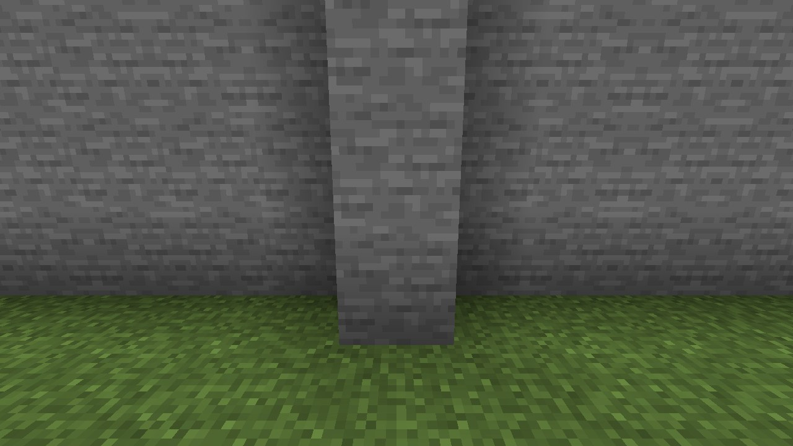
*Wulong Forest, the Fire Nation's airships over it*

## Finding it

At the Jasmine Dragon in Ba Sing Se (see [Ba Sing Se and Omashu](Earth-Kingdom-Cities)), ask **Iroh** whether he
knows **where Ozai is**: he tells of his brother at Wulong Forest and Sozin's Comet, and, if you ask him to show you
the way, gives you a **map to Wulong Forest** with a red cross on it (the nearest one).

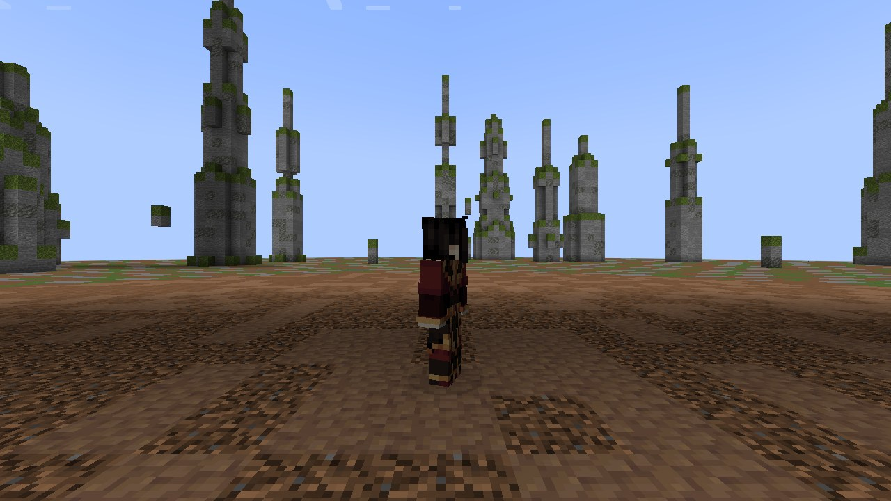
*Fire Lord Ozai, the Phoenix King*

**Wulong Forest** stands in plains, savannas, meadows and windswept hills: a field of bare earth ringed by a forest of
tall **rock spires** capped with moss. **Three Fire Nation airships** hang over it (red hulls ribbed in black, the Fire
Nation emblem on their flanks, a gondola under each); on the deck of the flagship in the middle stands **Fire Lord
Ozai**.

## The Fire Palace

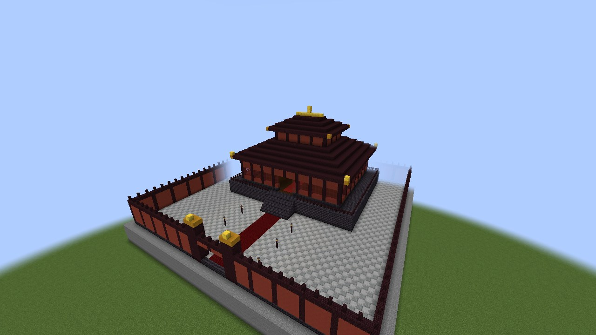
*The Fire Nation's Royal Palace*

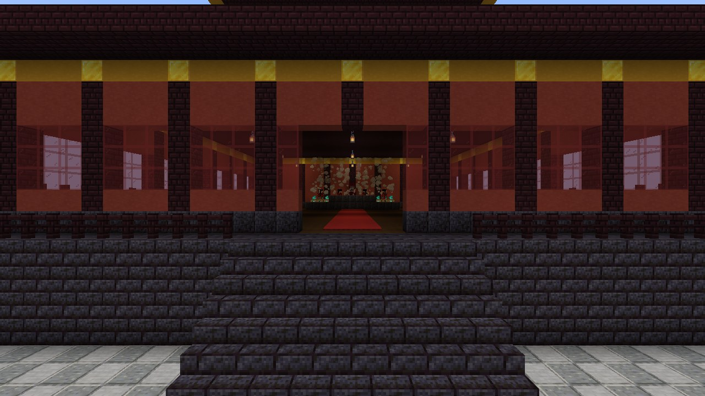
*The grand stairs to the hall*

**The Fire Palace is a structure of its own, far from Wulong Forest** (in badlands, savannas, deserts and plains): a
walled courtyard entered by a gate between two golden-topped towers, a red path and lamps to a raised platform and its
grand stairs, and the great hall on it, red walls between dark pillars, a gold band, a stepped dark roof in two tiers
with golden corners and ridge. Inside: a red carpet to the throne on its dais, a **wall of blue flame** behind it.
Guards keep the gate, the stairs and the hall. Beneath the platform, down a **ladder by the hall's east wall**, is
**the prison**: a corridor and four barred cells.

## The challenge

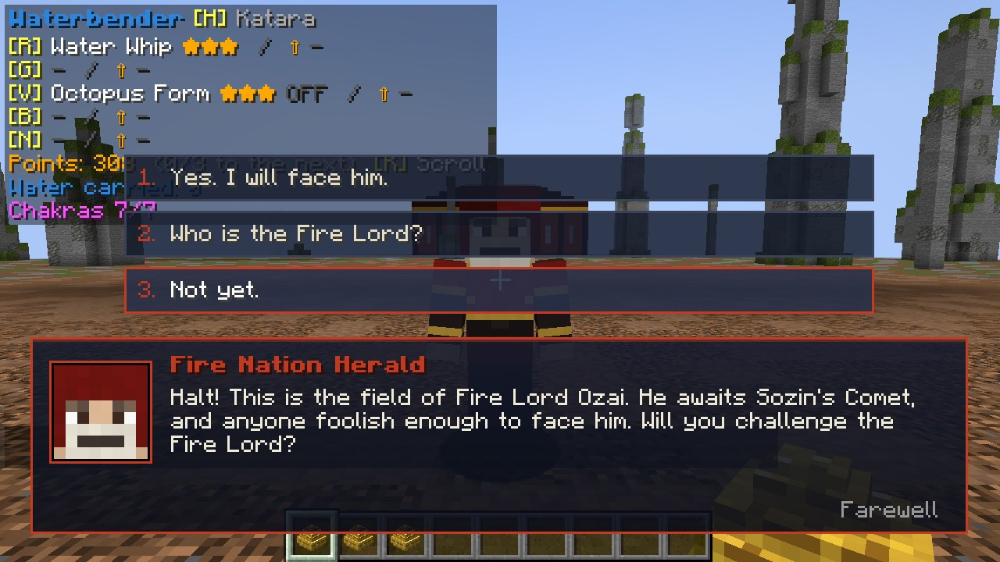
*The herald asks*

The **Fire Nation herald** on the field asks whether you will challenge the Fire Lord. Answer **"Yes. I will face
him."** and:

* **Sozin's Comet** comes: the whole sky turns **red**, the comet burns across it with its long tail of fire, and the
  screen says so. It stays until the battle ends.
* **Every firebender's fire and lightning strike twice as hard** under the comet (players, and Ozai).
* **Ozai comes down from his flagship on jets of fire** and lands on the field, his boss bar at the top of the screen.

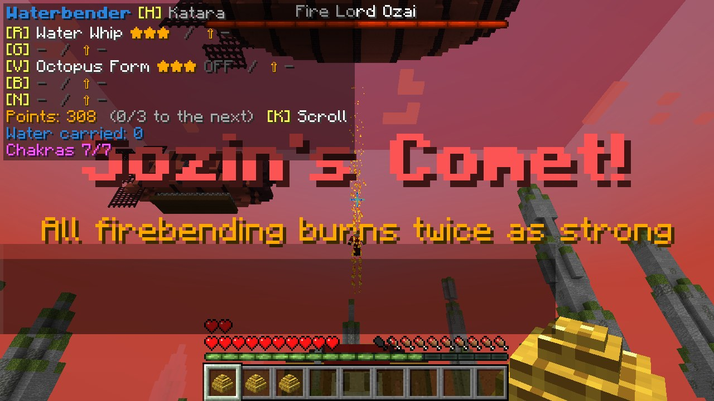
*Sozin's Comet: the sky turns red, and Ozai comes down*

## The battle

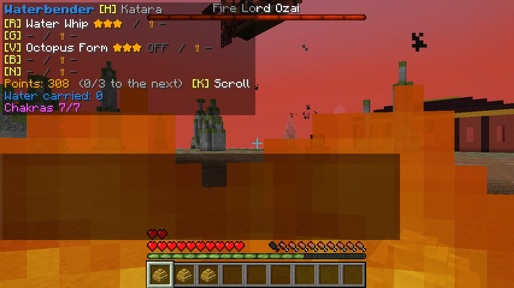
*Ozai's lightning*

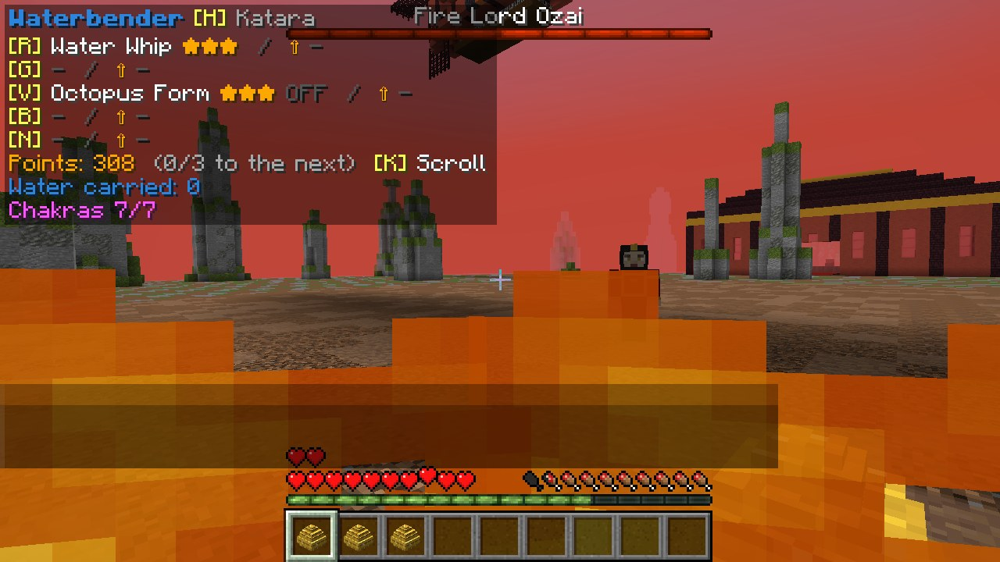
*A stream of fire*

Ozai is **very strong** (600 health, armour), and the comet doubles his fire. He fights on the ground and hovering on
his jets, with **fire blasts**, **streams of flame**, **rings of fire** that throw you back, jet dashes, and
**lightning** (sparks gather round him for a second first: that is your warning).

* **Fire barely touches him** (a fifth of its harm), and other blows little (two fifths).
* **Water strikes him fully**: waterbending is effective against him.
* **A firebender who has mastered every art of fire** (each at ★★★), fighting under the comet, strikes him fully, and
  twice as hard by the comet: the main way to beat him.
* **Energybending**: from close (5 blocks), it **takes his firebending away at once**, and the fight is over.
* If everyone who fought him falls or leaves, he flies back up to his ship and the comet passes; ask the herald again.

## After

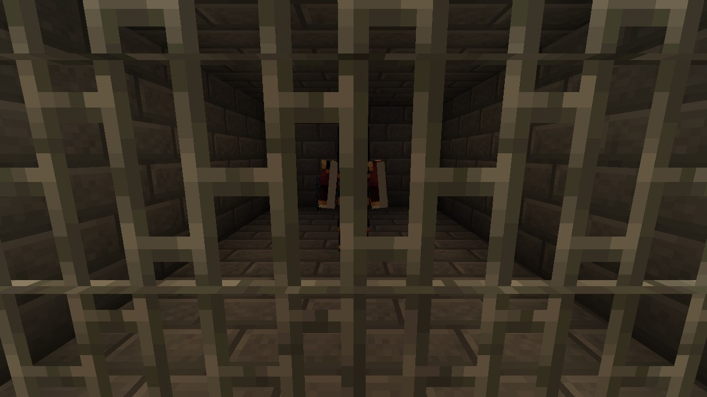
*Ozai in his cell*

Beaten (or his bending taken), Ozai is **not killed**: he is taken to **the prison under the nearest Fire Palace**,
powerless, and **stays in his cell forever**. Everyone who fought him gets 5 ability points. Go down the ladder in the
palace hall and you can talk to him through the bars (he is not sorry). The herald says the Fire Lord is in chains.

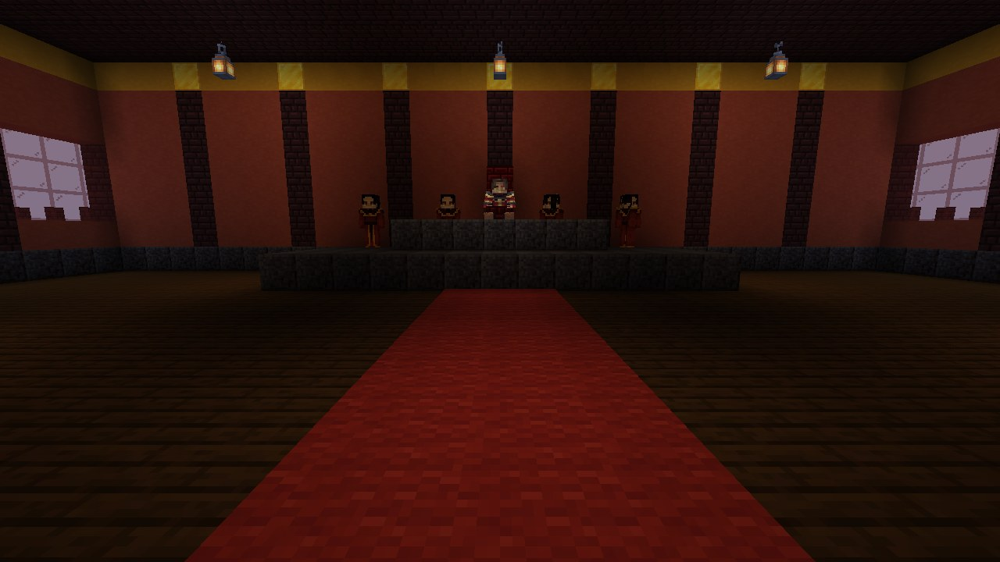
*Fire Lord Zuko on the throne, guards where the blue fire burned*

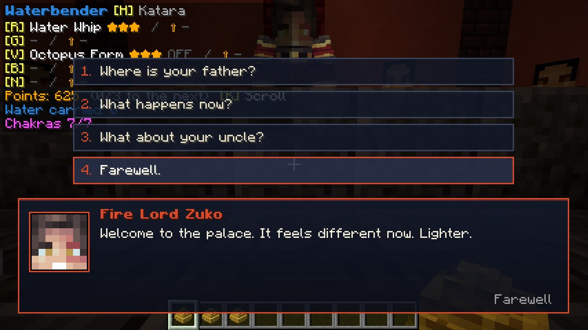
*Talking to Fire Lord Zuko*

And at the palace, **the blue fire behind the throne goes out, guards stand where it burned, and Fire Lord Zuko sits on
the throne**. Talk to him: he thanks you, and speaks of his father, of his uncle and of peace.
